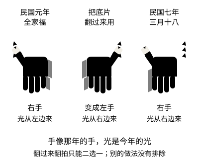

# 《显影》背后的档案

> SignaPilot · Case Notes 11
> 定稿，2026 年 11 月 12 日经 PO 批准封存。含剧透。
> 标注说明：**［已核］**指这次读过原文；**［已核：据羅士傑］**指这次读了羅士傑 2024 年论文的全文，引到的原始材料（日记、书信、《灵学丛志》）是从他的引文里读到的，没有另看原件；**［已核：二手］**指读到的是报刊文章或百科的转述；**［待核：只见摘要］**指只读到摘要或书目；**［待核］**指凭以前的阅读写成，这次没有对照；未标注的是小说的虚构设定，或作者的概括。

---

## 一、民国上海的灵学会与灵魂照相

**上海灵学会。** 1917 年在上海成立，以扶乩为核心活动，附设乩坛“盛德坛”，出版会刊《灵学丛志》。发起和参与的人里有出版界、教育界的知名人物。黄克武 2007 年的论文把它放在“传统扶乩”和“西方灵学（psychical research）”交汇的地方来看：这些人并不觉得自己在反对科学，他们相信自己在做一种新的科学。［待核：只见摘要］

**灵魂照相怎样进入中国。** 西方的灵魂照相（spirit photography）一般从美国人穆勒（William H. Mumler）算起：他在 19 世纪 60 年代声称拍到了亡灵，1869 年在纽约以欺诈罪受审。［已核：据羅士傑］在中国，伍廷芳曾自述在美国与“鬼”同拍过照片，被看作把这种做法介绍进来的人之一；1918 年徐班侯的照片在温州传开时，徐家的亲戚就在信里拿伍廷芳的照片作旁证。［已核：据羅士傑］

**盛德坛的照相试验。** 1918 年阴历八月起，盛德坛请照相师试照乩仙，前后照了十几回，也替会众照过过世的父母；同年九月下旬，坛上的乩谕宣布“以后灵魂照相事，永远谢绝”。［已核：二手，界面新闻转载《东方历史评论》文章］小说第十章冯葆初带来的抄件，用的就是这条乩谕；坛上照相的细节，小说没有写。

**舆论。** 1918 年 5 月出版的《新青年》第四卷第五号，集中登了几篇批评灵学的文章，其中有陈大齐的《辟“灵学”》和陈独秀的《有鬼论质疑》；陈大齐认为扶乩写出来的字，是扶乩的人自己无意识的手部动作。［已核：二手］鲁迅 1918 年 3 月 10 日给许寿裳的信里提到徐班侯的照片，说那张像“其状乃如鼻烟壶”。［已核：据羅士傑］

小说没有替任何真实人物编造言行。徐班侯、陈大齐、陈独秀、盛德坛和《灵学丛志》，只作为人物在报纸、书摊和闲谈里接触到的背景出现。

## 二、徐班侯的照片：发生了什么，争议在哪里

徐定超，字班侯，前清监察御史，民初温州的地方要人。1918 年 1 月 4 日，从上海开往温州的普济轮在吴淞口与英商的新丰轮相撞沉没，约 300 人遇难，徐定超夫妇在船上。打捞持续到 1 月 24 日，没有找到他们的遗体。［已核：据羅士傑］

此后，徐家扶乩，乩上指示请人照相。照片的拍法，有两条几乎一致的记载：

- 温州文人张棡 1918 年 2 月 24 日的日记，听同事转述：灵前的幕放下，不许人窥探，灯火熄掉，只在外面留一盏煤灯，照出来果然是徐的遗像。［已核：据羅士傑］
- 徐的外甥陈纪芳给上海灵学会的信（1918 年阴历正月廿三，即 3 月 5 日）：堂前挂好白布，用最亮的电灯，叫照相的对着白布照，洗出来就是他。这封信和照片登在《灵学丛志》第一卷第二期，后来第三期又登了徐氏夫妇的照片。［已核：据羅士傑］

羅士傑的论文从温州地方政治的角度读这件事：一个在地方上举足轻重的人物死了，扶乩和照片让他“继续在场”，乩语里还给他安排了“京城城隍”这样的身后职位。［已核：据羅士傑］张棡 2 月 27 日的日记还记了一句很值得注意的话，说照片上的像“近视不明，透视之则俨然班老矣”：凑近了看不清，隔着光透过去看，才像他。［已核：据羅士傑］

小说里每个人拿到照片，都要“举起来对着光看”，就是从这句话来的。一张照片在什么条件下被认出“是他”，本身就是证据的一部分。

## 三、1918 年的照相：干片、暗房和“鬼”

**干片和片匣。** 1918 年的照相馆普遍用工厂生产的玻璃干片：玻璃上涂着明胶溴化银感光层，买来就能用，曝光后可以放很久再冲洗。干片装在木制的片匣里，一只片匣正反两面各装一片。人像多在有玻璃顶的“玻璃房”里借天光拍，曝光一般要一两秒到几秒，所以主顾脑后常有铁托子固定头部，摄影师揭开镜头盖、默数，再盖上。［待核］

**显影。** 冲洗在暗房里进行，用对干片不太敏感的红光照明，摄影师可以看着影像在药盘里一点点出现，到合适的深浅时取出，再放进定影液（海波）。底片上的明暗是反的。［待核］

**加厚和升汞。** 曝光不足、太薄的底片，可以在显影之后“加厚”（intensification）：让底片上已有的银像再附上一层金属，增加密度，晒印时才印得出来。19 世纪的摄影刊物里，这种做法讲得很多，汞盐是最常提到的一类，此外还有铅、铬、铀的化合物。［已核：Hagley 博物馆图书馆的保存研究文章］先用升汞（氯化汞）漂白、再用氨水处理，是一种老式加厚法，今天已经弃用。［已核：普林斯顿大学环境健康与安全办公室的摄影安全资料］所以 1912 年一家照相馆的暗房里有升汞，用它给底片加厚，是可信的。小说只写到“化了一撮”“漂白”“再用阿摩尼亚水泡”，没有写浓度、用量和配方，这里也不写。

**升汞的毒性。** 同一份安全资料说，汞化合物经皮肤可吸收，吸入毒性高，误服则毒性极高。［已核：普林斯顿资料］医学文献里，误服无机汞盐会腐蚀消化道，引起腹痛、呕吐、出血性胃肠炎和休克，并损伤肾脏，可在一天之内出现急性肾衰竭；今天有透析等治疗，多数病人能救回来，死亡多见于大量服用。［已核：二手，StatPearls 等医学综述的检索摘要，没有读全文］1912 年没有这些治疗。小说写囡囡喝了一口、三天后死去，医生只说“像是吃了什么东西”，没有写病程细节；这样的时间在医学上并非不可能，但小说没有、也不打算给出医学证明。

**修版和晒印。** 底片可以在“修版台”上用铅笔在药面上修改，去掉皱纹、斑点；照片多用日光晒印。在底片上做的改动和在照片上做的改动，留下的痕迹不同。［待核］

**鬼影的做法。** 当时最常见的是两次曝光：先在一片干片上拍下要出现的“鬼”（往往是翻拍来的一张脸，在黑背景前、曝光很短），再用同一片干片拍主顾，显影时两个像一起出来，鬼是淡的、透明的。另一种是晒印时把两张底片叠在一起。民国时期的中文摄影读物里，也有专门讲“摄鬼法”的文字。［已核：二手］小说第二章葛秉衡的做法，就是第一种，加上蒙纱、在毛玻璃上做记号。

**意外的“鬼”。** 不是每一个影子都是做的。曝光时间长，有人走过就会留下半透明的人形；片匣漏光会在边上留下光斑；玻璃反光、镜头里的反射也会造出不该有的亮影。穆勒最早的“鬼”，按后来的说法就是冲洗不熟练留下的模糊轮廓。［已核：据羅士傑］

**当时怎样检查。** 1918 年的人能用的办法都是物理的：看底片而不是只看照片；看片框的边有没有两道；比较鬼和人的光是不是从同一个方向来；用放大镜看颗粒和纱纹；试验时由旁人自带、自拆、自装干片，在干片上做记号。小说第四章葛秉衡的四项检查，和第八章汤彦和要求“当着面拆封条”，都只用这一类办法。小说里没有、也不能有电子图像处理或现代的数码鉴定。［待核］

这些办法每一种都只能排除某一种做法，不能排除所有做法：光的方向对得上，可能是同一次曝光，也可能是做假的人对准了光（葛秉衡六年来就是这样做的）；只有一道片框，说明干片没有被拿出来重装，可是在同一只片匣里先后曝光两回，也只留一道框；没有纱眼，只排除了蒙纱；两只手极像，不等于是同一个影像；把底片翻过来翻拍会把左右手一起换掉，这只排除了“翻过来翻拍”这一种，修版、另摆一只手等别的做法并没有被排除。小说里葛秉衡最后达到的结论，也只到这一步：他熟悉的做法解释不了这张底片，但他证明不了没有人动过它。

## 四、照片是一种“痕迹”：Index 的理论与边界

皮尔士把符号分成三类：Icon 靠相似，Index 靠实际的因果或物理联系，Symbol 靠约定。他特别举过照片的例子：照片像被拍的东西，可这种相似，是因为照片在物理上被迫与对象逐点对应。所以照片既是 Icon，更是 Index。［待核］这也是照片比绘画更容易被当作证据的原因：光确实到过那里。

但“痕迹”能证明的东西是有限的：

- **底片和照片不是一回事。** 底片记的是光；照片还经过了一次晒印，可以遮、挡、叠。葛秉衡的口头禅“我没看见底片”，说的就是这一层。
- **痕迹不等于解释。** 底片上有一块光留下的黑，可以证明当时那里有一样亮的东西，不能证明那是谁。汤彦和说“他在笑”，周芸说“是她”，都是看的人加上去的。
- **反过来也一样。** 一个摄影师解释不了一张底片，只说明他的办法查不出来，不等于超自然的东西就被证明了。

小说的中心那张底片，就站在这条线上：葛秉衡用他会的办法查过了，只排除了他知道的几种做法；还能再查的那张底片，最后被他自己埋掉了。他的技术判断不能证明那只手是超自然的，小说也没有这样说。

## 五、小说里的证据：哪些能证明，哪些不能

三月十八那张底片，小说给了几条读者可以自己检查的线索：

| 线索 | 能说明什么 | 不能说明什么 |
| --- | --- | --- |
| 封条在三月十八以前已经撕开 | 有人可能动过那盒干片 | 是谁、动了没有 |
| 光的方向对得上 | 手的光和这间屋子下午的光一致 | 是同一次曝光；做假的人本来就会对光 |
| 片框只有一道 | 干片没有被拿出来再装回去 | 只曝光过一次：同一只片匣里先后曝光两回，也只有一道框 |
| 没有纱眼 | 没有用蒙纱，不像葛秉衡和钱小满的做法 | 不是任何人做的 |
| 手的样子和民国元年那张极像，光却是今年的 | 不是把全家福直接翻拍、也不是翻过来翻拍的 | 是同一个影像；不是有人照样摆出来的，不是修版或别的办法做的 |
| 顶针在棺材里 | 那只瘪顶针六年没有离开过 | 照片上那一只是哪里来的 |

能做这张底片的人，小说里都有可能：钱小满配了钥匙，会做两次曝光；周芸知道顶针，知道全家福，一直在暗房门外；葛秉衡自己说不清三月十八前头那个礼拜天的下午在哪里，毛玻璃上也有一道他不记得画过的线。还有一种可能，是这张底片不是任何人做的。小说不替读者选。

囡囡的死因也要分开看。葛秉衡的记忆和他在第十章的供述，是小说交代为事实的部分：她喝了他暗房里化着升汞的那杯水。周芸的判断则是推断：她在棺材里看见用他的手帕包着的一只家用茶杯，想起医生那句“像是吃了什么东西”，又看见他把那套杯子都送了人、药柜加了锁。小说里没有验尸，也没有医学证实。

小说交代清楚的，是现实的部分：葛秉衡做了六年假照片；他瞒着周芸囡囡的死因；他辞退了钱小满，钱小满把做法告诉了报馆；他对汤彦和说了实话；他打开了女儿的棺材，把那张底片放了进去，把茶杯带了回来。这些都不能撤回。

## 六、事实与虚构

**依据史料或研究的：**

- 上海灵学会、盛德坛和《灵学丛志》的存在与大致年代。［待核：只见摘要］
- 普济轮船难的时间、地点和规模；徐班侯照片的出现、拍法的两种记载、刊登的期数；鲁迅信中的评论。［已核：据羅士傑］
- 《新青年》第四卷第五号的“辟灵学”文章；盛德坛 1918 年的照相试验和九月的乩谕。［已核：二手］
- 升汞加厚是当时的老式工艺；汞化合物误服毒性极高。［已核：Hagley、普林斯顿］
- 干片、片匣、天光人像、红光显影、修版、日光晒印等当时的照相工艺。［待核］
- 上海的同乡会馆设丙舍，暂停棺木等待运回原籍安葬。［待核］看门人收钱私开棺木、周芸清明独自去开棺，是小说情节，不代表当时会馆的规矩；会馆对开棺、移柩有什么规定，这次没有查。

**虚构的：**

- 镜心照相、葛秉衡一家、钱小满、冯葆初和他的乩坛、汤彦和父子、柯怀谦和《沪声报》、老耿。
- 汤启文是虚构的普济轮遇难者；小说里汤家的抚恤、招商局的安排，只作背景，没有具体依据。
- 所有的假照片、三月十八的底片、棺材里的东西。
- 书中日期的阴历和星期，没有逐日核对。

**有意的处理：**

- 小说不回答那只手是谁的。它交代的是：每个人看见了什么，因此做了什么。
- 冯葆初说“就算是你做的，也是借你的手”，是小说人物的想法，不代表任何真实乩坛的主张。

## 七、参考资料

**这次读过的**

- 羅士傑，〈靈魂攝影與地方政治──以 1918 年徐定超船難前後的溫州為中心〉，《新史學》35 卷 4 期（2024 年 12 月），頁 59–116。读了全文的文字层，引用的是第一节（鲁迅的信）和第四节（照片在温州的出现与流传）。
- 〈鬼形神影：灵魂照相术在近代中国〉，《东方历史评论》，界面新闻转载。读的是网页摘要转述，作者署名这次没有核对。
- Laura Wahl, “Why is this film yellow? Chemical Intensification of Photographs,” Hagley Museum and Library 网站，2020 年 8 月 14 日。讲加厚的原理、所用金属盐和对底片保存的影响。
- Princeton University, Office of Environmental Health and Safety, “Photography” 安全资料页，“Intensifiers and Reducers”一节。讲升汞加氨水等旧式加厚剂和汞化合物的毒性。
- 澎湃新闻关于上海灵学会、吴稚晖问音韵与《新青年》“辟灵学”的文章（newsDetail_forward_3929115）。读的是网页读取工具给出的转述。

**只见摘要或书目、这次没有读到正文的**

- 黃克武，〈民國初年上海的靈學研究：以「上海靈學會」為例〉，《中央研究院近代史研究所集刊》第 55 期（2007），頁 99–136。PDF 是扫描图像，这次只读到摘要。
- 王宏超，〈神界灵光：上海盛德坛之灵魂照相活动〉，《上海文化》2016 年第 3 期。只读到网页上的摘要和开头。
- Shengqing Wu, *Photo Poetics: Chinese Lyricism and Modern Media Culture*（Columbia University Press, 2020）。只确认了书目和书中讨论鬼魂与仙人摄影的介绍，章节标题和内容没有核对。

**凭以前的阅读，这次没有核对的**

- 皮尔士关于 Icon、Index、Symbol 和照片的论述（Collected Papers 第 2 卷，照片的例子一般引作 CP 2.281，出处这次没有核对原文）。
- 无机汞盐中毒的临床表现：这次只读到医学综述的检索摘要。
- 干片、显影、加厚、修版、晒印的工艺；早期摄影的意外重影和漏光。
- 上海同乡会馆丙舍的做法。

## 相关课程

- 01-03 皮尔士：相似、指示与象征
- 07-03 灵媒主义：现代人为什么重新寻找亡灵？
- 02-05 历史符号研究：如何判断一种解释是否可靠？
- 09-03 从神秘巧合到过度诠释
- 02-04 谁有权解释一个符号？
- 01-04 巴特：日常文化如何制造神话？
