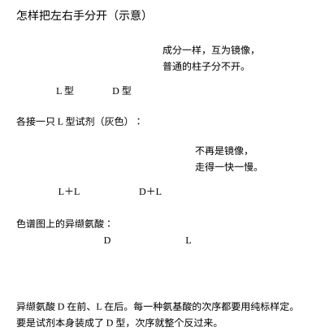
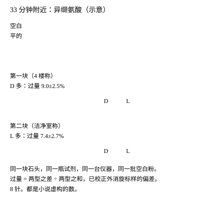
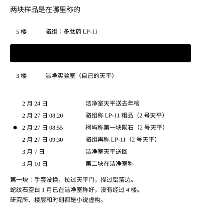
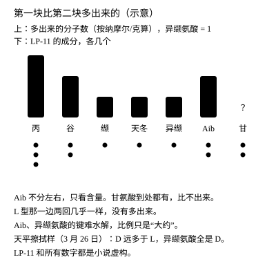

# 《手性》背后的档案

> SignaPilot · Case Notes 26
> 定稿，2026 年 11 月 13 日经 PO 批准封存。含剧透。
> 标注说明：**［已核］**指这次读过原文，或读过机构、百科发布的文本；**［已核：二手］**指读到的是百科或网站对原典的转述，原典本身没有看；**［待核：只见摘录］**指只见到搜索结果里的摘录或书目，没有读到正文；**［待核］**指凭以前的阅读写成，这次没有对照；未标注的是小说的虚构设定，或作者的概括。

---

## 一、先说清楚：读到了什么，没读到什么

这一篇用真实的科学做骨头，用虚构的人和数做肉。读者读完最容易带走的一个误会是“陨石里查出过反手的东西”，所以先把界线划清：

- **没有任何人发现过镜像生命，也没有人造出过。**小说里那张 D 型偏多的图是一次污染，最后查清了。
- **一个化学上的怪数，不是生命的证据。**D 型氨基酸在自然界本来就有；小说里的样品在 100 °C 的水里泡了一天，又在酸里蒸过，色谱仪只认分子，不分死活。
- 小说里的研究所、那块格罗夫山陨石、LP-11、所有测量值、2016 年的霉菌事件和那份处置程序，都是虚构的。
- 真实的部分是：氨基酸有左右手，地球生命造蛋白质几乎只用左手型；有几块含水的碳质球粒陨石里，异缬氨酸左手型偏多；这一行怎样防污染；有些真菌肽里含右手的异缬氨酸；2024 年 12 月那篇关于镜像生命风险的联名文章。

这一次我直接读了原文的一手材料有四份：Glavin 和 Dworkin 2009 年的 PNAS 论文（PMC 全文）；《科学》2024 年那篇文章的作者接受稿（曼彻斯特大学机构库的 PDF，读了全文）；Shenkarev 等 2004 年关于 zervamicin IIB 的论文（PMC 全文，读了引言里的序列和缩写说明）；Nagaraj 等 2001 年的真菌肽抗疟论文（PMC 全文，读了序列表）。格罗夫山的数字读的是二手介绍。那份将近 300 页的技术报告我没有读，凡是只出自它的说法都标成二手或待核。

## 二、左手和右手，怎么分开，怎么算

很多分子由同样的原子、同样的连法组成，却像左右手一样互为镜像，怎么转也叠不到一起，这叫手性。氨基酸里除了甘氨酸，都有 L 型和 D 型两种。地球上的生命造蛋白质几乎只用 L 型。两种各半的混合叫外消旋。［已核：二手］（这几句是教科书常识，《科学》那篇文章开头也这样概括：已知生命都是同手性的，蛋白质用“左手”的氨基酸。）

这两种镜像分子的沸点、溶解度、质量都一样，普通的色谱柱分不开。陨石氨基酸分析里常用的办法，是先让它们同邻苯二甲醛和 N-乙酰-L-半胱氨酸（OPA/NAC）反应 15 分钟，接上一个本身有手性的部件：L 配 L、D 配 L，生成的两样东西不再是镜像，就能分开，还会发荧光。［已核］

**出峰次序。**哪一个峰是 D、哪一个是 L，要拿纯标样一种一种定。Glavin 和 Dworkin 的色谱图里，D-异缬氨酸的峰编号排在 L-异缬氨酸前面，标记后的异缬氨酸出峰时间在 33.6 分钟附近；论文没有用文字直接说“D 先出”，这是我从峰的编号读出来的。［已核］别的氨基酸各自的次序，小说里只说“抄在一张表里”，没有给通则。初稿里写过“同一种氨基酸，D 型都先出来”，这句没有依据，已删。

**比值和过量是两种说法。**

- D/L 比：D 型的量除以 L 型的量。外消旋时是 1。
- 对映体过量：两者之差占总量的百分数。小说里用 D 型过量 =（D − L）÷（D + L）× 100%。Glavin 和 Dworkin 用的是 L 型过量，正负号相反；论文表注里给的公式是（L − D）÷（L + D）× 100%，正文图注里另写作“L% − D%”，两种写法其实是同一个数。［已核］
- 换算：D 型过量 9.0%，相当于 D/L ≈ 1.2。小说第二章已改成先给比值、再给过量，并写明比值是“换算成量以后的比，不是峰高”。

**扣掉标样偏差。**测出来的比例要用一份纯外消旋标样走同样的流程来校正。［已核］小说里外消旋标样测出 2.3% 的表观 D 型过量，说明方法本身往 D 那边偏 2.3 个点，每个结果都要往 L 那边校回 2.3：第一块测得 D 型过量 11.3%，校正后 9.0%；第二块测得 L 型过量 5.1%（即 D 型过量 −5.1%），校正后是 −7.4%，即 L 型过量 7.4%。这个 2.3 是虚构的数，做法照论文。

## 三、陨石里的异缬氨酸

Glavin 和 Dworkin 2009 年在 PNAS 第 106 卷第 14 期第 5487–5492 页发表的论文，测了几块碳质球粒陨石里异缬氨酸的左右比例。［已核］

| 陨石 | 类型 | 异缬氨酸 L 型过量 |
|---|---|---|
| 默奇森（Murchison） | CM2 | 18.5 ± 2.6% |
| 奥盖尔（Orgueil） | CI1 | 15.2 ± 4.0% |
| QUE 99177 | CR2 | 0.3 ± 2.1%（等于外消旋） |
| EET 92042 | CR2 | −1.0 ± 4.3%（等于外消旋） |

（默奇森的误差，摘要和表 1 写 ±2.6，正文一处写 ±2.4。）

几个要点，都出自这篇论文：［已核］

- 异缬氨酸不是蛋白质里的氨基酸，在地球上极少见，主要以 D 型出现在真菌肽里；它又不容易自己翻转手性，所以适合用来看陨石本身。
- 作者看到 L 型过量的大小同母体小行星上水蚀变的程度似乎相关，并推测水蚀变“可能”是造成大量过量的原因。这是相关和推测，**论文没有说所有含水的碳质球粒陨石都必然 L 型偏多**。
- 默奇森的 C5 氨基酸总量约 3,100 ppb，其中异缬氨酸约 2,400 ppb。

小说里第二块样品 L 型过量 7.4 ± 2.7%，这个数是我编的，只是放在“这类陨石可能出现的范围”里。第九章已改成“可能有的样子：有的偏左，有的几乎不偏”，并让邹敏承认她对这个数并不更有把握。真实的格罗夫山陨石有没有人这样测过，我没有查到。［待核］

## 四、怎么防污染

Glavin 和 Dworkin 的做法大致是：［已核］

- 玻璃器皿用纯水冲洗、铝箔包好，在 500 °C 烘一夜；
- 陨石磨粉后放进密封的玻璃安瓿，加 1 毫升水，100 °C 提取 24 小时；
- 提取液再用 6 摩尔盐酸蒸汽在 150 °C 水解 3 小时；
- 过阳离子交换树脂除盐；
- 同一流程处理一份蛇纹石做流程空白；
- OPA/NAC 衍生后上液相色谱，用荧光和飞行时间质谱检测；
- 把地球上常见的蛋白质氨基酸当作污染的指示：它们若明显 L 型偏多，就说明受了地球污染。

**空白只走它自己走过的路。**这是小说谜底的关键。蛇纹石空白的粉 1 月份就在洁净室里称好、分装在烧过的小瓶里，2 月 27 日直接倒进安瓿；只有陨石粉去了一趟 4 楼。流程空白能证明“流程里没有带进东西”，证明不了“样品在流程外没有碰到东西”。

## 五、污染是怎么进去的，能证明到哪一步

修订稿把转移途径写成了最小的一条，不添新人、不添新事：

1. 2 月 27 日 8:20—8:50，骆组的王在 2 号天平称 LP-11 粗品，按组里的习惯用毛刷把秤盘扫到台面上，没有照墙上的规程用无尘布擦。
2. 8:55，柯屿戴着从洁净室戴上来的手套进门，没有先擦台子，也没有换手套。
3. 他每称一份，都要拉一回天平的玻璃门，把铝箔铺上秤盘、摆正、去皮、倒粉；称完用手指捏着铝箔两边折成槽，把粉倒进小瓶。6 份，每份都重复一遍。
4. 铝箔隔开了秤盘，隔不开手套：手套在拉手、台面上沾的粉，经由他捏过的铝箔边进了陨石粉。
5. 回到洁净室，他换了手套，把粉和空白一起封进安瓿。空白从没有经过 4 楼。
6. 3 月 10 日第二块在洁净室自己的天平上称，没有这个异常。

**证据能撑到哪里，撑不到哪里。**

- 登记本上 2 月 27 日两条相隔 5 分钟的记录、成分比例对得上（第六节）、3 月 26 日的擦拭样里有同样组成而对照天平没有、平行样干净、空白干净：这五条一起支持“来源是这台天平上的 LP-11”。
- 擦拭样是 3 月 26 日取的，只说明这台天平这一个月里一直有 LP-11 残留；那天的手套早已丢弃，具体是哪一次接触、经由哪一处带进去，无法复现。所以处置记录写的是“最可能的转移途径”和“具体转移过程无法复现”。小说里宣传处想删掉后一句，贺文清让加了回去。

**量对不对得上。**这一段是我按小说里的数做的估算，不是出自论文。［待核］

- 设第二块样品每克含异缬氨酸约 7.4 纳摩尔（约 870 ppb，比默奇森少），每 150 毫克约 1.1 纳摩尔。要把 L 型过量 7.4% 变成 D 型过量 9.0%，每份样品要多出约 0.2 纳摩尔 D-异缬氨酸。
- 按 LP-11 的虚构成分，每 0.2 纳摩尔 LP-11 水解后放出 D-丙 0.6、D-谷 0.4、D-缬 0.2、D-天冬 0.2、D-异缬 0.2、Aib 0.4、甘 0.4 纳摩尔。把这些按各自的分子量换成质量，不算甘氨酸约 0.23 微克，即小说里说的“大约 0.2 微克”。
- 假设 LP-11 分子量约 1,100，0.2 纳摩尔约 0.22 微克；6 份样品合计约 1.3 微克纯肽，按粗品纯度折算，约一两微克药粉。
- 丙氨酸同样核过：第二块每份 L-丙约 1.43 纳摩尔、D/L 0.98，多 0.6 纳摩尔 D 型后 D/L 变成约 1.4。

一两微克的粉，大约是一粒 0.1 毫米细沙的分量。这个比喻是估算。［待核］

## 六、指纹：为什么是成分比例

- **先换算成分子数再相减。**峰面积不能直接比，要先用标准曲线换成每克样品里多少纳摩尔。OPA/NAC 衍生物的荧光响应因氨基酸而异，所以每一种都要用自己的标准曲线。［待核］
- 第一块比第二块多出来的 D 型：丙、谷、缬、天冬、异缬大约 3：2：1：1：1。
- **L 型那一边两回几乎一样。**LP-11 里没有 L 型成分，它只往右边添。这一条比“D 多了”更有分量。
- 不分左右的 Aib 也多了，约为异缬氨酸的两倍。甘氨酸到处都有，比不出来。
- **只是“大约”。**含 Aib 等 α-甲基氨基酸的肽键空间位阻大，酸水解比一般肽键慢，3 小时不一定完全断开；所以 Aib 和异缬氨酸只会测少，不会测多。［待核］酸水解本身也会让少量氨基酸翻转手性，对 3：2：1：1：1 这样的粗比例影响不大；异缬氨酸这种 α-甲基氨基酸很难翻转。［待核］
- LP-11 的成分和这些数字都是虚构的。

## 七、真菌肽里的 D-异缬氨酸，和虚构的 LP-11

骆教授说“右手的异缬氨酸，有几种真菌造的抗菌肽里头本来就有”。这一条初稿标的是“只见摘录”，这次读到了原文：

- Shenkarev 等 2004 年在 *Biophysical Journal* 第 86 卷第 3687–3699 页的论文给出 zervamicin IIB 的 16 个残基序列：Ac-Trp-Ile-Gln-**Iva**-Ile-Thr-Aib-Leu-Aib-Hyp-Gln-Aib-Hyp-Aib-Pro-Phl，缩写说明里写明 Iva 是 D-异缬氨酸。［已核］
- Glavin 和 Dworkin 2009 也写到异缬氨酸“主要以 D 型出现在真菌肽里”。［已核］
- Nagaraj 等 2001 年在 *Antimicrobial Agents and Chemotherapy* 第 45 卷第 145–149 页的序列表里列出了 zervamicin IIB、antiamoebin I 和几种 efrapeptin 的序列，其中都有 Iva 和 Aib，但这张表没有标 Iva 的构型。［已核］
- antiamoebin I 里的 Iva 是 D 型，我只在数据库条目和摘要里见到，没有读到原文。［待核：只见摘录］

这一类真菌肽通称 peptaibol（Shenkarev 等的论文标题就称 zervamicin IIB 为 peptaibol），里面常有不分左右的 Aib。［已核］

**LP-11 是虚构的。**它不是任何已发表或已登记的化合物，也不代表 zervamicin 一类天然肽。小说里只借了一个思路：做多肽药，可以在链子里放几个 D 型氨基酸，让体内的蛋白酶不容易切断它。［待核］

骆教授拒绝交出序列，在小说里是正当的：未公开的专利和合作方的保密协议都是真实存在的顾虑。修订稿让廖副所长定了一个折中办法：成分只给两个人看，签保密承诺，处置记录里只写“某在研多肽候选物”。安全核查需要化学信息，这一条也站得住。

## 八、镜像生命：2024 年的那篇文章说了什么，没说什么

2024 年 12 月 20 日，《科学》第 386 卷第 6728 期第 1351–1353 页发表了政策论坛文章“Confronting risks of mirror life”（DOI 10.1126/science.ads9158），第一作者 Katarzyna P. Adamala，作者共 38 人；同时发布了一份详细的技术报告。以下依据作者接受稿：［已核］

- **它是论证和推断，不是实验发现。**作者说他们起初怀疑镜像细菌会构成重大风险，研究之后变得“深感担忧”。
- **时间：**造出镜像生命的能力“很可能至少还要十年”，需要大量投入和重大技术进步。
- **免疫：**作者的分析认为，镜像细菌“很可能”躲过许多依赖手性分子的免疫机制。真正有实验的是更小的事：镜像蛋白不容易被切成肽段去呈递，也不能稳定地引起抗体反应。作者同时写明，免疫失灵到什么程度“必然是不确定的”，补体旁路途径和一些抗菌肽对手性不太敏感。
- **养分：**很多细菌（包括大肠杆菌）在不含手性养分的培养基里也能长，所以镜像版本也能；不分左右的养分在自然环境和宿主体内都有。
- **建议：**除非有令人信服的证据表明镜像生命不会带来非常危险的后果，否则不应制造镜像细菌；不应允许以此为目标的研究。
- 文章没有一处说陨石里会有镜像生命，也没有说镜像细菌感染会“不红不肿”。

**甘油。**初稿里贺文清举了“甘油不分左右，它可以吃”的例子。甘油分子本身没有手性，这一点是化学常识；但我在接受稿里没有找到甘油这个例子，所以修订稿删掉了，改成“有一些简单的养分不分左右”。［待核：技术报告是否举过此例未查］

文章发表后，也有科学家认为风险被说重了，或者担心这样的呼吁会妨碍正常研究。［已核：二手］

小说里网帖、老秦、邹敏夜里的恐惧，都把“可能”读成了“会”。修订稿特意写了两处：贺文清对委员会说网上的版本“把‘可能’都换成了‘会’”；邹敏读报告时意识到“不红”是她自己接上去的。

## 九、一个怪数离“镜像生命”有多远：贺文清的四行字

修订稿在第四章让贺文清写了四行：

1. 一个怪的化学数；
2. 这个数来自生物；
3. 来自活的东西；
4. 来自一个从里到外全是反手的活东西。

每往下一行都要新的、不同种类的证据：从 1 到 2，要排除污染和非生物的化学来源；从 2 到 3，要能生长、能繁殖；从 3 到 4，要证明它的蛋白质、核酸、糖全是镜像的。小说里的数据连第一行都没站稳。

**那为什么还要启动程序？**修订稿给了三条，都不是镜像生命：保全现场以便核查；有人在现场受了伤，要登记；所里所外已经在传，一套有书面记录的程序比各说各话好。程序本身是虚构的，修订稿补上了它的适用条件和启动权限：委员会主任和分管副所长共同决定，书面写明理由。

**正压和负压不是一回事。**洁净室通常保持正压，往外送过滤过的风，防的是外面的灰尘进来，屋里的空气会往走廊漏；生物安全实验室用负压，防的是里面的东西出去。［待核：工程常识，没有对照具体标准］所以把洁净室“封起来”并不能起到生物隔离的作用。修订稿让贺文清把这一点说明白，他请人停掉送风、贴上门缝、把样品移到自己实验室上锁的冰柜，称之为“保全现场”。第八章邹敏回去工作时送风恢复，她穿的是洁净室平常的衣服。柯屿发烧，修订稿里送去的是普通医院的发热门诊，而不是传染病医院。

## 十、格罗夫山

格罗夫山在东南极，中国南极考察队从 1998—1999 年度第 15 次考察开始在那里的蓝冰上回收陨石，最初找到 4 块；到 2009 年前后累计近万块，有资料称七个季度共回收 12,665 块，已分类的有数千块。陨石样品由上海的中国极地研究中心保存和借用。［已核：二手］

老冯描述的野外采集流程（拍照、记坐标、两层手套、烧过的夹子、特氟龙袋、冷链运回），是按通行的南极陨石采集规范写的，具体到中国考察队的细节我没有核对。［待核］黑色陨石被太阳晒暖、在蓝冰上陷出浅坑，也没有核到具体出处。［待核］小说里的那块陨石不对应任何真实标本。

## 十一、伤口为什么不红

小说里邹敏拇指的口子一个月不长，不红不肿。修订稿里皮肤科大夫的判断依据是看得见的情况和病史：边上不红、不热、不肿、不流脓、按着不疼，一个月里没有变大，没有发烧；天天戴手套、摘手套，用酒精搓手，边缘的皮干硬，一再被撕开。她的判断是长不好，不是感染。

修订稿删掉了初稿里大夫那句过于肯定的话（大意是“真有东西在长，就一定会把肉拱开、会烂”）。现在大夫说的是：她不能担保“绝对没有”，不红不肿不等于百分之百没有感染，上了年纪的人有时候发炎不明显；她看的是这个口子本身，并交代了什么情况要马上回来、一个礼拜没有起色就取样培养。这些写得尽量合乎常识，但不是医疗建议。伤口长期不愈应当就医。［待核］

小说里的恐怖就落在这里：**“没有炎症”可以读成“没有东西”，也可以读成“有一样身体认不出来的东西”。**这两种读法从外面看是一样的。邹敏一辈子管空白，知道空白干净只说明会看的东西不在；这一次，她自己的身体成了一支只会看一部分东西的空白。大夫的那几句话，是她一个月来听到的第一份把“看过什么、看不了什么、下一步看什么”都说清楚的报告。

## 十二、改左手

上世纪中国许多家庭和学校会把孩子的左手习惯改成右手，尤其是写字和拿筷子。小说里用围巾绑手的细节是虚构的，但这类做法在回忆文字里并不少见。［待核］

## 十三、小说里虚构的东西

- 东海行星物质研究所和它的全部人员、楼层、天平室、洁净室；
- 那块 2014 年在格罗夫山捡到的陨石、它的分类、2 克借样；
- 2016 年的霉菌事件和《样品异常信号处置程序》，包括它的适用条件、启动权限，以及 2025 年加上去的那一行“写明所用方法能查出什么，不能查出什么”；
- LP-11 及其成分，骆组的称量习惯，天平室的清洁规程；
- 所有测量值：D/L 比、11.3%、5.1%、2.3%、9.0 ± 2.5%、7.4 ± 2.7%、擦拭样结果、0.2 微克、一两微克；
- 网帖、官网说明、评论数；
- 柯屿的甲流，3 月 11 日到 3 月 28 日的 17 天停用。

## 十四、怎么写的

- **恐怖来自“空白”这个概念。**空白只能说明你会看的东西不在。小说让同一个逻辑出现了好几次：试剂空白、培养基、甲流核酸、伤口不红、皮肤科大夫的判断。每一次都是“查到的说明有，没查到的说明不了没有”；最后一次，大夫把查不到的也说清楚了。
- **专业的人不慌，慌的是人。**贺文清把化学异常和生命的距离讲得很清楚，仍然启动了程序，理由是保全现场和留下记录。邹敏懂这些道理，夜里照样怕。修订稿想写的正是这两件事可以同时成立。
- **谜底必须是化学，而且要说清证据的边界。**邹敏能结案，靠的是把两回实验一步一行列出来，找到唯一不同的那一步，再用成分比例、L 型不变、擦拭样、平行样几条线钉住来源；转移的具体过程，她只写“最可能”。
- **责任分在几个人身上，没有一个替罪羊。**王没有照规程擦天平，柯屿没有换手套、没有填天平编号，还在群里漏了话；骆组的习惯和天平室三年没人抽查是更大的漏洞；批准去 4 楼称样的是邹敏。骆教授守住专利也站得住。
- **左右手是题目，也是家事。**这一层留给读者。

## 参考

- Glavin, D. P. & Dworkin, J. P. (2009). Enrichment of the amino acid L-isovaline by aqueous alteration on CI and CM meteorite parent bodies. *PNAS* 106(14): 5487–5492. doi:10.1073/pnas.0811618106. PMC2667035.
- Adamala, K. P. et al. (2024). Confronting risks of mirror life. *Science* 386(6728): 1351–1353. doi:10.1126/science.ads9158.（读的是曼彻斯特大学机构库的作者接受稿。）
- Shenkarev, Z. O., Balashova, T. A., Yakimenko, Z. A., Ovchinnikova, T. V. & Arseniev, A. S. (2004). Peptaibol zervamicin IIB structure and dynamics refinement from transhydrogen bond J couplings. *Biophysical Journal* 86(6): 3687–3699. PMC1304270.
- Nagaraj, G., Uma, M. V., Shivayogi, M. S. & Balaram, H. (2001). Antimalarial activities of peptide antibiotics isolated from fungi. *Antimicrobial Agents and Chemotherapy* 45(1): 145–149. PMC90252.
- 关于格罗夫山陨石回收数量的中文介绍与数据集说明（中国极地研究中心相关页面）。

## 相关课程

- 01-01 为什么一个符号可以有不同的意义？
- 02-05 历史符号研究：如何判断一种解释是否可靠？
- 04-02 炼金术：实验、金属与物质转化
- 08-03 中国互联网玄学：传统知识如何被重新包装？
- 09-03 从神秘巧合到过度诠释
