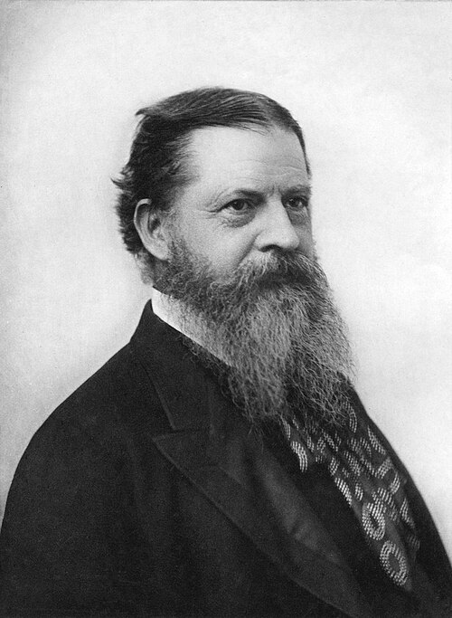

# 皮尔士：相似、指示与象征

> 定稿，2026 年 11 月 15 日经 PO 批准封存。

1854 年 9 月，伦敦的《每周出生与死亡报告》登了一条死亡记录，地点是城北的汉普斯特德：

“西区，9 月 2 日，一位雷管工匠的遗孀，59 岁，腹泻两小时，流行性霍乱十六小时。”[^1]

这是 9 月 9 日那一期上的一行字。看上去平平常常。

可那几天，伦敦城中心的苏豪区正在暴发霍乱。按医生斯诺（John Snow）后来的记录，布罗德街和剑桥街交叉口周围 250 码之内，十天里死了 500 多人。[^2]

而汉普斯特德在几英里之外。当时西区一个别的病例也没有。这位寡妇的儿子告诉斯诺，母亲已经好几个月没去过布罗德街一带了。

线索在一只瓶子上。

每天有一辆马车从布罗德街跑到西区。她喜欢布罗德街水泵的水，家里习惯让车捎一大瓶回来。那一瓶是 8 月 31 日星期四装的，她当晚喝了，星期五又喝了。星期五晚上发病，星期六死去。

来看她的一个外甥女也喝了这瓶水。外甥女回到伊斯灵顿一处地势高、空气好的住所，也染上霍乱死了。那一带同样没有别的病例。[^2]

**一个从没走近布罗德街的人，怎么会成了布罗德街疫情的证据？**

这条记录是另一位医生弗雷泽提醒斯诺注意的。斯诺说，这也许是全案最有说服力的一条。

登记簿上那一行字，本来只说一个人死了。经过斯诺的追问，它开始指向一台街头的水泵。

这一课要问的，就是这种“指向”是怎么来的。上一课的索绪尔把事物放在符号之外，只看符号和符号之间的差别。这一课换一个人，换一个方向：一个符号怎样连到它所说的那样东西上，又怎样在读它的人那里生出新的意思？



## 一、一行字是怎样指向一台水泵的

先看斯诺手里有什么。

- **一份死亡记录**：地点、日期、年龄、病程。它是一串约定好的文字和数字，谁读都一样。只看这一行，它说的是一个人的死，跟水泵没关系。
- **一个儿子的话**：母亲没去过那一带，家里每天从布罗德街捎水。这段证词，把这个人和一个地方接了起来。
- **一个时间顺序**：星期四装水，当晚和第二天喝，星期五晚上发病，星期六死去。霍乱病程短，这几步挨得很紧。
- **一个对照**：同一瓶水，外甥女喝了，在另一个没有霍乱的地方发病死去。

把这几样放在一起，那一行字就不再只是“一个人死了”。它成了一个被布罗德街的水实实在在碰过的事件留下的痕迹。


斯诺能从汉普斯特德的一张登记表读到苏豪区的一台水泵，靠的是什么？

不是这行字长得像水泵；也不是登记处约定过“这类记录表示水泵”。靠的是一条**物理上的链**：水被装进瓶子，瓶子被运到西区，水被喝下去，人病了，死了，被登记了。

这条链为什么要紧，得看斯诺在和什么样的看法争论。

他这本书的目录里有一节，标题就是“霍乱不是通过气味传播的”。从斯诺反驳的对象看，当时不少人相信，疫病是从污浊的空气、腐败的气味里来的：一片街区出事，是那片街区的空气坏了。

斯诺的主张不同。霍乱从肠道开始，致病的东西一定是被人意外吞下去的，然后在肠胃里繁殖。[^3]

照前一种看法，汉普斯特德的寡妇不该得病，她呼吸的是几英里外的空气。照后一种看法，她喝下的那瓶水就足以解释一切。

一行登记记录，就这样卡在了两种理论之间。

斯诺的路也走得并不顺。

他一知道这次暴发的位置和范围，就怀疑剑桥街口那台常有人去的水泵。可 9 月 3 日晚上他去验水，水里的有机杂质少得很，他迟迟不敢下结论。后来几天，他用肉眼细看，水里时多时少地浮着一些白色絮状的小颗粒，他推想暴发开始时水可能更脏。

光看水，他找不到决定性的东西。[^4]

于是他换了一种符号。

他去总登记处，抄下截至 9 月 2 日那一周，金广场、伯威克街和苏豪圣安妮三个分区登记的霍乱死亡：89 例。其中前四天只有 6 例，星期四 4 例，星期五、星期六两天 79 例。他据此判断，暴发是从星期四开始的。[^4]

一张死亡名单不像水，也不像病。可它记下了实实在在发生的事，并且按日期、按地址排好，可以拿去一户一户核对。斯诺正是从这张名单出发，才走到了汉普斯特德的那一行。

像不像，有没有约定，有没有实际的连接，这三样东西，正是这一课要讲的三种关系。

给它们起名字的人，是和斯诺同时代、比斯诺年轻二十多岁的美国哲学家和逻辑学家皮尔士（Charles Sanders Peirce）。

## 二、三个角，不是两面

上一课的符号有两面：能指和所指，像一张纸的正反。

皮尔士画的是一个**三角**。他在一段后来收入《皮尔士文集》的手稿里写道：

> 一个符号，或者说表征体，是在某个方面、以某种身份，对某人代表某物的东西。它向某人说话，也就是在那个人的心里造出一个对等的符号，或者一个更发达的符号。它造出的那个符号，我叫作第一个符号的解释项。这个符号代表某物，即它的对象。
> —— 皮尔士，《皮尔士文集》第 2 卷第 228 段（中文据英文原文译出）

三个角，一个一个看。

**表征体**（representamen）：承担符号作用的那个东西。登记簿上那一行字，墙上的风向标，一张照片。

**对象**（object）：符号所代表的东西。它在符号之外，是真实的，或者至少被当作真实的：那位寡妇的死，风的方向，镜头前的那一刻。

这里和索绪尔分开了。索绪尔的所指在符号内部，是一个概念；皮尔士的对象可以是世界上的事物或事件。

**解释项**（interpretant）：最容易被误读的一个。

很多人第一次读到这个词，以为它指“解释的人”。不是。皮尔士说得很清楚：符号向某人说话，在那个人心里造出另一个符号，被造出来的这个符号才是解释项。**解释项是一个符号，不是一个人。**[^5]

拿登记簿那一行来试：

- 表征体：那一行字；
- 对象：那位寡妇 9 月 2 日的死；
- 解释项：对一个普通读者，可能只是“又一个霍乱死者”；对追问过她儿子的斯诺，是一个更发达的符号，“这是一例经由布罗德街的水而来的霍乱”。

同一个表征体，同一个对象，解释项可以不一样，也可以一步步发展。

斯诺把这个判断写进书里，书里的句子又成了新的表征体，在读者心里造出下一个解释项。一个符号的意思，在皮尔士这里不是一个封闭的盒子，而是一条可以往下延伸的链。


那段话里还有一个短语值得停一下：“在某个方面”。

符号代表对象，不是在所有方面，而是在某一个方面。皮尔士把这个“方面”叫作表征体的“根据”（ground）。[^6]

那一行字在病程长短上代表那位寡妇的死；在她的长相、她的为人上，什么也不代表。

下面要讲的相似、指示、象征，说的正是：符号**凭什么根据**连到对象上。

## 三、相似、指示、象征

1894 年，皮尔士写了一篇短文，题目就叫《什么是符号？》。他把符号分成三种。[^7]

**相似**，也叫“像符”（icon）：靠模仿对象来传达关于对象的观念。一幅肖像，一张设计图，一个模仿猫叫的声音。

**指示**，也叫“指号”（index）：能表明某物，是因为和那个东西有实际的、物理上的连接。皮尔士举的例子很日常：

- 一个人走路一摇一晃，大概是个水手；
- 风向标指示风向，日晷和钟表指示时刻；
- 有人敲门，是一个指示；
- 一声巨雷告诉你出了件大事，哪怕你还不知道是什么事。

凡是把注意力拽过去的东西，都是指示。

**象征**，也叫“规约符”（symbol）：和意义的联系靠用法建立起来。大多数词语、句子、书都属于这一类。“霍乱”这两个字和那种病毫不相像，也没有任何物理连接；我们读得懂，是因为一群人一直这样用。

在后来的文稿里，皮尔士对“指示”讲得更细。风向标为什么是指示？两条理由：[^8]

- 它真的跟着风转到同一个方向，两者之间有实在的连接；
- 人天生如此，看见它指向哪里，注意力就被带到哪里。

一根标准码尺，乍看像是“一码”的像符。可它的用处，恰恰在于比眼睛估得更准；这种准确，来自它和伦敦那根标准码尺做过的机械比对。所以皮尔士说，给码尺价值的是一个实在的连接：它是一个指示，不只是像符。[^8]

到这里，先拆掉一个常见的误解：**像符要“很像”才算。**

皮尔士的说法正相反。他说每一张图解都是像符，哪怕它和对象之间没有任何感官上的相似，只要两者各部分之间的关系是类似的就行。[^9]

他甚至把代数公式也算作像符：盯着一个公式看，按交换律、结合律去变它，能发现关于它所代表的东西的新真理，这正是像符的特征。[^9]

想想地铁线路图。站与站的距离全不按比例，颜色和弯折都是画出来的；可哪站挨着哪站、在哪里换乘，这些关系和实际一致。这就够它当一个像符了。

还有一个更大的误解，留到下一节：照片。

## 四、照片为什么不止一种

照片几乎是所有教科书讲“指示”时的第一个例子：光从对象射到底片上，留下痕迹，像脚印一样。

这个说法不算错。可它常被说成“照片是纯粹的指示”，这就不是皮尔士的意思了。

他在《什么是符号？》里是这样写的：照片，尤其是快照，很有启发，因为我们知道，它们在某些方面和所拍的对象一模一样。可这种相似之所以有，是因为照片是在一种条件下产生的：在这种条件下，它们被物理地强迫着与自然逐点对应。“在这一方面”，它们属于第二类，也就是靠物理连接的那一类。[^10]

把这几句拆开看：

- “在某些方面一模一样”：这是**相似**的根据；
- “被物理地强迫着逐点对应”：这是**指示**的根据；
- “在这一方面”：这个限定说明，皮尔士没有把照片整个塞进某一类。

同一张照片，靠相似让你认出拍的是谁，靠因果连接让你相信那人当时真在镜头前。再加一层：照片下面的说明文字、报纸版面的约定，又让它带上**象征**的根据。

皮尔士在另一份文稿里说得更彻底：[^11]

- 指示被对象实际影响，就必然和对象有某些共同的性质，所以指示“包含一种像符”；
- 象征的意义靠一条规律，而规律总要通过一个个实际的实例起作用，所以象征“包含一种指示”。

说到地图，他也这样讲。一张地图，除非标出一个已知的地点，有比例尺和方位，否则它指示一个地方的能力，不比《格列佛游记》里那张大人国地图强。可一旦我们知道世上没有第二处海岸长这个样子，这份经验就让地图不只是像符，又添上了指示的性质。[^12]

由此，“同一个符号可以既是一个相似，又是一个指示”。他紧接着补了一句：尽管如此，这几类符号的职能完全不同。[^12]


所以，相似、指示、象征，最好不要理解成三个装符号的**抽屉**，而是三种**根据**，三条把符号连到对象上的线。

每条线做的事不一样：

- 相似，让人看出形状和关系；
- 指示，把符号钉在某个此时此地；
- 象征，让它能被一群人按同样的方式读出来。

实际碰到的符号，往往同时有几条线连着。哪一条最粗，因符号而异，也因用途而异。皮尔士说得很干脆：一切推理都要用相似、指示和象征的混合，哪一种都少不了。[^12]

## 五、一张地图里的三条线

回到斯诺。

他的书在 1855 年出了第二版，里面有一张后来非常出名的地图：图 1。

按他自己的说明，图上画出了 8 月 19 日到 9 月 30 日这六个星期里，一条虚线圈出的几个分区内登记的全部霍乱死亡。每一例死亡，在它发生的那所房子的位置上画一道黑线；转进米德尔塞克斯医院死去的人，也画在原来的住址上。[^13]

他也承认图有缺漏：有些在医院死去的人，登记时没写住址；有些人逃到乡下去才死。可他说，这些缺漏大概不影响这张图作为“一张疫情地形图解”的正确性。[^13]

“图解”这个词，斯诺用得很准，正落在皮尔士的“像符”上。

下面这张图，是据斯诺图 1 的布局重画的简化示意，不是原图，街道、黑线的数目和位置都做了简化。点开图上的六个标记，看每一样东西靠哪几条线连到它的对象，在读者那里又会生出什么解释项。

```widget
{
  "type": "grounds",
  "caption": "据斯诺 1855 年图 1 的布局重画的示意，不是原图。黑线数目和街道走向都做了简化。三种根据各自标出：主要依据、部分依据、不靠这一条。",
  "img": "figs/01-03-map.svg",
  "alt": "苏豪区几条街道的示意图：布罗德街横贯中间，水泵在布罗德街与剑桥街交口附近；黑色短线沿街排列，越靠近水泵越密；济贫院和啤酒厂附近没有黑线；一条虚线圈出统计范围；右下方另有一台水泵。",
  "grounds": ["相似", "指示", "象征"],
  "spots": [
    { "x": 66, "y": 40, "label": "一列黑线", "levels": [1, 2, 2],
      "why": ["一列黑线越长，那所房子死的人越多；长短对应数目，这是一种图解式的相似。可一道线本身不像死亡。", "每一道线都落在一例已登记死亡发生的房子位置上，背后是一个实际发生的事件、一行登记、一次追问。", "黑线表示一例死亡，是斯诺在说明里规定的；不读说明，没人知道它的意思。"],
      "interp": "这所房子里死了好几个人。" },
    { "x": 47, "y": 64, "label": "水泵", "levels": [1, 2, 2],
      "why": ["它在图上的位置，和它在街上的位置关系一致。", "它标出一台真实存在的街头水泵，有确定的地点。", "一个小记号表示“水泵”，靠的是图例和文字约定。"],
      "interp": "布罗德街的水泵在这里，离那几列最长的黑线很近。" },
    { "x": 22, "y": 24, "label": "街道轮廓", "levels": [2, 1, 1],
      "why": ["街与街怎样相交、哪条长哪条短，图上的关系和实地的关系一致；这正是皮尔士说的图解。", "单看轮廓，它可以是任何一座城市；要等街名和已知地点出现，它才落到苏豪区。", "两条平行线表示一条街，是地图的通行画法。"],
      "interp": "这是一片街巷密集的城区。" },
    { "x": 13, "y": 58, "label": "街名", "levels": [0, 2, 2],
      "why": ["“布罗德街”这几个字和那条街毫无相像。", "专名只挂在一个特定的地方上；它把整张图钉在伦敦的某一片街区，正是皮尔士说的“已知地点的标记”。", "文字本身是约定的符号。"],
      "interp": "这是伦敦苏豪区，不是某个虚构的城。" },
    { "x": 90, "y": 62, "label": "虚线边界", "levels": [1, 2, 2],
      "why": ["虚线的走向大致描出几个分区的边界形状。", "它对应真实的行政分区：登记数据正是按这些分区收集的。", "虚线表示“统计范围的边界”，要读了斯诺的说明才知道。"],
      "interp": "图上只算了这几个分区里登记的死亡，界外的不在图上。" },
    { "x": 6, "y": 92, "label": "整张图", "levels": [2, 2, 2],
      "why": ["看一眼就能发现黑线围着一台水泵聚集；按皮尔士的说法，能从观察里读出新东西，正是像符的特征。", "每一个成分都钉在实地和实事上，整张图因此能被拿去对照、复查。", "图例、文字、画法的约定，让它能被不在场的读者读懂。"],
      "interp": "死亡集中在布罗德街水泵周围。这是一个分布，还不是原因。" }
  ]
}
```

点完六处，至少能看出三件事。

**第一，没有哪一处只靠一条线。** 黑线是约定的记号，又是实在事件的痕迹，排起来的长短又在模仿数目。即便是街名这种最纯粹的文字，也在做指示的工作，因为一个专名只挂在一个地方上。

**第二，整张图最有用的东西，是相似这条线给的。** 死亡围着水泵聚集，这个形状是人一眼看出来的，用不着先读完一页表格。皮尔士说，像符的一大特征，是直接观察它就能发现关于对象的新真理。斯诺的地图，正是一个让人从“形状”里读出新东西的图解。

**第三，最后一格的解释项，停在“分布”上，没有走到“原因”。** 一张地图能让人看见聚集，不能证明这口井的水让人得病。从聚集走到原因，斯诺还要靠别的符号。

## 六、从聚集到原因，还缺什么

斯诺手里的证据，大部分不是图，是一户一户问出来的。

暴发开始后，他对这一周最后三天登记的 83 例死亡，逐一去现场调查：[^14]

- 只有 10 例死在明显更靠近另一台水泵的房子里。其中 5 家说，他们一向专门去布罗德街打水，因为更喜欢那里的水；另有 3 例，是在布罗德街水泵附近上学的孩子。
- 其余属于这台水泵供水范围的死者中，61 例据说常喝或偶尔喝布罗德街的水，6 例问不到情况，6 例据说病前没喝过。

接着是那些**没出事**的人。


波兰街济贫院，四分之三被出现死亡的房子包围。院里 535 人，只有 5 人死于霍乱。济贫院有自己的井，从不去布罗德街取水。斯诺算了一下：假如院里的死亡率和周围三面的街道一样，应该死 100 多人。[^15]

布罗德街上紧挨水泵有一家啤酒厂，登记里一个工人也没有。斯诺去问厂主哈金斯：厂里 70 多名工人，没有一个得重症。工人每天有定量的麦芽酒，厂主相信他们根本不喝水；厂里还有自己的深井。[^15]

相反，布罗德街 37 号的雷管工厂，大约 200 名工人，厂里常备两桶从街上水泵打来的水，供人随意喝。有 18 人死于霍乱。[^15]

这几组数字的分量，在于把**“住得近”**和**“喝了这口井的水”**拆开了。

济贫院和啤酒厂离水泵一样近，甚至更近，里面的人却不喝那口井的水，几乎没人得病；雷管工厂的工人喝了，死了 18 个。只看地图，住得近和喝了水叠在一起，分不开；分开它们的，是一户一户问出来的饮水情况。

用皮尔士的眼光看，这是一场符号的接力：

- 每一次上门询问都是一次**指示**：一个确定的人，一句确定的回答，钉在一所确定的房子上；
- 数字和表格是**象征**：它们靠约定，把几十个案例收拢成一句可以比较的话；
- 地图是**相似**：它把收拢后的东西铺回街道上，让聚集的形状显出来。

斯诺的论证三种都用上了，缺了哪一种都站不住。

9 月 7 日星期四晚上，斯诺去见了圣詹姆斯教区的济贫委员会，把调查到的情况讲给他们听。第二天，水泵的把手被卸掉了。[^16]

这件事常被讲成“一张地图拯救了伦敦”。斯诺自己的记录要克制得多。

他写道，发病最多的一天是 9 月 1 日，共 143 例；第二天降到 116 例，第三天 54 例，此后逐日减少；到 9 月 8 日卸下把手那天，只有 12 例。[^17]

他承认，停用这口井之前，发病已经少了这么多，所以无法断定那时井里是否仍有活跃的霍乱毒素，还是水已经因为某种原因干净了。井被打开检查，砌砖上没有任何孔洞或裂缝：污染的来路，在这一点上没有找到实物证据。[^17]

这里能看出斯诺论证的真正形状：**他从头到尾没见过他要证明的那个东西。**

他在书里说，“霍乱毒物”（他那个时代的说法，指致病的物质）一定有某种结构，大概是细胞那样的东西。用显微镜认不出它，也不构成反对的理由，因为天花和下疳的致病物质，同样只能从它们造成的后果认出来，而不能从它们的物理性质认出来。[^18]

上一课，索绪尔靠一个音在系统里的位置推出了它。这一课，斯诺靠一个看不见的东西在世界上留下的痕迹去追它。

前者靠的是差异和位置；后者几乎全是指示：一具具尸体，一行行登记，一瓶被运走的水，一口没人出事的深井。斯诺的对象，只有通过它的效果才在场。

还有一个容易被忽略的细节。地图标出的是 8 月 19 日到 9 月 30 日的死亡，所以它最早也要到 9 月底以后才画得完。从日期推断，说服济贫委员会的，不会是这张图，而是斯诺带去的调查本身。[^17]

地图是后来为读者画的。它是证据的一个解释项，被造出来，去在更多不在场的人心里，造出下一个解释项。

## 七、两种“象征”，和下一个问题

最后要提醒一个容易绊倒人的词：**象征**。

上一课的《教程》也用了“象征”（symbole），意思几乎和皮尔士相反。《教程》说，象征的特点是从来不完全任意，它和所指之间还留着一点自然的联系：天平象征公正，就不能随便换成一辆车。所以《教程》不愿意用这个词称呼语言符号。

皮尔士的“象征”，恰恰是靠约定、靠用法的那一类，大多数词语都在其中。

同一个词，在两套理论里几乎站在两头。读这两个人的书，碰到“象征”，先看是谁说的。

两个人的方向也不一样：

- 索绪尔问：在一个系统内部，一个符号凭什么是它自己？他的回答是差异。
- 皮尔士问：一个符号凭什么连到它之外的对象上，又在读者那里生出什么？他的回答是三个角、三种根据，和一条不断往下延伸的解释项之链。

前者适合解释一门语言为什么这样切分世界；后者适合解释一张地图、一行登记、一张照片怎样成为证据。

这一课的例子都是证据。可是，解释项之链并不总是走向更准确的知识。

一张照片靠相似和因果连接，说“这件事发生过”。同一张照片放到杂志封面上，配上标题，可能被拿来说一件大得多的事，一件照片本身并没有说的事。整个第一层意思被当作材料，去承载第二层意思。

这第二层是怎样搭起来的？它为什么让人觉得天经地义？下一课，法国批评家巴特会在一家理发店里拿起一本杂志，从这里讲起。

[^1]: 原文为 “At West End, on 2nd September, the widow of a percussion-cap maker, aged 59 years, diarrhœa two hours, cholera epidemica sixteen hours.” 斯诺引自 9 月 9 日那一期的《每周出生与死亡报告》（原文 “of September 9th”），记录里的死亡日期是 9 月 2 日；两者不要混为一谈。见 Snow 1855, 布罗德街一节。
[^2]: 寡妇的儿子提供的情况、马车与水瓶、外甥女的死，均见 Snow 1855, 布罗德街一节。“250 码内十天死亡 500 多人”见同节开头。
[^3]: 目录中的节名为 “Cholera not communicated by means of effluvia”；“必然是被意外吞下”的论证，见 Snow 1855 论霍乱病理的一节。书中另一处提到痢疾和热病时，斯诺也说到“瘴气”等“常被认为”的病因。本课对当时舆论的概括只据斯诺书中所见，未另查医学史研究。
[^4]: 9 月 3 日验水、白色絮状颗粒、去总登记处抄录名单和 89 例的逐日分布，均见 Snow 1855, 布罗德街一节。
[^5]: CP 2.228。皮尔士这里用了“某人”“那个人的心里”，但被命名为解释项的，是那个人心里“造出的符号”，不是那个人。
[^6]: 同在 CP 2.228：符号代表对象，“不是在所有方面，而是就某种观念而言”，他有时称之为表征体的“根据”。
[^7]: “What Is a Sign?”（1894），第 3–5 节，收入 *The Essential Peirce*, vol. 2。本课据马克思主义者互联网文库的转录本读了全文。
[^8]: 风向标的两条理由、北极星、码尺，见 CP 2.286；晴雨表也在同段。
[^9]: CP 2.279。
[^10]: “What Is a Sign?”，第 4 节；同一段又见 CP 2.281。
[^11]: 《符号的三种三分法》，收入 Justus Buchler 编 *Philosophical Writings of Peirce*（1955），其中关于像符、指示、象征的一节对应 CP 2.247–249。本课据马克思主义者互联网文库的转录本读了这一节。
[^12]: “What Is a Sign?”，第 5 节。“一切推理都要用相似、指示和象征的混合”见同文第 9 节。
[^13]: 地图的说明、6 周的时间范围、虚线所圈分区、“疫情地形图解”的说法，均见 Snow 1855, 布罗德街一节。
[^14]: 83 例的调查结果，见 Snow 1855, 布罗德街一节。
[^15]: 济贫院、啤酒厂和雷管工厂的数字，均见 Snow 1855, 布罗德街一节。
[^16]: 原文为 “I had an interview with the Board of Guardians of St. James’s parish, on the evening of Thursday, 7th September … the handle of the pump was removed on the following day.” 见 Snow 1855, 布罗德街一节。
[^17]: 逐日发病数、“无法断定”和井壁检查，均见 Snow 1855, 布罗德街一节。地图不会早于 9 月 30 日画完，因而晚于 9 月 7 日的会见，这是本课据地图所注日期范围作出的推断，斯诺没有交代作图日期。
[^18]: 见 Snow 1855 论霍乱病理的一节，原文为 “the matter of small-pox and of chancre can only be recognised by their effects, and not by their physical properties.”

## 参考与出处

- John Snow, *On the Mode of Communication of Cholera*, 2nd ed., London: John Churchill, 1855。读了布罗德街疫情一节全文（Project Gutenberg 电子本，第 72894 号）；本课所引死亡记录、寡妇与外甥女的病例、83 例调查、济贫院、啤酒厂、雷管工厂、9 月 7 日会见与次日卸下把手、逐日发病数、井壁检查和图 1 的说明，均据此节。[Project Gutenberg](https://www.gutenberg.org/ebooks/72894)
- Charles S. Peirce, “What Is a Sign?”（1894），收入 *The Essential Peirce*, vol. 2, ch. 2。读了转录本全文。[Marxists Internet Archive](https://www.marxists.org/reference/subject/philosophy/works/us/peirce1.htm)
- Charles S. Peirce, “Three Trichotomies of Signs”，收入 Justus Buchler ed., *Philosophical Writings of Peirce*, New York: Dover, 1955。读了转录本全文。[Marxists Internet Archive](https://www.marxists.org/reference/subject/philosophy/works/us/peirce2.htm)
- *Collected Papers of Charles Sanders Peirce*, vol. 2, ed. Charles Hartshorne and Paul Weiss, Cambridge, MA: Harvard University Press, 1932。读了 §§ 2.227–2.229、2.279–2.287 的扫描页。[University of Alberta 课程资料](https://sites.ualberta.ca/~michaelf/M665/sources/Pages%20from%20Charles%20Sanders%20Peirce,%20Charles%20Hartshorne,%20Paul%20Weiss,%20Arthur%20W.%20Burks%20Collected%20Papers%20of%20Charles%20Sanders%20Peirce%20%201994-2.pdf)
- Albert Atkin, “Peirce's Theory of Signs”, *Stanford Encyclopedia of Philosophy*, rev. 2022。只通过网页工具的摘要核对了术语和总体框架，未读原文全文。[SEP](https://plato.stanford.edu/entries/peirce-semiotics/)
- Ferdinand de Saussure, *Cours de linguistique générale*, 1916，第一编第一章第 2 节（“象征”与天平之例）。见上一课参考文献。

