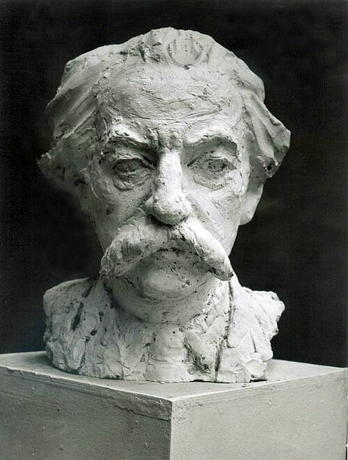

# 文化符号学：意义如何属于一个群体？

> 定稿，2026 年 11 月 15 日经 PO 批准封存。

1583 年，两个意大利耶稣会士罗明坚（Michele Ruggieri）和利玛窦（Matteo Ricci）获准在广东肇庆住下来。

他们的住所里，挂着一幅从欧洲带来的世界图。后来整理出版的利玛窦日记，记下了这幅图在肇庆引起的反应：

> 传教所的墙上挂着一幅宇宙全图，用的是欧洲文字。中国人中有学问的人非常喜欢它；听说这既是全世界的样子，又是对全世界的说明，他们很想看到用中文做成的同样一幅图。
> —— 金尼阁编《利玛窦中国札记》，据 Gallagher 1953 年英译，转引自 Yee 1994

应肇庆知府的请求，利玛窦着手重画。日记说，是让这幅图“说中文”。

新图比原图画得大，好给比拉丁字母大的汉字留出地方；还“加了新的注文，更合中国人的口味”。1584 年，它以《舆地山海全图》为名刻印出来。[^1]

这一版今天一张也没有留下来。我们能看到的，只是将近 30 年后，章潢在类书《图书编》里收的一个摹本。[^1]

此后几十年里，这张图的遭遇很奇怪：

- 有人赞它；
- 有人斥它为骗局；
- 有人把它刻进类书，却删掉了它最要紧的东西；
- 而明代的中国地图，几乎没有因它改变；
- 它最深的影响，反倒落回了欧洲。

**同一张图，在一个群体里为什么会变成好几种东西？它的意思，到底属于谁？**

上一课的舰队是一个整齐的小群体：一本书，一套训练，一种读法。

这一课换一个问题：当一个符号从一个群体走进另一个群体，接收它的那一方，并不是一个手里拿着同一本书的整体。我们跟着这张地图走一遍，看它每到一处，被怎样读、怎样改。



## 一、第一站：一张欧洲的图

利玛窦带来的那幅图，属于 16 世纪后期欧洲流行的世界图一类。按 Yee 的说法，利玛窦照着摹画的，是佛兰德地图学家奥特柳斯（Abraham Ortelius）的图。[^2]

这一类图满幅经纬线，0° 经线从图的正中穿过：欧洲和非洲在中间，亚洲推到右边，美洲在左边。中国在这样一幅图上，挤在“东方的一角”。[^2]

这幅图在欧洲人眼里很自然。可它的很多约定，没有一样写在图面上：

- 经纬线是航海和天文的通用语；
- 零度经线放在哪里，取决于绘图者从哪里出发、为谁画图；
- 一条线代表 10°，海洋是可以航行的。

这些，都要靠图外的知识。

上一课说过，一套代码能用，前提是收发两边手里拿着同一本书。地图也有它的“书”，只是这本书从不随图附送。

图挂到肇庆的墙上，墙边站着的是另一群人。他们手里的书，是另一些。

## 二、第二站：利玛窦的中文本

利玛窦对这幅图动了三处手术。

**第一处，是比例。** 为了给汉字留地方，整幅图放大了。

**第二处，是注文。** 图上加了许多说明文字，介绍各地的物产、风俗、奇闻。Yee 认为，利玛窦似乎看出了中国传统地图的一个特点：图要配文，图与文一起，才是一幅完整的图。

第三处最常被人谈起：**他把图的中心挪了。**奥特柳斯的图以 0° 经线居中；利玛窦把 180° 经线挪到图的正中。这条线在原图上，落在亚洲附近、太平洋的某处。挪过来以后，太平洋成了中轴，美洲到了右边，欧洲和非洲到了左边，中国就靠近了图的中央。


为什么要挪？金尼阁本的日记给了一个解释，后来被反复引用：中国人“坚信他们的帝国就在世界正中”，不喜欢“我们的地理图把他们的中国推到东方的一角”。所以，利玛窦挪动中心，是对中国人的迁就。[^3]

这个解释听上去合情合理，而且确实有中国人这样批评过利玛窦。

可是先别急着接受。它说的是“中国人坚信”：一个主语，一个信念，好像整个中国只有一种读图的眼光。这正是这一课要检查的那种说法。

先往下走，看看拿到这幅图的中国人，实际上都说了些什么。

这里只需记住一件事：利玛窦的中文本，已经不是奥特柳斯的图了。比例变了，文字变了，中心变了，经纬网留了下来。一张图要越过语言，先在出发的地方就被改写了一遍。

## 三、边界：一层会翻译的膜

在跟着地图走进中国读者手里之前，先认识一个概念。

1984 年，塔尔图大学的洛特曼（Juri Lotman）发表了一篇短文《论符号域》。“符号域”是他仿照地球化学家维尔纳茨基（V. I. Vernadsky）的“生物圈”造的词。[^4]

他的出发点，是一个和前几课都不一样的问题：单个的符号、单个的语言，是先有的吗？

洛特曼说，不是。他打了个比方：把一块块牛排粘起来，得不到一头小牛；可把一头小牛切开，能得到牛排。[^5]

同样，把一个个孤立的符号行为加在一起，得不到一个符号的世界。恰恰相反：要先有这样一个世界，也就是**符号域**，具体的那一次表意才成为可能。

前面几课，都从一个符号、一套系统讲起。洛特曼把顺序倒了过来：先有一个由许多语言、许多文本混在一起的整体空间，具体的符号，是在这个空间里才“活”起来的。

符号域有一条**边界**。

洛特曼特别提醒，这条边界是抽象的，不能用具体的想象把它画出来：**它不是国境线**。[^5]

他给边界下的定义很特别：边界是一组“双语的、可翻译的过滤器”。外面的东西要进入一个符号域，必须先被翻译成这个空间内部的某一种语言；没有被翻译过的东西，对这个空间来说等于不存在。[^5]

他把边界比作活细胞的**膜**：膜的作用是限制渗透、过滤，把外面的物质加工成里面能吸收的结构。


这一点和上一课的号码书正好相对：

- 号码书讲的是“同一本书”：只要两边的书一样，信息就能原样到达；
- 洛特曼讲的是“不同的书”：信息要过边界，就必须被翻译；而翻译从来不是原样送达，它是过滤，也是加工。

洛特曼还说，边界上通常站着一些特别的人。他们因为天赋或职业，同时属于两个世界，在边界上充当翻译。他举了帝国边境上的雇佣兵、城市的边缘地带、商路。这样的地方，是“克里奥尔化”的地带：两种符号结构在那里混成一种新的东西。[^6]

利玛窦就是这样一个人：一个在中国住下来、学会了中文的意大利神父。冯应京、李之藻这些和他来往最密切的中国士人，还有 1595 年见过他的章潢，也站在这条边界上。

地图要过边界，先要经过他们。

## 四、第三站：读得懂的人，读出了什么

1603 年，冯应京为利玛窦地图的第四版写了一篇序。按 Yee 引用的英译，序里称赞这幅图：[^7]

- 用天上的度数来确定地面；
- 用太阳的轨迹区分寒带和暖带；
- 以五大洲划定世界的范围；
- 又附上各地的物产和风俗，“真是好东西”。

这篇序很值得细读。冯应京并没有像金尼阁本日记说的那样，介意中国在不在正中。他称赞的，首先是**经纬网**。

经纬网对一个明代士人来说，并不完全陌生。Yee 指出，中国天文学里的二十八宿，就是给天象定位的一套坐标。

用天上的度数去定地上的位置，这件事冯应京能懂，因为他手里已经有一本类似的“书”：天文。正是这种和中国天文体系的对称，吸引了一些中国士人的注意，也帮助他们相信了这幅图。

洛特曼的文章里，正好有一句话可以解释这件事。

两个系统要交换真正新的东西，彼此之间不必一模一样；它们只要各自能对应到一个更高层的“第三者”上，交换就能发生。他的例子是文字和图画：两种语言互不相同，但各自对应着同一个现实世界，于是一方可以翻译成另一方，翻译的时候又不至于太简单。[^8]

在冯应京这里，那个“第三者”是**天**。欧洲的经纬网和中国的二十八宿互不相同，却都对着同一片天。地图借着天，过了边界。

可是过了边界的，已经是另一样东西。

在奥特柳斯那里，经纬网首先是航海和测量的工具。到冯应京的序里，它成了“以天定地”的证明，一个天地相应的秩序。**经纬网被保留了，它的意思被改写了。**

冯应京同样喜欢那些物产和风俗的注文。这是利玛窦专为中国读者加上的，正好落在中国地图“图文相配”的习惯里。

这是边界翻译的第一种结果：有对应物的东西被接收下来，但它是按接收一方的那本书被读懂的。

## 五、第四站：读得懂的人，也会拒绝

同一张图，在另一些读者手里，引起的是怀疑和愤怒。

晚明的魏濬批评利玛窦，说中国应在世界的中央，证据很简单：半夜可以看到北极星正在天顶。他问，这幅图怎么能把中国当作一个无足轻重的小国，还放得偏北？[^9]

这句话常被引来证明金尼阁的说法：中国人坚信自己在世界中心。

可是 Yee 提醒，魏濬并不一定代表当时各阶层的普遍看法。所谓“中央之国”的观念，比这复杂得多：[^10]

- 对朝廷官僚来说，世界的中心可能在洛阳附近的登封，那里有测日影的大圭表；
- 另有一种传统，把世界的中心放在昆仑山，那在中国的西边，不在中国境内；
- 中国的佛教徒画的南赡部洲图，大陆是一个倒三角，上面有印度及其周边，中国是东北角上的一个小国；后来中国佛教徒把中国画大了些，却也没有把它挪到中间；
- “中国”这个名字，最初指的是周王朝核心的北方诸国，后来一直带着文化和政治上居于首要地位的意思，并不必然意味着地理上的正中。

所以，“中国人坚信自己在正中”这句话，最多说对了某一群人。

金尼阁本日记，把这一群人的看法说成了“中国人”的看法，又把利玛窦挪动中心说成是对这种看法的迁就。Yee 甚至认为，利玛窦把中国放在中间，可能只是因为看这幅图的人最关心的就是中国。[^10]

另一种拒绝，来自**距离**。

利玛窦的图画出了极大的距离，传教士也自称走了几万里才到中国。

1615 年起任南京礼部侍郎的沈㴶，说的是在南京传教的王丰肃（Alphonse Vagnoni）等人：他们自称奉行天主教，实际上骗了吕宋的国王，夺了他的土地，改名为“大西洋”；这样说来，福建、广东就挨着一个狡诈野蛮的国家，“怎么会有八万里远”？

另一位晚明作者更进一步：这些外国人说自己来自九万里外，是要让我们相信他们没有野心，好不防备他们吞并我们。[^11]

这些拒绝的人，并不是读不懂地图。沈㴶读懂了图上的距离，然后判定这个距离是一个诡计。

所以，图里的同一个信息，在冯应京那里是新知，在沈㴶那里是假话。

洛特曼对这种现象也有一句话。[^12]

从符号域内部的运作看，边界是把两边连起来的；可从一个文化的“自我描述”看，边界是把两边分开的：一个文化要认识自己，就要强调自己和别人的不同。

他还说，一个文化不只建立自己内部的秩序，也建立它自己那一种“外部的混乱”。古代文明要把自己看成完整的，就得造出一个据说是统一的“野蛮人”世界，不管那些“野蛮人”实际上彼此差别有多大。

沈㴶把吕宋、“大西洋”和这几个传教士归成一类，读成一个统一的、狡诈的外部。金尼阁本日记把某一些人的看法，说成“中国人”的信念。

两边做的是同一种事：**把边界另一侧的许多声音，概括成一个声音。**

## 六、核心与边缘

到这里，接收的一方已经裂成了好几种读法。


洛特曼的符号域，正是为这种状况设计的概念。

他说，符号域的内部是**不整齐的**。里面有若干个核心结构，常常不止一个；核心周围，是一片组织得比较松散、更不定形的地带，越往边缘越松。[^13]

如果某一个核心不但占了主导，还发展出一套“自我描述”，用自己的元语言来描述自己和整个空间，那么它描述出来的“理想的统一”，就会凌驾在那张实际上很不整齐的符号地图之上。


洛特曼打过一个比方。想象博物馆的一个展厅：不同时代的展品陈列在不同的柜子里，说明文字有的用认得的语言写，有的用不认得的语言写，还有讲解员写的参观路线和规矩。再往展厅里放进更多的参观者，每人带着自己的一套符号世界。这就有点像符号域了。[^13]

拿这个图景去看晚明的读者，就清楚多了。

朝廷里有以登封圭表为中心的天文官僚传统，有佛教的世界图，有昆仑居中的旧说，有冯应京那样熟悉天文又愿意和传教士来往的士人，有沈㴶那样负责礼制、警惕外人的官员。他们都属于“明代中国”，却并不共用一本书。

洛特曼还有两点特别重要。

**第一，核心的自我描述会让结构变硬。** 一套语法一旦写成，它所描述的那部分就发展得慢了；那些没被描述、或者被描述得很不贴切的部分，反而发展得快。所以边缘常常比核心更活跃。久而久之，旧的核心可能变成边缘，边缘可能变成新的核心。[^14]

**第二，核心与边缘画成什么样子，取决于用哪一种语言来描述。** 是这个文化从内部描述自己，还是一个外部观察者用另一个系统的范畴来描述它？洛特曼甚至说，一种文化的边界在哪里，取决于观察者站在哪里。[^15]

金尼阁本日记的那句“中国人坚信”，就是一个外部观察者的描述。它和常被引用的魏濬那句话放在一起，成了许多地图史讲述的起点。Yee 要做的，正是把这种描述拆开，换回那张不整齐的地图。

这里有必要分清，洛特曼说过什么，没说过什么。

一种常见的简化，是把“符号域”想成：一种文化就是一个圆圈，圆心是这个文化的本质，圆周是国境线，外来的东西撞到圆周上，要么被挡住，要么被同化。

洛特曼的原文与此有几处明显的不同：

- 符号域的边界是抽象的，他明说不能把它当成一条可以画出来的线；
- 核心可以有好几个，核心与边缘的位置会移动，而且取决于描述用的语言；
- 边界既分开也连接，它是翻译和加速发生的地方，新的信息往往在那里产生；
- 他关心的不只是一个文化“是什么”，更是它怎样描述自己，以及这种描述怎样和实际的不整齐互相拉扯。

本课用的是原文的这些意思；《论符号域》后半篇关于镜像对称的讨论，本课没有用到。

## 七、第五站：类书里的地图

利玛窦的图，在晚明流传得相当广。[^16]

- 有官员看到它，当即下令刻版，拿印本送朋友；
- 有一位地方官把它刻在石头上，拓下来分送；
- 冯应京、李之藻都刻印过；据陈观胜的说法，李之藻那一版印了好几千份；
- 1608 年，一个太监把一幅利玛窦的图拿给万历皇帝看，皇帝很喜欢，要了 12 份。

更持久的流传，是进入类书。[^17]

- 章潢的《图书编》收了第一版的摹本；
- 王圻的《三才图会》收了第二版，删掉了纬线，只留下几个地名；
- 程百二等人的《方舆胜略》（1612）收了 1601 年的东西两半球图，附上一张各国经纬度的表；
- 潘光祖约 1630 年编的《舆图备考》，又从《方舆胜略》里转抄了这两幅半球图。

这一串转抄，是边界翻译的又一种结果。

在一次次抄录里，地名和注文出了差错：有的国家标错了名字，有的把利玛窦的注文当成了地名。《方舆胜略》的经纬度表，给法国标的是北纬 45°、经度 5°（以福岛为 0°），一个国家只有一个点，国土有多大，没有人去管。[^17]

把这些差错只当作“抄得马虎”，就漏掉了一些东西。

经纬度表里的数字，原本属于一套完整的读法：要用它，得知道投影怎样画、一度有多长、一个坐标只是一个点。**数字被抄了下来，读数字的那本书没有跟过来。**

于是那张表变成了别的东西：一份关于远方国度的知识清单，和类书里其他条目并排。

洛特曼说，一个符号系统的碎片，甚至一个单独的文本，都保存着重建整个系统的机制；原来的整体失去以后，人们会试图从碎片“回忆”出整体。可这种重建，几乎总是造出一种新的语言，而不是复原旧的那一种。[^18]

类书里的利玛窦地图，正是这样的碎片。它被收进“天、地、人”三才的框架里，和别的地理知识放在一起，按类书的读法被读。它活了下来，但活成了类书的一部分。

这些图后来的命运，也说明了这一点。

潘光祖的《舆图备考》，开头是两幅照抄的半球图，后面二十多幅图多半照着罗洪先约 1555 年的《广舆图》画，连《广舆图》原有的方格网都去掉了。Yee 认为，潘光祖似乎并没有打算用欧洲的方法去重新处理本土材料。除了这些摹本，明代的中国地理地图里，看不到使用经纬网或类似坐标系统的痕迹。[^17]

流传很广，却没有改变制图法。

Yee 的结论是：许多地图史家一直在追问“为什么利玛窦的地图没有给中国制图留下持久的影响”，可能是在回答一个不成立的问题，“流传广不一定说明影响大，看到了也不等于采用了”。[^19]

这句话对理解“一个群体的意义”很要紧。一样东西在一个群体里到处可见，并不说明这个群体用同一种方式理解它，更不说明它进入了这个群体的核心。它可能一直停在边缘，以碎片的样子被收藏、被转抄、被重新归类。

## 八、回流：地图改变了出发的地方

故事还有最后一站，在欧洲。

利玛窦第一版地图上的中国，按章潢的摹本看，是一块连着亚洲大陆的地方，外加两个相连的岛。这反映的是当时欧洲关于中国的知识有多不完整。Yee 说，中国本土地图里关于中国的信息，比这可靠得多。[^20]

利玛窦在中国用了中国的地图和地理书，其中包括罗洪先的《广舆图》，自己也测了一些地方的经纬度。他的测量有误差：他以为一度是 250 里，实际约是 194 里。

但在他后来几版地图上，中国的样子越来越接近中国地图里的中国。这些新的中国形象，再经由他的地图进入欧洲。

Yee 因此说，谈利玛窦的影响，更恰当的场合是欧洲：欧洲人笔下中国形象的变化，可以直接追溯到他的地图。[^20]

这和洛特曼讲的“对话”正好相合。

他说，真正的对话里，信息是双向的；翻译出去的文本，要预先在自己身上留下一点对方语言的成分，否则对话无法进行。他举的例子是：19 世纪文学要想有力地影响绘画，自己的语言里就得先含有“如画”的成分。[^21]

利玛窦的图为了“说中文”，先在自己身上放进了中国的东西：更大的字，图文相配的注文，把中国放在靠近中央的构图。图回到欧洲时，又把从《广舆图》里学来的中国带了回去。

一张地图跨过边界，没有一边是原封不动的。

## 九、意义属于谁

回到开头的问题：一张图被请来“说中文”，为什么在一个群体里变成了好几种东西？

因为这个群体本来就不是一个整体。晚明的读者，手里拿着不同的“书”：天文、礼制、佛教宇宙图、类书的分类框架。地图越过边界，被翻译进哪一本书，就成为哪一种东西：

- 冯应京按天文读，它是天地相应的新证据；
- 沈㴶按边防和礼制读，它是外人的诡计；
- 类书编者按三才的框架读，它是一页关于远方的知识。

每一次翻译，都保留了一些东西，改写了一些东西，丢掉了一些东西，也添进了一些原图上没有的东西。

下面这张表，把这张图上的几样东西，在每一站的遭遇排在一起。点开每一格，可以看到依据；标着“资料未及”的格子，不是说那里什么也没发生，只是本课所用的材料没有记录。

```widget
{
  "type": "crossing",
  "caption": "利玛窦世界图上的四样东西，经过六站时的遭遇。用方向键可以在格子之间移动。这是一个教学用的整理，格子里的判断都依据 Yee 1994 等文献的记述，归为“保留、改写、丢失、新增”是本课的概括；一站之内的不同读者常常并不一致，表里只能择要。",
  "stations": [
    "① 欧洲底本",
    "② 利玛窦中文本",
    "③ 冯应京的序",
    "④ 批评者",
    "⑤ 类书转抄",
    "⑥ 回到欧洲"
  ],
  "elements": ["经纬网", "中国的位置", "注文与地名", "距离与坐标"],
  "cells": [
    [
      { "s": "start", "t": "奥特柳斯一路的投影：满幅经纬线，0° 经线居中。" },
      { "s": "start", "t": "按金尼阁本日记的说法，欧洲地图把中国“推到东方的一角”。" },
      { "s": "start", "t": "欧洲文字的地名和说明。" },
      { "s": "none", "t": "本课所用材料没有专门记述欧洲底本上的距离与坐标。" }
    ],
    [
      { "s": "keep", "t": "经纬网照画；只是中轴从 0° 经线换成了 180° 经线。" },
      { "s": "change", "t": "180° 经线挪到正中，中国靠近图的中央。按章潢的摹本，第一版里的中国是连着亚洲大陆的一块，外加两个相连的岛。" },
      { "s": "add", "t": "比例放大，给汉字留地方；新加注文，日记说是“更合中国人的口味”。" },
      { "s": "add", "t": "图上画出极大的距离，传教士也自称走了几万里。" }
    ],
    [
      { "s": "change", "t": "冯应京称赞它用天上的度数定地面。经纬网被读成天地相应的秩序，二十八宿是他手里现成的对应物。" },
      { "s": "none", "t": "据 Yee 所引的序文，冯应京没有谈到中国的位置。" },
      { "s": "keep", "t": "冯应京称赞图上附了各地的物产和风俗，这正是利玛窦新加的注文。" },
      { "s": "none", "t": "序文没有谈到路程。" }
    ],
    [
      { "s": "none", "t": "本课所用材料里，批评者没有专门针对经纬网。" },
      { "s": "change", "t": "魏濬说中国应在正中，北极星在天顶可证；这幅图却把中国画成偏北的小国。Yee 提醒，这不一定代表普遍看法。" },
      { "s": "none", "t": "本课所用材料没有记录批评者对注文的意见。" },
      { "s": "change", "t": "沈㴶问，既然在吕宋夺地，“怎么会有八万里远”；另一位作者说，自称九万里是为了让人不加防备。距离被读成诡计。" }
    ],
    [
      { "s": "lose", "t": "《三才图会》的摹本删掉了纬线。除了这些摹本，明代地理地图里看不到经纬网的痕迹。" },
      { "s": "none", "t": "本课所用材料没有专门记述类书摹本里中国的位置。" },
      { "s": "change", "t": "转抄中标错国名，把注文当成地名；《三才图会》只留下几个地名。" },
      { "s": "change", "t": "《方舆胜略》把坐标抄成一张表，法国是北纬 45°、经度 5°，一国一个点，不管国土大小。" }
    ],
    [
      { "s": "none", "t": "本课所用材料没有记述这一项。" },
      { "s": "change", "t": "利玛窦借《广舆图》等中国地图修正中国的轮廓；欧洲人笔下中国形象的变化，可以直接追溯到他的地图。" },
      { "s": "none", "t": "本课所用材料没有记述这一项。" },
      { "s": "change", "t": "利玛窦以为一度是 250 里，实际约 194 里，测出的中国经纬度因此有误差。" }
    ]
  ]
}
```

那么，一张图的意思属于谁？

不属于利玛窦一个人，因为他在出发的地方就改写了它；也不属于“中国人”这个整体，因为这个整体并不存在于一本共同的书里。

洛特曼的回答是：意义产生在一个符号域里，一个由许多语言、许多核心和一片松散边缘组成的不整齐的空间。一个群体之所以能共享意义，不是因为每个人手里的书一模一样，而是因为大家在同一个空间里，不断地彼此翻译、彼此描述，也彼此误解。

这比上一课的舰队复杂得多，却更接近大多数群体的真实状况。

一个群体对自己的描述，比如“我们都相信什么”，总是比它的实际要整齐。而真正的变化，常常发生在边缘，在那些站在边界上、同时属于两个世界的人身上。

讲到这里，还剩下一个问题。冯应京、魏濬、沈㴶、类书的编者，每个人都从同一张图里读出了不同的东西。他们读得有对有错吗？如果一个符号可以被不断地翻译下去，读者是不是想怎么读就怎么读？

第一阶段的最后一课，从一部 1898 年的鬼故事和它引起的半个世纪的争论讲起。

[^1]: 肇庆传教所的情形、知府的请求、“说中文”、放大比例与新加注文、1584 年刻本及其失传、章潢《图书编》（1613）中的摹本，均据 Cordell D. K. Yee, “Traditional Chinese Cartography and the Myth of Westernization”, in *The History of Cartography*, vol. 2, bk. 2, 1994, 第 171 页。Yee 所引的日记，是金尼阁（Nicolas Trigault）1615 年据利玛窦手稿编成的拉丁文本，经 Louis J. Gallagher 译为英文，题为 *China in the Sixteenth Century: The Journals of Matthew Ricci, 1583–1610*（1953），第 165–166 页。本课未读 Gallagher 译本和利玛窦意大利文原稿，引文由 Yee 的英文转译为中文，不是中文原文。
[^2]: 奥特柳斯底本与 180° 经线的位置，据 Yee 1994, 第 172 页；“0° 经线居中”是由此推出的。“推到东方的一角”是金尼阁本日记的说法，见下文。
[^3]: 金尼阁本日记的这两句话，据 Gallagher 1953, 第 167 页，转引自 Yee 1994, 第 172 页。
[^4]: Juri Lotman, “О семиосфере”, *Труды по знаковым системам* 17, 1984。本课读的是 Wilma Clark 的英译 “On the semiosphere”, *Sign Systems Studies* 33.1, 2005, 第 205–229 页，通读了第 205–220 页；俄文原文未读。下文引洛特曼，均为本课据英译所作的中译。
[^5]: 牛排与小牛的比方见英译第 208 页；边界不能用具体想象画出、“双语的可翻译的过滤器”、细胞膜的比方，见第 208–210 页。
[^6]: 英译第 211 页。
[^7]: 冯应京序见 Pasquale M. d’Elia 1961 年发表于 *Monumenta Serica* 第 20 卷的文章（第 129 页），转引自 Yee 1994, 第 171 页及注 7。本课未读冯序中文原文，此处据 Yee 的英译转述；引号里的“真是好东西”也是由英译转译的，不是冯序原文的措辞。
[^8]: 英译第 216 页。
[^9]: 魏濬的话见 Kenneth Ch’en（陈观胜）1939 年发表于 *Journal of the American Oriental Society* 第 59 卷的文章（第 348 页），转引自 Yee 1994, 第 173 页注 11。本课未读魏濬原文，这里是据英译转述。
[^10]: 登封圭表、昆仑、佛教南赡部洲图、“中国”一词的本义，均据 Yee 1994, 第 173–174 页。Yee 关于利玛窦可能只是照顾读者兴趣的推测，见第 174 页。
[^11]: 沈㴶的话据张维华《明史欧洲四国传注释》（1934）第 131 页，转引自 Yee 1994, 第 171 页注 8；“九万里”一段，Yee 注 9 只说出自晚明作者 Su Jiyu，同引张维华书第 131 页，见 Yee 1994, 第 172 页。本课未读张维华书，这位作者的汉字写法未能核实，暂不写出。两段引文均由英译转译，“大西洋”是利玛窦对自己故乡的称呼。
[^12]: 英译第 211–212 页。
[^13]: 英译第 213 页。博物馆展厅的比方见第 213–214 页。
[^14]: 英译第 214 页。
[^15]: 英译第 213–214 页。
[^16]: 刻版赠友、刻石拓印、冯应京与李之藻刻本、李之藻本数千份（据陈观胜）、1608 年万历索图 12 份，均据 Yee 1994, 第 174–175 页。
[^17]: 王圻、程百二、潘光祖诸书的情况，抄录中的差错，以及法国坐标一例，据 Yee 1994, 第 174–177 页；Yee 关于差错的归纳本身也依据陈观胜的研究。Yee 正文说《三才图会》所收是 1600 年的第二版，图注又作 1602 年，本课只写“第二版”。
[^18]: 英译第 214–215 页。
[^19]: Yee 1994, 第 177 页。引文为本课中译。
[^20]: Yee 1994, 第 176–177 页。
[^21]: 英译第 218 页。

## 参考与出处

- Juri Lotman, “On the semiosphere”, trans. Wilma Clark, *Sign Systems Studies* 33.1, 2005, 第 205–229 页（俄文原文 1984 年刊于 *Труды по знаковым системам* 17）。通读了英译第 205–220 页，涉及符号域的定义、边界、不整齐性、核心与边缘、记忆和对话；第 220 页以后关于镜像对称的部分本课未细读；俄文原文未读。DOI: 10.12697/SSS.2005.33.1.09
- Cordell D. K. Yee, “Traditional Chinese Cartography and the Myth of Westernization”, in J. B. Harley and David Woodward eds., *The History of Cartography*, vol. 2, bk. 2, Chicago: University of Chicago Press, 1994, 第 170 页起。读了第 170–177 页关于利玛窦地图的全部论述。本课所引利玛窦日记、冯应京序、魏濬、沈㴶及另一位晚明作者的话，均转引自此章，中文原文和 Gallagher 译本本课均未读。
- Louis J. Gallagher trans., *China in the Sixteenth Century: The Journals of Matthew Ricci, 1583–1610*, New York: Random House, 1953。仅据 Yee 的引用，本课未读。
- Kenneth Ch’en（陈观胜）, “Matteo Ricci’s Contribution to, and Influence on, Geographical Knowledge in China”, *Journal of the American Oriental Society* 59, 1939, 第 325–359 页。仅据 Yee 的引用，本课未读。

