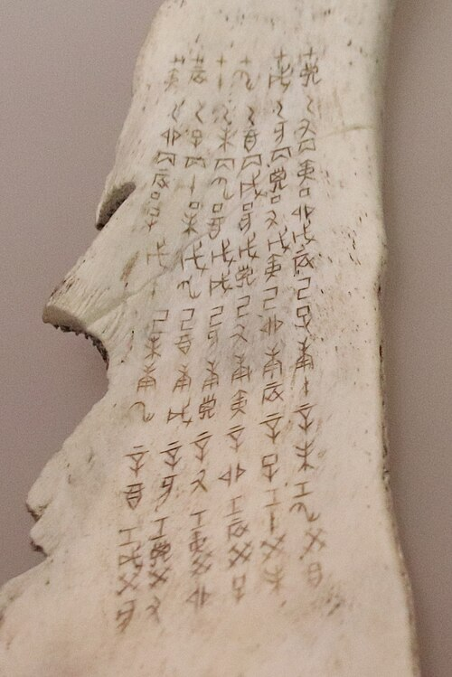

# 天干地支：时间为什么可以成为符号系统？

> 定稿，2026 年 11 月 16 日经 PO 批准封存。

1976 年 3 月，陕西临潼零口的村民挖出了一件西周早期的青铜簋。

簋的内底铸着 4 行、32 个字。铭文一开头说武王征伐商，紧接着就是四个字：“唯甲子朝。”[^1]

武王伐商，是在一个“甲子”日的早晨。

这件器后来被叫作“利簋”，因为铭文说，铸它的人名叫“利”。

巧的是，传世的《尚书·牧誓》开头也写着：“时甲子昧爽，王朝至于商郊牧野，乃誓。”[^2] 天将亮未亮的甲子日，武王到了商都郊外的牧野。

一件埋在地下三千年的铜器，一篇代代抄传的文献，说的是同一个日子。

那么，这个“甲子”是公元前哪一年、哪一天？

答案并不简单。武王克商发生在哪一年，历来有许多互相竞争的复原，彼此可以相差很多年。后来，“夏商周断代工程”给出了一个推定：公元前 1046 年 1 月 20 日。[^1] 本课读到的只是介绍这个推定的二手文章，没有读工程报告，也不替学界判断它是否已被普遍接受。


**两件记录都写得清清楚楚：甲子。可“甲子”本身，并没有告诉我们是哪一年。这一课就从这里开始：干支到底是一种什么样的符号？**



## 一、两组字

干支由两组字组成。

**天干十个**：甲、乙、丙、丁、戊、己、庚、辛、壬、癸。

**地支十二个**：子、丑、寅、卯、辰、巳、午、未、申、酉、戌、亥。

这些字原本各有字义，但放在干支里，它们主要是“序号”。甲是天干第一，子是地支第一，就像我们说“第一个”“第二个”。

用法是一干配一支，两字一组：第一天叫甲子，第二天乙丑，第三天丙寅……一天往前走一格，两组字同时往前走一个。

这个办法很早就用来记日了。商代甲骨卜辞里，占卜的日子几乎都用干支记，这是研究甲骨的学者都熟悉的情形。[^3]

## 二、为什么是六十

天干走 10 步回到甲，地支走 12 步回到子。两组一起走，要多少步才同时回到“甲子”？

答案是 10 和 12 的最小公倍数：60。


所以干支一轮是六十个，叫“六十甲子”或“一个花甲”。

这里有一个容易想错的地方。10 个天干、12 个地支，随便配对的话，应该有 10×12＝120 种。为什么只用到 60 种？

因为两组字**每次同时**走一步，不能单独跳。天干排第 1、3、5、7、9 位的（甲、丙、戊、庚、壬），只会碰上地支排单数位的（子、寅、辰、午、申、戌）；双数位只碰双数位。

所以“甲子”会出现，“甲丑”永远不会出现。120 种里，正好有一半走不到。


## 三、动手：转一转两组字

下面这个小工具从甲子开始。先把两种数法分清楚：**“第几个”是位置的编号，从 1 数起；“走几步”是离开甲子往后走了多少，从 0 数起。**所以：

- 甲子是第 1 个，走了 0 步；
- 辛未是第 8 个，走了 7 步；
- 从甲子往后走 8 步，到的是第 9 个壬申，不是辛未；
- 走 10 步，到第 11 个甲戌；
- 癸亥是第 60 个，走了 59 步；
- 走满 60 步，才回到甲子，这时是第 61 个位置，与第 1 个同名。

你可以一步一步走，也可以一次走 10 步或 12 步，看看天干和地支是怎么错开的，六十个格子要走多久才能填满。

```widget
{
  "type": "cycle",
  "caption": "天干、地支各走一格，组成一个名字。读数规则：显示的“第 n 个位置”从 1 数起，“已走 k 步”从 0 数起，n ＝ k ＋ 1（超过 60 后接着数）；下方提示按位置编号。下面的六十格按出现的先后排，走到过的会写出名字。试试一次走 10 步：天干回到原位，地支却没有；一次走 12 步：地支回到原位，天干却没有",
  "stems": ["甲","乙","丙","丁","戊","己","庚","辛","壬","癸"],
  "branches": ["子","丑","寅","卯","辰","巳","午","未","申","酉","戌","亥"],
  "notes": {
    "1": "**第 1 个位置：甲子**（走了 0 步）。两组都在第一位。利簋和《牧誓》记的，就是一个叫甲子的日子。",
    "8": "**第 8 个位置：辛未**（走了 7 步）。利簋铭文接着记“辛未，王在阑师”。辛未在顺序里是甲子之后的第 8 个位置。如果两条记录是同一次行动里前后相继的日子，就相隔 7 天；铭文没有自己写明天数。",
    "9": "**第 9 个位置：壬申**（走了 8 步）。从甲子走 8 步，到的是壬申，不是辛未。",
    "10": "**第 10 个位置：癸酉**（走了 9 步）。天干走完一圈了，地支才走到第 10 位。",
    "11": "**第 11 个位置：甲戌**（走了 10 步）。天干回到甲，地支却是戌。所以“甲”开头的日子，每 10 天就有一个，但它们的名字都不一样。",
    "12": "**第 12 个位置：乙亥**（走了 11 步）。地支也走完一圈了。",
    "13": "**第 13 个位置：丙子**（走了 12 步）。地支回到子，天干却是丙。",
    "60": "**第 60 个位置：癸亥**（走了 59 步）。六十个名字都出现过了，这是一轮里的最后一个。",
    "61": "**第 61 个位置：又回到甲子**（走了 60 步）。和第 1 个同名：名字转回来了，日子却已经过去 60 天。"
  },
  "end": "六十个格子都填满了（走了 59 步，到第 60 个位置）。再走 1 步，也就是共走 60 步，就回到甲子。10 和 12 的最小公倍数是 60；天干、地支每次一起走一步，单数位只碰单数位，所以 120 种配对里只有 60 种会出现。"
}
```

## 四、循环的名字，不是绝对日期

回到利簋。

“甲子”这个名字，每隔 60 天就出现一次。一年里有六个左右的甲子日；一百年里，有六百多个。

**记录只说“甲子”，没说是哪一个甲子。**


要把它换成公历的某一天，至少还要知道两件事：

1. 这件事发生在哪一年、哪个月。
2. 某一个甲子日，对应公历的哪一天。这叫“锚点”。

有了锚点，往前往后一天天数，就能算出任何一个干支日在公历里的位置。干支记日从古代一直连续用了下来，这种往回推算才成为可能。[^4]

难的是第一件事。武王伐商在哪一年，传世文献说法不一，利簋只有“甲子”，没有年份。研究者要把文献里的年数、天象记录、历法推算、碳十四测年放在一起，才能得出一个推定。

这就是为什么同一个“甲子”，会有互相竞争的几种换算结果。**“公元前 1046 年 1 月 20 日”是一个经过论证的推定，不是铭文上写着的日期。**它会随新证据的出现而被讨论、被修正。

利簋还有一处说明了这一点。铭文里紧接着“甲子朝”的两个字，“岁鼎”，到底是指岁星（木星）当空，还是指别的意思，学者理解不同。[^1] 如果理解成天象，它就能帮忙定年；如果不是，它就帮不上。

利簋还记了“辛未”，王在阑地赏赐了利。[^1] 在六十个名字的顺序里，辛未是甲子之后的第 8 个位置，也就是从甲子往后数 7 步。如果两条记录说的是同一次行动里前后相继的日子，那就是相隔 7 天；这个“如果”是通常的理解，铭文没有自己写明天数。**干支本身只能说明两个名字在顺序里相隔几位，不能单独说明相隔了几天，更不能说明是哪一年。**

## 五、从记日到记年

干支最早、最稳定的用法是记日。用它来记年，是另一回事。

《史记·历书》记汉武帝改历：太初元年，“年名‘焉逢摄提格’，月名‘毕聚’，日得甲子，夜半朔旦冬至”。[^5]

这一句里，**日子用的是干支**：甲子。**年份用的却是另一套名字**：“焉逢摄提格”。《历书》后面附的《历术甲子篇》，一年一年往下排，用的也是“端蒙单阏”“游兆执徐”这样的年名。[^5]

这套年名和干支有对应关系，常见的对应是把“焉逢摄提格”算作“甲寅”。但对应关系怎样整理、各家怎样换算，本身就有争论，这一课不展开。[^6]

今天常说“甲子年”“辛亥年”，这种直接用六十干支纪年的办法，是后来才普遍使用的。确切从什么时候开始成为常规，本课没有找到可以直接引用的研究。[^6]

再看《历书》这一句的另一层意思。“日得甲子，夜半朔旦冬至”：甲子日的半夜，正好是新月（朔）、早晨（旦）、冬至三者同时到来。**这是一个历法计算的起点。**

历法家喜欢这样的时刻：日、月、季节和干支，几个循环在同一刻对齐。《历书》把它写进诏书里，说明改历是国家大事。

这里的“甲子”，已经不只是一个日子的名字。它是一套计算的零点。

## 六、后来叠上去的意义

干支的字本来是序号。可时间一长，人们开始给每个字配上别的东西。

**配动物。**东汉王充写《论衡》时，记下了一种当时流行的说法：“寅，木也，其禽虎也；戌，土也，其禽犬也……子亦水也，其禽鼠也；午亦火也，其禽马也。”[^7] 他接着又列出酉鸡、卯兔、申猴、亥豕、巳蛇、丑牛、未羊。

有意思的是，王充引这段话，是为了**反驳**它。当时的人说，老虎能制服狗和牛羊，是因为寅属木，木胜土。王充反问：照这样说，子是水，午是火，水胜火，老鼠为什么不去追马？[^7]

也就是说，地支配动物在东汉已经是一种常见的说法，但这些配法能不能用五行去“解释”动物的行为，在当时就有人不同意。

王充这一段里，十二支只出现了十一个，没有提到辰。[^7]

**配方位、配时辰。**后来人们又用地支分别代表方位和一天里的时段，比如子配北、午配南，“子时”是半夜。这些配法什么时候出现、什么时候定型，各种说法不少，本课没有一一核对。[^8]

**用来择日。**一旦每个干支日都有了五行、方位、动物，就可以说某天宜做什么、忌做什么。择日、择时是一大套学问，下一课讲到的几种术数，都要用到干支。


## 七、四层要分开

读到一条带干支的材料，可以先问：我手里的是哪一层？

**第一层，记录里的干支。**利簋上的“甲子”，就是当时的人写下的日子名字。这是最硬的证据。

**第二层，换算成公历。**“公元前 1046 年 1 月 20 日”，是今天的研究者推出来的。它依赖于年代判断，可能改变。

**第三层，当时的历法计算。**《历书》里的“日得甲子，夜半朔旦冬至”，是汉代人自己做的推算。它告诉我们汉代人怎样计算，不一定和今天天文学推出的结果一致。

**第四层，后来的配属。**干支配动物、方位、时辰、吉凶，是在循环之上叠加的意义。它们有自己的历史，不能拿后来的配属，去解释更早的记录。

比如利簋的“甲子”，就不能说成“鼠年”或“吉日”。铭文里没有这些东西。

## 八、回到甲子

再看一眼利簋上的四个字：“唯甲子朝。”

它简单到只有一个名字。可这个名字背后，是一套设计：两组字，各自循环，一起前进，六十个一轮。

**这套设计好在哪里？**它不需要知道“现在是第几年”，只要一天一天往下数，就不会乱。所以它可以从商代一直连到今天，中间几乎没有断过。

**它的局限也在这里。**名字会重复。单看一个干支，你永远不知道它是哪一轮里的那一个。要把它钉到一条绝对的时间线上，得靠别的证据。

天干地支把时间变成了一组可以循环的符号。下一课要看的，是在这样的时间符号之上，人们怎样搭起更复杂的体系，奇门遁甲、六壬和太乙。

[^1]: 杨曙明《利簋：西周第一青铜器》，中国社会科学网，2019 年 4 月 25 日［已核：二手］。1976 年 3 月出土于陕西临潼零口、4 行 32 字、铭文首记武王征商与“唯甲子朝”、“岁鼎”释读的分歧、“辛未，王在阑师”、夏商周断代工程推定为前 1046 年 1 月 20 日，均据此文。该文还提到克商年份有很多种说法，其中的具体数目和起讫年份，本课没有查到可以独立核对的学术来源，所以正文不引用具体数字［待核］。本课没有读到铭文拓片和发掘报告。“利”是作器者名，是通行的释读。
[^2]: 《尚书·牧誓》，读的是维基文库录文［已核］。“时甲子昧爽，王朝至于商郊牧野，乃誓”，据此录文。
[^3]: 商代甲骨卜辞以干支记日、并有刻写六十干支的甲骨，这是甲骨学的常识性说法；本课没有核对具体的甲骨著录编号和释文［待核］。
[^4]: 干支记日自春秋以来连续不断，是历史年代学通常的前提，本课据此说明换算原理；具体的连续性论证没有在本课展开［待核］。
[^5]: 《史记》卷二十六《历书》，读的是维基文库录文［已核］。武帝诏书“年名‘焉逢摄提格’，月名‘毕聚’，日得甲子，夜半朔旦冬至”，以及《历术甲子篇》“太初元年，岁名‘焉逢摄提格’……”“端蒙单阏二年”“游兆执徐三年”，均据此录文。
[^6]: “焉逢摄提格”等岁名与六十干支的对应、以及干支纪年何时成为通行做法，现代研究有不同看法，本课没有查到可以直接引用的研究，暂不下断语［待核］。
[^7]: 王充《论衡》卷三《物势篇》，读的是维基文库录文（四库全书本）［已核］。“寅，木也，其禽虎也。戌，土也，其禽犬也。丑、未亦土也，丑禽牛，未禽羊也……亥，水也，其禽豕也。巳，火也，其禽蛇也。子亦水也，其禽鼠也。午亦火也，其禽马也”，以及“子，鼠也……水胜火，鼠何不逐马”，酉鸡、卯兔、申猴，均据此录文。这一段十二支只出现十一个，没有辰；王充的书中别处是否提到辰配龙，本课没有核对。录文作“虵”“䑕”，正文按通行字作“蛇”“鼠”。
[^8]: 地支配方位、配一日时段的早期材料，本课没有核对［待核］。

## 参考与出处

- 引文说明：直接引用的古文，据上述维基文库的繁体录文转写为简体，没有改动词句；个别异体字（如《论衡》录文的“虵”“䑕”）在注中说明。

- 杨曙明《利簋：西周第一青铜器》，中国社会科学网，2019 年 4 月 25 日。
- 《尚书·牧誓》。[维基文库](https://zh.wikisource.org/wiki/尚書/牧誓)
- 司马迁《史记》卷二十六《历书》。[维基文库](https://zh.wikisource.org/wiki/史記/卷026)
- 王充《论衡》卷三《物势篇》。[维基文库](https://zh.wikisource.org/wiki/論衡_%28四庫全書本%29/卷03)
