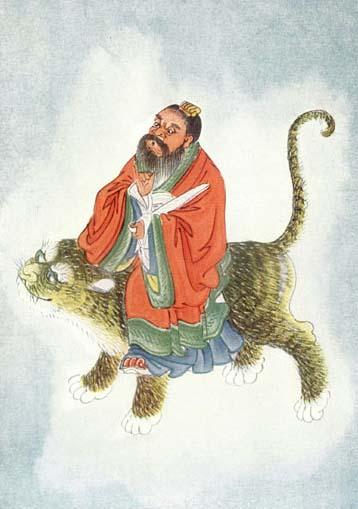

# 符箓、法箓与仪式权威

> 定稿，2026 年 11 月 16 日经 PO 批准封存。

公元 5 世纪，南朝刘宋。道士陆修静写了一篇整顿道门的文字，后来被称为《陆先生道门科略》。

读起来，它很像一份内部检查报告。陆修静一条一条数落他看到的乱象：

有人只受了很低的箓，却偷偷穿上只有高阶道士才能穿的“帔褐”。[^1]

有人觉得箓越多越好，“佩箓惟多”，争先恐后。[^1]

有人“身受下治，署人上品”：自己只在很低的职位，却给别人封了很高的职位。[^1]

还有人“自荷白板，而加板于人”：自己的职位还没有经过正式确认，就去任命别人。[^1]


这些人手里都有箓，身上也穿着法服。可陆修静认为，他们并没有真正的资格。

**那么，一个道士的权威，到底从哪里来？手里有一份箓，能证明什么，又证明不了什么？**

上一课讲了符：一种被认为来自天上、必须照原样保存的文字。这一课讲“箓”，以及围绕它的师承、职位和组织。

和上一课一样，本课只谈历史上的人怎样描述这些制度，**不复制任何箓文，也不讲授箓的具体仪轨**。



## 一、符和箓不是一回事

“符箓”常常连在一起说，但它们不是同一种东西。

唐初编的《隋书·经籍志》，在道经部分的序里讲过箓是什么：

“箓皆素书，纪诸天曹官属佐吏之名有多少，又有诸符，错在其间，文章诡怪，世所不识。”[^2]

箓是写在白绢上的，记的是“天曹官属佐吏之名”，也就是天上各个官署的官员、属吏的名字。中间也夹着一些符。


所以：

- **符是一件东西**。写好了拿去用：贴在门上，挂在四角，带在身上。上一课里葛洪讲的入山符，就是这样。
- **箓是一份名册**。它记着一批神明官吏的名字，而这份名册属于某一个具体的人。

符可以给任何人用；箓却写明了“这是谁的”。拿到箓，意味着受箓的人和名册上的那些神明官吏，建立了一种隶属关系。

这就是为什么，箓比符更接近一种“身份文件”。

## 二、受箓：一对金环

《隋书》还记下了受箓的大致过程。[^2]

受箓的人先要“洁斋”，然后带着一枚金环和一些礼物（贽币）去见老师。老师收下礼物，把箓授给他。

接着有一个很特别的动作：“仍剖金环，各持其半，云以为约。”[^2]

把金环剖成两半，师徒各拿一半，作为约定。


还记得上一课《说文》怎么解释“符”吗？“分而相合”：一根竹片剖开，双方各持一半，合得上才算数。

剖开的金环，也是这样一对凭证。**它证明的不是“你有一份箓”，而是“这份箓是从这位老师手里，按约定传给你的”。**

弟子拿到箓以后，“缄而佩之”：封好，随身佩带。[^2]

《隋书》还说，受箓有先后次序：“初受《五千文箓》，次受《三洞箓》，次受《洞玄箓》，次受《上清箓》。”[^2] 一级一级往上。

不过要注意：这是唐初修史的人对“当时道教”的概括。它写得很整齐，但不一定适用于所有道派、所有地方，更不适用于所有时代。[^2]

## 三、一架梯子

陆修静的文字，让我们看到另一种更细的次第。他讲的是天师道的制度。

先是普通的信徒，叫“道民”。陆修静引用“科教”说：“民有三勤为一功，三功为一德。民有三德则与凡异，听得署箓。”[^1]

勤勉三次算一功，三功算一德，有了三德，才允许受箓。

受箓以后，还要“有功更迁，从十将军箓，阶至百五十”。箓本身也分级，从“十将军箓”一直升到“百五十”。[^1]

再往上，就是职位了。陆修静列出一架很长的梯子：[^1]


散气道士、别治、游治、下治、配治，再到“三八之品”，分下八、中八、上八，最高是“阳平、鹿堂、鹤鸣三气治职”。

每升一级，都要有条件：“忠良质朴”“清修”“精笃”“严能”“功称”“合法”。到了“三八之品”，还要“本治道士皆当保举，表天师子孙”，由同一个治的道士联名推荐，报到天师的后人那里。

这里的“治”，是天师道的基层组织单位，有点像一个教区。

陆修静为这架梯子写了一句总纲：“勿以人负官，勿以官负人。”[^1] 不要让人配不上职位，也不要让职位委屈了人。

**这架梯子说明，箓和职位是分开的两样东西。**受箓是入门；职位要靠功德、靠推荐、靠上级确认，一级一级升。

开头那些乱象，也就好理解了。“佩箓惟多”的人，以为箓越多权威越大；可在陆修静看来，箓多不等于职位高。“自荷白板”的人，职位还没被天师“除正”，也就是正式确认，却已经在任命别人。

## 四、老师和名籍

除了箓和职位，陆修静还反复讲两样东西：老师和名籍。

**先说老师。**陆修静说：“若学不由师成，非根生；不承本名，为无根之草。”[^1] 不是从老师那里学成的，就“没有根”；不承认自己的本师，就是“无根之草”。

他批评的乱象里，有一种叫“都无师籍”：有的人以前信过道，可早就和老师断了联系；有的人干脆是外地流落来的普通人，道士不先教化，就直接给他授了箓。还有人“越诣他官”，绕过自己的老师，去找别的道士受箓。[^1]

**再说名籍。**陆修静讲到一种“宅录”，称之为“民之副籍”，也就是道民的户口副本。家里有几口人，都要登记。生了男孩、生了女孩、娶了媳妇，都要带着宅录到本治去，“以注正命籍”。[^1]

每年有几次“三会”，道民要到治里去，交纳“命信”。陆修静说：“奉道之科，师以命籍为本，道民以信为主。”又说：“若命信不到，则命籍不上。”[^1]

他还描述了名籍混乱的后果：有人死了很久，名籍上还在；有人头发都白了，还没登记；娶了妻不报，嫁了女不除，结果名籍上出现了“百岁童男，期颐处女”。[^1]


把这些放在一起，可以看出一个道民或道士，不是只靠一份箓就立住的：

- 他要有**老师**，传承要有来历。
- 他要在**治**里有位置，升迁要有人推荐、有上级确认。
- 他和家人要在**名籍**上，每年按时登记、交纳命信。
- **箓**是他随身佩带的那一份文件。

**箓只是四条线中的一条。**其余三条，都是关系，靠师承、组织和每年的登记来维持。所以一个人即使手里有箓，如果师籍断了、名籍不上、职位没被确认，在陆修静看来，他的权威仍然是虚的。

## 五、不是只有一种制度

讲到这里，很容易把陆修静描述的制度，当成“道教”的标准制度。其实不是。


**北魏的寇谦之**，走的是另一条路。《魏书·释老志》记载，寇谦之声称太上老君亲自降临，对他说：“授汝天师之位，赐汝《云中音诵新科之诫》二十卷。”老君还让他“除去三张伪法，租米钱税，及男女合气之术”。[^3]

“三张”指张陵、张衡、张鲁，也就是天师道的祖师。寇谦之的权威，不是来自天师道一代一代的师承，而是来自一次**新的天启**；他还要改掉天师道原有的一些做法，比如收租米钱税。[^3]

同样叫“天师”，陆修静在南方讲的是“治”的阶梯和名籍；寇谦之在北方，宣称的是直接从老君那里得到的新科。

**到了唐代**，道士张万福写过一部《传授三洞经戒法箓略说》，把各级弟子所受的戒一一列出。比如“七十二戒”，是“正一弟子所受，即仙灵录辈是也”；“百八十戒重律”，是“男官、女官、正一道士所受”；“太清阴阳戒”，是“五千文录弟子受”；灵宝又分“初盟”“中盟”“大盟”；“智慧观身三百大戒”，是“上清道士所受”。[^4]

可以看到，唐代已经出现了一种把正一、五千文、灵宝、上清等不同传统串成一个大次第的做法。这和《隋书》说的“五千文、三洞、洞玄、上清”的先后，是同一种思路。[^2][^4]

张万福这部书里，还列出了授受时用到的各种信物和仪式名目，其中就有“金环”“断环”“券契”“盟”“誓”。[^4] 剖环为约，看来不是《隋书》作者随手记下的孤例。

不过，这三种材料出自不同的时代、不同的作者、不同的立场。**陆修静在整顿，寇谦之在改革，张万福在汇总。**它们说明的，恰恰是：没有一个从古到今、各派共用的单一制度。

## 六、动手：文件能证明什么

下面把本课读到的几条材料摆在一起，看看它们分别支持、挑战哪一种关于“权威从哪里来”的说法。

```widget
{
  "type": "evidence",
  "caption": "一个教学用的整理。证据都摘自本课引过的《隋书》《陆先生道门科略》《魏书》和张万福的书；每条证据对各说法的关系，是本课的判断，读者可以不同意。条数不等于分量",
  "hypotheses": [
    { "id": "H1", "t": "有了箓就有权威" },
    { "id": "H2", "t": "权威来自老师的传授" },
    { "id": "H3", "t": "权威来自功德和资格" },
    { "id": "H4", "t": "权威来自组织的确认和登记" }
  ],
  "evidence": [
    {
      "id": "E1",
      "t": "剖金环，各持其半",
      "d": "《隋书》：受箓者带金环见师，师授箓后“剖金环，各持其半，云以为约”。",
      "rel": { "H1": ["0", "箓确实交到了弟子手里，但仪式的重点在师徒之约，不在箓本身。"], "H2": ["+", "一对只有师徒才合得上的凭证，证明的正是“从谁那里传来”。"], "H3": ["0", "这段话没有说受箓要什么条件。"], "H4": ["0", "没有提到组织或登记。"] }
    },
    {
      "id": "E2",
      "t": "三德才可署箓",
      "d": "陆修静引科教：“民有三勤为一功，三功为一德。民有三德则与凡异，听得署箓。”",
      "rel": { "H1": ["-", "箓不是先给的；要先有资格，才“听得”受箓。"], "H2": ["0", "这一句没有说老师。"], "H3": ["+", "最直接的支持：功、德是受箓的前提。"], "H4": ["0", "谁来认定功德，这一句没说。"] }
    },
    {
      "id": "E3",
      "t": "佩箓惟多，身受下治，署人上品",
      "d": "陆修静批评有人箓越多越好、争先竞胜，自己在低位却封别人高位。",
      "rel": { "H1": ["-", "有人正是这样想的，但陆修静认为他们“以积衅之身，佩虚伪之治箓”。箓多不等于有权威。"], "H2": ["0", "这一条本身不涉及师承。"], "H3": ["+", "职位高低要和资格相配，所以才算乱象。"], "H4": ["+", "低位的人不能封高位，说明职位要在组织里被承认。"] }
    },
    {
      "id": "E4",
      "t": "学不由师成，非根生",
      "d": "陆修静：“若学不由师成，非根生；不承本名，为无根之草。”又批评“都无师籍”“越诣他官”。",
      "rel": { "H1": ["-", "没有师承，即使受了箓，也是“无根之草”。"], "H2": ["+", "直接的支持。"], "H3": ["0", "这一句讲来历，不讲功德。"], "H4": ["+", "“师籍”本身就是一种登记。"] }
    },
    {
      "id": "E5",
      "t": "命信不到，命籍不上",
      "d": "陆修静：道民生育、婚嫁要报到本治，“三会之日”注正命籍；“若命信不到，则命籍不上”。",
      "rel": { "H1": ["-", "箓在身上，名籍却可能“不上”；文件和身份是两回事。"], "H2": ["+", "“师以命籍为本”：老师那里有一份名册。"], "H3": ["0", "讲的是登记，不是资格。"], "H4": ["+", "最直接的支持：身份要靠每年的登记来维持。"] }
    },
    {
      "id": "E6",
      "t": "窃穿帔褐",
      "d": "陆修静：法服“各有准式”，箓生只该穿裤褶，却有人“窃滥帔褐”。",
      "rel": { "H1": ["-", "法服和箓一样，是外在的标志；标志可以被冒用。"], "H2": ["0", "与师承无直接关系。"], "H3": ["+", "什么等级穿什么衣服，衣服要和资格相配。"], "H4": ["+", "“准式”是组织定下的规矩。"] }
    },
    {
      "id": "E7",
      "t": "寇谦之得“天师之位”",
      "d": "《魏书·释老志》：寇谦之称太上老君亲授“天师之位”和新科，要“除去三张伪法”。",
      "rel": { "H1": ["0", "这里讲的不是箓。"], "H2": ["-", "他的权威不是来自人间的师承，而是宣称直接来自老君。"], "H3": ["0", "老君称他“才任轨范”，但这是他自己的宣称。"], "H4": ["0", "这段话本身没有说组织怎样确认他。"] }
    },
    {
      "id": "E8",
      "t": "各级弟子各受其戒",
      "d": "张万福：七十二戒“正一弟子所受”，百八十戒“男官、女官、正一道士所受”，上清道士受三百大戒。",
      "rel": { "H1": ["0", "讲的是戒，不是箓本身。"], "H2": ["0", "没有直接讲师承。"], "H3": ["+", "等级越高，要守的戒越多；资格和约束一起增加。"], "H4": ["+", "这是一套把不同传统排成次第的制度。"] }
    }
  ]
}
```

摆完会发现：**“有了箓就有权威”几乎没有得到支持。**箓是真实存在的文件，但每一条材料都在说，文件之外还要有别的东西：老师、资格、组织、登记。

而 E7 又提醒我们：在另一些时候，有人会绕开这一切，宣称自己直接从神那里得到了权威。

## 七、文件能证明什么，不能证明什么

最后回到开头的问题。

一份箓，**能证明的**：

- 这个人在某个时候，经过某种仪式，接受了一份名册。
- 这份名册属于他，上面记着他所隶属的神明官吏。

一份箓，**证明不了的**：

- 他的老师是谁，传承是否有来历。
- 他有没有达到受箓的资格。
- 他在组织里是什么职位，那个职位有没有被确认。
- 他现在是否还在名籍上，是否按时参加三会、交纳命信。

这些要靠别的东西来证明：剖开的金环、师籍、命籍、保举、天师的“除正”。

**权威从来不只是“拥有一件东西”。**它是一张关系网：谁传给你，谁承认你，你在哪个名册上，你守哪些戒。文件是这张网上的一个节点，却不是整张网。

这几课从卦象、干支、式盘，一路讲到符和箓。下一课换一个方向：外丹。人们怎样想象，用炉火和矿物，造出能让人长生的东西？

[^1]: 陆修静《陆先生道门科略》，读的是维基文库录文［已核］。“箓生之法窃滥帔褐”，“佩箓惟多……争先竞胜，更相高上，遂乃身受下治，署人上品”，“自荷白板，而加板于人。谓自受白板治，既不诣天师除正”，“以积衅之身，佩虚伪之治箓”，“民有三勤为一功，三功为一德。民有三德则与凡异，听得署箓。受箓之后，须有功更迁，从十将军箓，阶至百五十”，散气道士、别治、游治、下治、配治、三八之品、“阳平、鹿堂、鹤鸣三气治职”及各级条件，“本治道士皆当保举，表天师子孙”，“勿以人负官，勿以官负人”，“若学不由师成，非根生；不承本名，为无根之草”，“都无师籍”“越诣他官”，宅录“此是民之副籍”“以注正命籍”，“三会之日”，“奉道之科，师以命籍为本，道民以信为主”，“若命信不到，则命籍不上”，“百岁童男，期颐处女”，法服“各有准式”，均据此录文。此书署名陆修静、陆修静为南朝刘宋人，是通行的说法；书名中的“陆先生”是后人的称呼，书是否全出陆修静之手，本课没有核对研究［待核］。“治”相当于教区，是本课为说明而打的比方。
[^2]: 《隋书》卷三十五《经籍志》道经序，读的是维基文库录文［已核］。“初受《五千文箓》，次受《三洞箓》，次受《洞玄箓》，次受《上清箓》。箓皆素书，纪诸天曹官属佐吏之名有多少，又有诸符，错在其间，文章诡怪，世所不识。受者必先洁斋，然后赍金环一，并诸贽币，以见于师。师受其贽，以箓授之，仍剖金环，各持其半，云以为约。弟子得箓，缄而佩之”，均据此录文。
[^3]: 《魏书》卷一百一十四《释老志》，读的是维基文库录文［已核］。太上老君谓寇谦之“授汝天师之位，赐汝云中音诵新科之诫二十卷”，“除去三张伪法，租米钱税，及男女合气之术”，“才任轨范”，均据此录文；录文附校记，指出此段文字有讹脱。“三张”指张陵、张衡、张鲁，是通行的解释。
[^4]: 张万福《传授三洞经戒法箓略说》，读的是维基文库录文（简体字录文，底本注为《正统道藏》正一部）［已核］。“七十二戒。此七十二戒者，正一弟子所受，即仙灵录辈是也”，“百八十戒重律。此男官、女官、正一道士所受”，“太清阴阳戒。此五千文录弟子受”，灵宝“初盟”“中盟”“大盟”，“智慧观身三百大戒。此上清道士所受”，以及目录中的“金环”“断环”“券契”“盟”“誓”，均据此录文。张万福为唐代道士，是通行的说法。目录里这些名目各指什么、怎样使用，本课没有展开。

## 参考与出处

- 引文说明：直接引用的古文，据上述维基文库的录文转写为简体，没有改动词句。《隋书》《陆先生道门科略》《魏书》的繁体录文作“籙”处，正文一律写作“箓”；张万福一书的维基文库录文本身是简体，照录。

- 陆修静《陆先生道门科略》。[维基文库](https://zh.wikisource.org/wiki/陸先生道門科略)
- 《隋书》卷三十五《经籍志》。[维基文库](https://zh.wikisource.org/wiki/隋書/卷35)
- 魏收《魏书》卷一百一十四《释老志》。[维基文库](https://zh.wikisource.org/wiki/魏書/卷114)
- 张万福《传授三洞经戒法箓略说》。[维基文库](https://zh.wikisource.org/wiki/傳授三洞經戒法籙略說)
