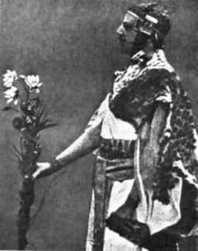

# 金色黎明：现代仪式魔法如何成为一个综合体系？

> 定稿，2026 年 11 月 16 日经 PO 批准封存。

1888 年 3 月前后，伦敦。三个人——Westcott、Mathers 和 Woodman——给“Isis-Urania 第三号神殿”签发了特许状，收下了第一批成员。据 R. A. Gilbert 对教团名册的研究：到 3 月底已有九人入会，7 月又添了 17 人，年底达到 55 人。[^1]

这个教团叫“金色黎明赫尔墨斯秘密教团”（Hermetic Order of the Golden Dawn）。[^2]

它有一份“官方历史”，是这样讲自己的来源的（据 Gilbert 的转引）：生命树体系的根基，“与密文手稿里的原样相比，没有被触动，也没有被改变”；这些手稿，“在几年前，由一位极其杰出、得到启示的赫尔墨斯学者（已故）”交给了 Westcott；后来，德国的一位“Sapiens Dominabitur Astris”（即 Anna Sprengel）批准他们在英格兰扩展教团。[^1]

Gilbert 对这段话的评语是：它“既不准确，也不诚实”；教团诞生的真相，“大概永远不会被完全知道”，但现存的证据，足以给出一个比它更可靠的说法。[^1]

这一课要问的是：**一个 19 世纪末的新组织，怎样把许多时代、许多来源的符号和文件，编成一个看起来前后一致的体系，并让这个体系显得古老？**先从它最关键的那份文件说起。

先说明：这一课**不是仪式魔法的手册**。不会写任何仪式的步骤，也不判断它有没有效。



## 一、一份来历不明的“古老文件”

关于这份“密文手稿”，要分四种东西看：

**1. 留下来的**

- 手稿本身存在。据一份网上汇编转引的描述，它大约 60 页，写在棉纸上，用一种简单的替换密码写成，里面有入会仪式的纲要和草图［已核：二手转引；待核］。[^3]
- 教团的特许状和名册，使 Gilbert 能够给出 1888 年成立和发展的时间表（见上）。[^1]
- Wheeler 在脚注里指出：所谓 Sprengel 的“神秘座右铭” *Sapiens Dominabitur Astris*，出现在 Anna Kingsford 1886 年出版的 Weigel《占星神学》一书的扉页上。[^4]

**2. 当事人说的**

- 手稿由一位已故的、杰出的赫尔墨斯学者交给了 Westcott（Gilbert 推测指的是牧师 Woodford）；[^1]
- Westcott 写信给德国的 Anna Sprengel，她用德文回信，授权他在英格兰建立神殿，后来又“提升”了三位首领的等级；1890 年 8 月，Westcott 称自己收到了她去世的通知。[^1]

这些，都是 Westcott 一个人的说法。Gilbert 指出，Westcott 写给她的信没有留存。[^1]

**3. 学者的解释**

- **Gilbert（1987）**：1886 或 1887 年，一批密文手稿到了 Westcott 手里，“可能来自 Woodford，但最终来自在共济会大厅（Freemasons’ Hall）里翻出来的文件”；他还指出：Westcott 本人是手稿原作者，这种可能性仍然存在；但无论如何，他“无疑”在手稿里添上了一位德国“大师”的地址；这位“Sprengel”是“虚构”的，而她的“去世”，是由“她的创造者”早已决定了的。[^1]
- **Wheeler（2019）**：手稿的来历“已经证明是一个谜”；研究者指出，其内部证据显示，它不可能在被“发现”前很久才写成；一种看来合理的推测是，它由神秘学者 Kenneth Mackenzie 为教团的前身“八人会”写成。没有人能查到 Anna Sprengel 这个人；她与 Westcott 的通信，连同手稿里最初提到她的那一页，“几乎可以肯定”是 Westcott 伪造的，或是他让人伪造的；“Anna”这个名字，很可能来自 Anna Kingsford。手稿里的等级制度，似乎是抄自 SRIA 的结构。[^4]

**4. 没有解决的**

- 手稿是谁写的：Mackenzie？Westcott？别人？现有的证据，没有定论；两位学者给出的方向，也不完全一样。
- 手稿怎样到了 Westcott 手里：Woodford？共济会大厅里的文件？某个旧书摊？都是推测。
- Sprengel 的“授权”，没有任何独立的证据；学者们认为信是伪造的，但那是推论，不是出自某份供词。


这里有一个很要紧的观点，来自 Wheeler：对我们来说，**最重要的不是手稿的来历是什么，而是它的来历“被遮住了”。**一份来历说不清的文件，加上一条通向“古老德国大师”的线，成了教团的“宪章神话”：手稿提供了仪式，Sprengel 提供了谱系；这样，创始人们就可以声称，自己是在**继承**一个古老的传统，而不是**创造**一个新的。[^4]

**一份来历有争议的文件，也可以帮一个组织建立权威。**这和前几课（玫瑰十字、共济会）一脉相承：**起源的叙述，是组织的材料，不是它的历史。**


## 二、一座三层的房子

教团的结构，是它“显得古老”的一个来源。

据百科条目，它分三层：[^2]

- **外层**：入门者从低到高，名字用拉丁文，每一级对应生命树上的一个位置，例如“Neophyte 0=0”“Zelator 1=10”……“Philosophus 4=7”；
- **内层**：成员称为 Adeptus（“有成就的人”），也有几个等级；
- **第三层**：据说是“秘密首领”的层，是教团的权威来源，在世的成员不在其中。

等级的名称和结构，据说借鉴了英格兰玫瑰十字学会（SRIA）的等级；三位创始人——Woodman、Westcott、Mathers——都是共济会员。[^2] 内层有一个名字，叫“红玫瑰与金十字会”，用了玫瑰十字的象征（07-01）。

于是，**一个新建的组织，借用了两个旧组织的形式：共济会的等级、玫瑰十字的象征。**这并不是造假：借用，是一个组织学习怎样做组织的常见办法。但它有一个后果：**形式一旦是旧的，内容也就显得是旧的。**

## 三、三种“卡巴拉”

教团自己的核心，是一个叫“卡巴拉”的体系。这里很容易把三件事混在一起：


- **犹太卡巴拉**，是犹太教内部的神秘传统，有自己的经典、师承和社群（04-04）；
- **基督教卡巴拉**，是文艺复兴的基督教学者，如 Pico 和 Reuchlin，把卡巴拉的概念拿到基督教的神学和哲学里重新解释（04-05）；
- **赫尔墨斯卡巴拉**（常写作 Qabalah，以示区别），是 19 世纪西方秘传圈里的一种综合。据百科条目，它的特点是“更混合”：把生命树的十个质点，同行星、元素、神名、塔罗牌等许多对应联系起来。[^2]

对这一课，要紧的是：**这三个名字，每一层都在重新解释上一层。**说金色黎明的对应是“古代的卡巴拉”，是把第三层的东西，说成了第一层。

金色黎明还把别的材料也接了进来：John Dee 的以诺语（04-07）；据百科条目，还有东方宗教的概念。[^2] 这是“综合”的另一半：**不只借形式，也借材料。**

## 四、对应表，为什么看起来很“一致”

教团的核心工具，是一张张“对应表”：每一个希伯来字母，对应一个元素或行星，一张塔罗牌，一条生命树上的路径，一种颜色、一个神名……

这样的表，有一种很强的说服力：**每一格都与其他几格“咬合”着。**你问“空气”，表里就有字母、牌和路径；你问“愚者”，表里又给出字母和元素。表越大，越像一个“发现”，而不像一个“安排”。

但这样的一致，有两种来源：

- 这些联系**原本就在那里**；
- 有人把**来自不同时代、不同传统的联系**，**排在同一张表里**，并**调整了某些位置**，使它们彼此合拍。

以字母 Aleph 为例：


- 据一般性说明，《形成之书》（Sefer Yetzirah，年代有争议）把三个“母字母”——Aleph、Mem、Shin——同空气、水、火联系起来［已核：二手，一般性说明；待核］。[^5]
- 19 世纪中叶，Lévi 把希伯来字母同塔罗牌联系起来。据 Westcott 的英译本注释，Lévi 说“魔术师”这第一张牌的形象，像字母 Aleph。[^6]
- 金色黎明，则把 Aleph 配给“愚者”，同时配给空气；据一些概述，Mathers 还对调了“力量”和“正义”两张牌的位置，使它与星座的次序合拍［待核］。[^5]
- 最早的塔罗牌，是 15 世纪的游戏牌，那时没有任何字母的对应（下一课）。

**同一个字母，在不同的时代、不同的来源里，被联系到不同的东西。**金色黎明的做法，是在这些联系里**选择**、**调整**，再**合成**一张表。

用符号学的话说：它创造的，是一个**新的“代码”**：每一个符号的意义，不再来自它自己的传统，而来自它在这张表里的位置。**表里每一格的合理性，是由整张表担保的。**

## 五、之后的教团

教团的历史，很快就变得复杂。据百科条目：[^2]

- 成员最多时，大约有一百来人；包括 Annie Horniman、W. B. Yeats、A. E. Waite，后来还有 Aleister Crowley。
- 1899 至 1900 年间，伦敦的成员因对 Mathers 的领导不满而分裂；1903 年，教团分成几个团体，如 Waite 的 Isis-Urania 和 Felkin 的 Stella Matutina。
- 此后出现了许多自称继承它的现代团体；它们的做法，各不相同。

要特别留意：**今天的“金色黎明体系”，并不是 1888 年的那个组织原样。**一些后来的版本，把“秘密首领”当作象征，而不是实在的人。[^2] 书里流传的那些对应表，大多出自后来的整理与出版。

## 六、动手：这个联系，有来历吗？

下面是一些关于字母 Aleph 和塔罗牌的句子。请判断：每一句，是**早期文本里有的**，**19 世纪新加的**，**金色黎明重排的**，还是**没有证据的**？

```widget
{
  "type": "tagger",
  "caption": "句子是本课根据读到的材料改写的，涉及的几项联系，有的据一般性概述，没有读原著，已在注中标明。目的是练习分清：一个联系，是早已有的、后来才加上的、教团自己重排的，还是根本没有证据。有的句子身兼几种，只标最突出的一种",
  "labels": [
    { "name": "早期文本里有", "hint": "有较早的文本记录" },
    { "name": "19 世纪新加", "hint": "出现在 Lévi 一类的 19 世纪作者那里" },
    { "name": "金色黎明重排", "hint": "教团把几个来源合成、调整" },
    { "name": "没有证据", "hint": "现有材料不支持" }
  ],
  "docs": [
    {
      "tab": "字母与牌",
      "src": "据本课读到的 Westcott 译 Lévi 的注释和二手概述",
      "segs": [
        { "t": "Aleph 是三个“母字母”之一，与空气联系。", "ans": 0, "why": "这是《形成之书》的一般性说法；它的成书年代有争议，本课没有读原文。" },
        { "t": "第一张塔罗牌“魔术师”的形象，像字母 Aleph。", "ans": 1, "why": "这是 Lévi 的说法（据 Westcott 译本注），属于 19 世纪。" },
        { "t": "Aleph 配“愚者”，同时配空气。", "ans": 2, "why": "这是金色黎明的安排：把字母、元素和牌放进同一张表里。" },
        { "t": "塔罗牌在 15 世纪被设计出来，就是为了编码希伯来字母。", "ans": 3, "why": "没有任何材料支持；15 世纪的塔罗牌，是游戏牌。" }
      ]
    },
    {
      "tab": "关于对应表",
      "src": "据本课读到的二手概述",
      "segs": [
        { "t": "字母和塔罗的配对，在 19 世纪中叶的 Lévi 那里开始大量出现。", "ans": 1, "why": "据百科条目对 Lévi 的概述；本课没有读到更早的系统配对，也没有核对 Lévi 的原文。" },
        { "t": "Mathers 调换了“力量”和“正义”两张牌的次序，使它与星座合拍。", "ans": 2, "why": "这是一些概述里的说法，是教团内部的调整；本课没有读到 Mathers 的原文，需要核对。" },
        { "t": "密文手稿证明，这些对应是古代传下来的。", "ans": 3, "why": "手稿的来历不明；即使它很老，也不能证明上面的对应有古代的来源。" }
      ]
    }
  ]
}
```

练习的要点：**一张表里的每一格，都可以问：这一格，是谁、在什么时候、凭什么放进去的？**

## 七、与前面几课的联系

- 与**卡巴拉**（04-04、04-05）：金色黎明用的是第三层的“赫尔墨斯卡巴拉”，不是犹太教自己的传统。
- 与**以诺语**（04-07）：它把 Dee 的天使语言也接了进来。
- 与**玫瑰十字**（07-01）：借用了玫瑰十字的象征与“古老兄弟会”的叙述方式。
- 与**共济会**（07-02）：借用了等级与入会的形式。
- 与**神智学**（07-04）：几乎同时的另一个运动。据 Gilbert，Westcott 设计教团的仪式誓词时，参照了神智学会会员的誓词，而且神智学会“几乎可以肯定”给了他与“秘密首领”通信的想法；这是 Gilbert 的解释，本课没有读到教团自己承认这一点的文件。[^1] 所以两者不是“毫无关系的平行”，也不是“一条直接的传承线”：更像是后来者借用了前者的模式。

最后一个问题，留给下一课：**对应表里那一张张“牌”，原来是做什么用的？**一副 15 世纪意大利的游戏牌，是怎样一步一步，变成这张表里的格子的？

[^1]: R. A. Gilbert, *The Golden Dawn and the Esoteric Section*，伦敦神智学历史中心（Theosophical History Centre），1987 年；是 1987 年 7 月首届国际神智学历史会议上宣读的论文。我读的是该机构网站（theohistory.org）上的 PDF，读了关于教团起源、手稿、Sprengel 与早期成长的部分［已核：二手，学术论文，直接读到］。教团“官方历史”的引文（Westcott 的叙述）；Gilbert 对它“不准确、不诚实”的评语；1886 或 1887 年手稿到 Westcott 手中，“可能来自 Woodford，最终来自共济会大厅翻出的文件”；Westcott 可能是原作者；Sprengel 的“回信”“授权”“去世”由 Westcott 一人转述，去信没有留存；1888 年 3 月前完成各级仪式、签发 Isis-Urania 特许状；3 月底九人入会、7 月再加 17 人、年底 55 人；Westcott 的模型来自 Hermetic Society、SRIA 与神智学会（神智学会很可能给了他与“秘密首领”通信的想法），均据此。本课没有读该文的注释所列的原始档案。
[^2]: 英文维基百科“Hermetic Order of the Golden Dawn”和“Hermetic Qabalah”条目［已核：二手，百科，仅作线索；其中“创立”一节有清理标记，若干说法没有引文；待核］。三层结构与等级；与 SRIA 的关系；成员；1899–1903 年的分裂；后来的团体；赫尔墨斯卡巴拉的概述，均据此。条目对 Lévi 的叙述，标有“需要引文”；条目引了 Hanegraaff（2010）的论文作进一步阅读，本课没有读。
[^3]: 一份网上汇编（hermetic.com 的 Cipher Manuscript 资料，Internet Archive 上有扫描的文本），其中转引了 Ellic Howe 1972 年在 *Ars Quatuor Coronatorum* 上的文章和 Gilbert 为 *The Golden Dawn Scrapbook* 写的导言；汇编者还加了评论［已核：二手，转引；汇编者的评论不作依据；待核］。仅用来描述手稿的外形（约 60 页、棉纸、替换密码）；其中关于 Woodford 的信和谈话笔记的细节，以及 Gilbert 关于 Mackenzie 遗孀的说法，本课没有再用，因为 Gilbert 1987 年的论文（注 1）给出的说法不同，我没有读到那几处的原始出处。
[^4]: G. J. Wheeler, “The Finding of Hidden Texts in Esoteric and Other Religious Traditions: Some Notes on ‘Discovery Narratives’”, *Correspondences* 7, no. 2 (2019)。我读的是期刊网站上的预印本 PDF，读了关于金色黎明的一节、SRIA 一节和结论中相关的段落［已核：二手，同行评议期刊的研究论文，直接读到］。手稿的来历是个谜；内部证据显示它写成不久；一种合理的推测是它出自 Mackenzie 为“八人会”所写（Wheeler 引的是 Gilbert 的 “Provenance Unknown” 一类文章，本课没有读）；Anna Sprengel 查无此人，通信“几乎可以肯定”是 Westcott 或其授意者伪造；“Anna”之名可能来自 Anna Kingsford，座右铭出现在 Kingsford 1886 年版 Weigel《占星神学》的扉页；手稿里的等级似乎抄自 SRIA；“宪章神话”的分析；Zanoni（1842）的类比，均据此。Wheeler 的重点是“发现叙事”这一模式，金色黎明只是其中一个例子。
[^5]: 关于《形成之书》三个母字母、金色黎明把 Aleph 配“愚者”与空气、Mathers 对调“力量”与“正义”，我读到的是检索得到的概述，来源多是塔罗爱好者与教学网站，不是学术专著［已核：二手，业余网站，质量参差；待核］；本课没有读《形成之书》原文，也没有读 Mathers 的 *The Tarot*（1888）或 *Book T*。
[^6]: *The Magical Ritual of the Sanctum Regnum, Interpreted by the Tarot Trumps*，Éliphas Lévi 的手稿，Westcott 译注的英译本，我读到的是 Internet Archive 上 BYU 的扫描本的 OCR［已核：二手，译本；出版年份没有核对；OCR 有错字］。译者注：第一张牌 Le Bateleur（魔术师），Lévi 在另一部著作里说它的臂和身体像希伯来字母 Aleph；本课没有读 Lévi 的法文原文。

## 参考与出处

- R. A. Gilbert, *The Golden Dawn and the Esoteric Section*, 1987。[PDF](https://theohistory.org/wp-content/uploads/2017/10/r_a_gilbert-the_golden_dawn-1987.pdf)
- G. J. Wheeler, “The Finding of Hidden Texts…”, *Correspondences* 7.2, 2019。[PDF](https://correspondencesjournal.com/wp-content/uploads/2019/07/18602_20537158_wheeler.pdf)
- “Golden Dawn Cipher Manuscript”资料汇编（含对 Howe 的转引，仅用于手稿外形）。[Internet Archive](https://archive.org/stream/EllicHowe-TheGoldenDawnCypherManuscrit/EllicHowe-TheGoldenDawnCypherManuscrit_djvu.txt)
- “Hermetic Order of the Golden Dawn”，维基百科。[条目](https://en.wikipedia.org/wiki/Hermetic_Order_of_the_Golden_Dawn)
- “Hermetic Qabalah”，维基百科。[条目](https://en.wikipedia.org/wiki/Hermetic_Qabalah)
- Éliphas Lévi, *The Magical Ritual of the Sanctum Regnum*（Westcott 译）。[Internet Archive](https://archive.org/details/magicalritualofs00lvie)
- 引文说明：英文引文是对转引材料的汉译，由本课所作；本课不复述任何仪式的步骤。
