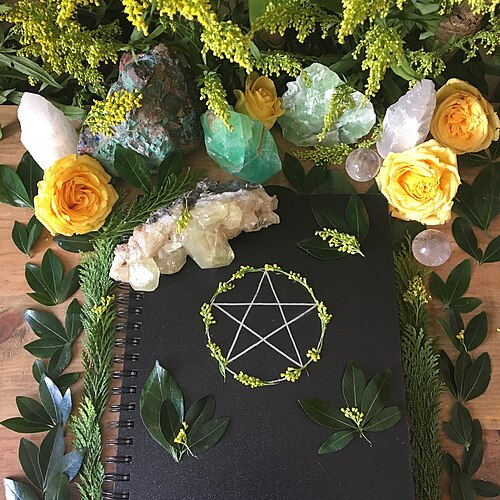

# Wicca 与现代异教：现代传统如何形成？

> 定稿，2026 年 11 月 16 日经 PO 批准封存。

1899 年，美国人 Charles Godfrey Leland 出版了一本小书，叫《阿拉迪亚，或女巫的福音》（*Aradia, or the Gospel of the Witches*）。书里有一段英译的训示，说话的是女神狄安娜的女儿阿拉迪亚：

“当我离开这个世界之后，每逢你们有所需要，每月一次，月圆的时候，你们要在某个荒僻的地方聚会……崇拜你们的女王，我的母亲，伟大的狄安娜……你们将从奴役中解脱出来……作为你们真正自由的标志，你们在礼仪中要赤身。”[^1]

半个世纪之后，英国的一些小团体，在月圆的夜里，也念着一段结构几乎相同的话：“每逢你们有所需要，每月一次，最好在月圆的时候……”它被称为《女神的训示》（Charge of the Goddess）。据百科条目对研究者的转述，这篇训示的第二段，大部分来自《阿拉迪亚》。[^2]

同一段话，从 1899 年意大利乡间的“民俗采集”，走进了 20 世纪中叶英国的宗教仪式。**它被谁改了，被谁用，意思有没有变？**

这一课要问的是：**一个现代宗教，怎样借用更早的符号、文本和传说，造出自己有意义的宗教身份？“它是新造的”和“它对信徒有意义”，是不是一回事？**


先说明：这一课**不讲任何入会仪式的步骤**，也不判断 Wicca 的信仰对不对。要做的，是把**历史怎么回事**和**它今天意味着什么**，分开。



## 一、先看一个案例：一段话的旅行

这段训示的几次出场，据百科条目对 Heselton、Hutton 等研究的转述，大致是这样：[^2]

- **Leland（1899）**：书里的一段英译，来自他的意大利“线人”；他说那是托斯卡纳乡间女巫传统的遗留。（Leland 的材料到底有多少真实的民间来源，学界另有争论，本课没有读到。）
- **Gardner（1940 年代末）**：已知最早的版本，出现在他的一份手稿《魔法艺术之书》里；据条目，他的版本混入了 Crowley 的《法之书》等材料。
- **Valiente（1950 年代中期）**：Doreen Valiente 入教之后，不喜欢 Crowley 的影响，先后写了诗体和散文体两个版本。
- **后来的传统**：各自再改，如 Starhawk 参与创立的 Reclaiming。


看这条线，要注意**哪一步有文本可查，哪一步只是转述**。第一格，我读到了 Leland 的原书。后几格，我读到的是百科条目，条目转述了 Heselton 和 Hutton 的研究；这些研究的原著，我没有读。**所以，要说“同一段话换了场合，意思也换了”，可以；要精确说每一步改了哪个词，这一课不替它们担保。**

这就是**再语境化**：同一串词，在 1899 年的书里，是一个外国学者“记录”的乡间传说，里面的“摆脱奴役”，针对的是旧世界的压迫；在 20 世纪中叶的英国小团体里，它成了仪式里由主持者念出的、面向参加者的训示。词没有大变，**谁在念、对谁念、为了什么念，变了。**

## 二、为什么 20 世纪中叶的英国，会有人信“女巫宗教幸存”

要知道 Gardner 的话为什么有人信，得先看当时的学界。

英国历史学家 Ronald Hutton 在 2025 年 5 月的一次公开讲座里，给了一条线索：[^3]

- 18 世纪的启蒙运动让欧洲的统治者相信，巫术并不存在；这就意味着过去三个世纪处决“女巫”，是一场可怕的错误。
- 拿破仑倒台之后，德国的一些保守派学者回应说，那些“女巫”仍然该死，因为她们是一个血腥堕落的、幸存下来的异教的信徒。
- 法国和美国的共和派自由主义者，接过了“有一个幸存的异教”这个想法，却说它是一个**好**宗教：尊重女性、自然和自由，同压迫的贵族与教士对抗。
- 20 世纪初，这个说法在英国被热情接受；到世纪中叶，被一些著名的中世纪和近代早期史专家，当作正统观点，写进了教科书。

其中一位关键的人物是 Margaret Murray：她 1921 年的《西欧的女巫教团》提出了“女巫宗教幸存”的假说。后来，她还给 Gardner 的书写了导言。[^4]

于是，**1950 年代，有人声称“我见过这个幸存的宗教”，并不显得荒唐：学术界的权威，已经替这个想法做了铺垫。**

## 三、Gardner 说了什么，留下了什么

按 Hutton：[^3]

- Gerald Gardner 是一位退休的殖民地公务员。他说，1939 年，他在新森林被接纳进一个“最后的女巫团”，学到了它的传统；他现在把它公之于众，是为了传承和保存。他从 1951 年起公开这样宣称。
- 他吸引了许多入教者，这个宗教在 1950 年代传遍英国，1960 年代到了北美。
- 到目前为止，**没有找到能证实他所说的那个女巫团存在的材料**；因此，他本人仍是这个宗教**唯一已知的来源**。Hutton 认为，最可能的是：他和朋友们创造了它，而且在整个 1950 年代，他们一直在发展它。

Gardner 的《今日巫术》（*Witchcraft Today*），1954 年 11 月由 Rider 出版，Murray 写了导言；据 Hutton 的评论（经百科条目转述），Gardner 在书里把自己写成一个超然的人类学家，没有说明自己已经入教，还在带领自己的团体。[^4]

这就是一个典型的**创始人的声明**：它是一个重要的**证据**，说明他**这样说**；但没有第二个独立的证据，不能直接当成**事实**。

## 四、既是“拼合”，又是“新创”

Hutton 对早期仪式的概括，值得照录：它的早期仪式，“处处可见”是由许多既有的来源拼合而成的；但也有一些**它独有的重要特征**，使它成为一个有特色、能存活的宗教体系。[^3] 例如：

- 它既不是一神教，也不是古代的多神教，而是尊奉一对神圣的伴侣——一位女神和一位男神，代表宇宙创造与维持的力量；其中**女神更重要**；
- 它以小团体（coven）为单位，由一位女祭司和一位祭司主持，其中**女祭司更重要**；
- 它有自己的来世观：一起生活过的人，可能一同转世；
- 它不是“崇拜”神，而是把神“邀请”到圈子里，像对待朋友一样与之共事。

这几条里，有的有更早的来源，有的是新的。**没有一条，要靠“古老”来成立。**

最近，剑桥大学出版社的一本小书（John Callow，2025）也说，Gardner 在殖民地马来亚的早年经历，和他对东方、西方多种传统的综合，是理解 Wicca 的关键；它还把“去掉魔鬼的成分”看作 Gardner 的创造之一。[^5] 我只读到该书的摘要，书的内容本课没有读。

## 五、两种错误的结论

到这里，容易出现两个都不对的结论：

- **“Wicca 是一个有文献可证、原样传下来的古代宗教。”**——没有这样的证据。到现在，连 Gardner 说的那个女巫团都没有被证实；他的宗教，是现代的。
- **“既然它的现代历史能被重建，它就没有任何真正的宗教意义。”**——这是另一种混淆：**一个宗教是什么时候、怎样形成的，和它对今天的信徒意味着什么，是两个不同的问题。**


Hutton 说得很明白：从 1970 年代起，历史学家系统研究猎巫案，证明那些被告并不是一个幸存的异教的信徒；这使 Wicca 的**奠基神话**崩塌了。可是，这个宗教**活下来了**：它是“一个有活力、成功的新宗教，特别适合激进的晚期现代”。原因，他列了几条：女权主义（女巫是传统欧洲文化留下的、很少的“独立的女性力量”形象之一）、环境主义（崇尚神圣的自然）、个人表达与自我实现。[^3]

信徒自己怎么看？据维基百科对 Hutton《月亮的胜利》（1999）反响的概括：书在异教圈子里反应不一，有人欢迎，有人批评（一位实践中的 Wiccan 认为 Hutton 太早放弃了“古老传统的延续”这个可能性；2010 年还有一本批评的《月亮的审判》）；有的评论还说，不少女巫今天把“古老宗教”当作一个比喻，或一个奠基神话。[^6] 这些，是二手的概括，**不能代表所有信徒**。

此外，Wicca 只是现代异教的一支。Hutton 称它是现代异教巫术“最古老、影响最大的传统”；[^3] 据美国“异教徒普查”（1993–1995 年，两千多名受访者）的介绍，“新异教”是一个伞状的名称，Wicca 是其中最大的一支；[^7] 此外还有德鲁伊、北欧异教等，各有自己的历史和信仰，不能都说成 Wicca。

## 六、动手：这一句，属于哪一类？

下面是一些关于 Wicca 起源和意义的句子。请判断：每一句，属于**历史文献**、**创始人的说法**、**后来的学术**、**当代信徒的理解**，还是**不能由此推出**？

```widget
{
  "type": "tagger",
  "caption": "句子是本课根据读到的材料改写的，没有引用任何入教仪式。分类是本课的判断。目的是看清：关于“它从哪里来”和“它意味着什么”的说法，来自不同种类的证据，不能互相代替。有的句子身兼几种，只标最突出的一种",
  "labels": [
    { "name": "历史文献", "hint": "有出版记录或原书可查" },
    { "name": "创始人的说法", "hint": "Gardner 等人自己怎样说" },
    { "name": "后来的学术", "hint": "历史学家的研究和结论" },
    { "name": "当代信徒的理解", "hint": "今天的参与者怎样看" },
    { "name": "不能由此推出", "hint": "现有材料不足以说" }
  ],
  "docs": [
    {
      "tab": "起源",
      "src": "据 Leland（1899）、Hutton（2025）和百科条目",
      "segs": [
        { "t": "1899 年，Leland 出版《阿拉迪亚》，里面有一段月圆聚会、脱离奴役的训示。", "ans": 0, "why": "这是一本可以读到原书的出版物，本课读到了它的英译。它只能证明这本书这样说，不能证明里面所说的“女巫传统”确有其事。" },
        { "t": "Gardner 说，他在 1939 年被新森林的一个女巫团接纳。", "ans": 1, "why": "这是创始人自己的说法，没有第二个独立的来源证实它。" },
        { "t": "到目前为止，没有找到能证实那个女巫团存在的材料。", "ans": 2, "why": "这是 Hutton 对现有证据的评估；它说“没有找到”，不是“证明不存在”。" },
        { "t": "Wicca 是一个原样传下来的古代宗教。", "ans": 4, "why": "现有材料不支持；甚至连 Gardner 的消息来源，也只有 Gardner 自己。" },
        { "t": "《女神的训示》的第二段，大部分来自《阿拉迪亚》。", "ans": 2, "why": "这是研究者经百科条目转述的比对结论；《阿拉迪亚》的原书可以读到，后来文本的逐句比对，本课没有读到。" }
      ]
    },
    {
      "tab": "意义",
      "src": "据 Hutton（2025）、百科条目对反响的概括",
      "segs": [
        { "t": "从 1970 年代起，历史学家证明，被告并不是一个幸存的异教的信徒。", "ans": 2, "why": "这是后来的学术结论；它拆掉了“幸存的异教”这个奠基神话。" },
        { "t": "Wicca 的奠基神话崩塌之后，这个宗教仍然继续发展，吸引新的信徒。", "ans": 2, "why": "这是 Hutton 的概括：宗教的活力，不靠“古老”来保证。" },
        { "t": "有的 Wiccan 把“古老宗教”当作一个比喻或奠基神话，而不是字面的历史。", "ans": 3, "why": "这是对信徒态度的二手概括，不代表所有信徒；也有信徒不同意 Hutton。" },
        { "t": "既然它的现代历史能被重建，它对信徒就没有任何宗教意义。", "ans": 4, "why": "历史起源和今天的宗教意义，是两个问题；前者的证据，回答不了后者。" }
      ]
    }
  ]
}
```

练习的要点：**“它是什么时候怎样形成的”的证据，和“它对今天的人意味着什么”的证据，不是同一种。**

## 七、符号怎样“站住”

回头看这一课的主角：一个训示、一个圈子、一位女神、一个“古老宗教”。

- **符号**：一段话（训示）、一个仪式空间、一对神。
- **谁来解释**：创始人 Gardner，改写的 Valiente，每个团体的女祭司和祭司。
- **约定**：团体的实践和传承，而不是一本固定的教义。
- **权威**：起初靠“古老传承”的声称；这个声称被学术否定之后，靠团体的实践、信徒的经验和一代代的传承继续。
- **再语境化**：从意大利乡间的“记录”，到英国的仪式。

**权威的来源变了，宗教没有消失。**这是一个很好的例子，说明：一个符号系统，可以靠声称“古老”起家，再靠它自己的实践站住。

下一课，我们走到这个光谱的另一头：混沌魔法。它不讲传承，也不讲古老，而是把“信念”和“符号”本身，当作可以拿来试验的东西。

[^1]: Charles Godfrey Leland, *Aradia, or the Gospel of the Witches*，1899 年；我读的是 Internet Archive 上的扫描本的 OCR 文本（条目 aradiaorgospelof00lela）［已核：原始印本的转录，读了这一段训示的英译；OCR 有错字］。引文的汉译为本课所作。书中的“线人”、女巫传统的真实性，学界有争论，本课没有读到那些研究。
[^2]: 英文维基百科“Charge of the Goddess”条目［已核：二手，百科条目，仅作线索；它转述了 Heselton、Hutton 等的研究］。Gardner 手稿《Ye Bok of Ye Art Magical》中最早的版本（1940 年代末）；《阿拉迪亚》是第二段的主要来源；Gardner 版本中的 Crowley 材料；Valiente 1950 年代中期的两个版本；Reclaiming 等后来的传统；Hutton 对“Leviter Veslis”一词的解释，均据此；条目没有给出逐句比对。本课没有读 Heselton 的原著，也没有读 Valiente 的《巫术的重生》。
[^3]: Ronald Hutton，“Modern Pagan Witchcraft”，格雷欣学院（Gresham College）讲座文稿，2025 年 5 月 14 日［已核：二手，学者本人的讲座文稿，读了全文（约一页）］。启蒙运动与“幸存的异教”的说法；20 世纪中叶的学界正统；Gardner 的声明（1951 年起）；新森林女巫团“至今没有找到证实”；早期仪式的“拼合”与独有特征；奠基神话的崩塌与新宗教的活力，均据此。这是一篇讲座文稿，本课没有读他的专著《月亮的胜利》。
[^4]: 英文维基百科“Witchcraft Today”条目［已核：二手，百科条目，仅作线索］。Rider 公司 1954 年 11 月出版，Murray 写导言；Gardner 以超然的人类学家的姿态写作（Hutton 1999，第 206 页，经条目转述）；Heselton 的评价；“女巫宗教幸存”的假说被描述为已被否定。Murray 的《西欧的女巫教团》（1921），本课没有读。
[^5]: John Callow，*Gerald Gardner and the Creation of Wicca*，剑桥大学出版社“Elements in Magic”丛书，2025 年 10 月［已核：二手，只读到出版社网页上的摘要］。摘要说，Gardner 早年在殖民地马来亚的经历，他对东西方多种魔法传统的综合，以及“去掉魔鬼成分”。本课没有读该书的正文。
[^6]: 英文维基百科“The Triumph of the Moon”条目中关于反响的部分［已核：二手，百科条目；其中关于“把‘古老宗教’当作比喻”的说法，来自条目引用的一篇书评，待核］。异教圈子里反应不一；一位实践中的 Wiccan 的批评；2010 年的《月亮的审判》。
[^7]: Helen A. Berger、Evan A. Leach、Leigh S. Shaffer，*Voices from the Pagan Census: A National Survey of Witches and Neo-Pagans in the United States*（南卡罗来纳大学出版社，2003）的出版社与目录介绍［已核：二手，只读到介绍；没有读正文］。调查 1993–1995 年进行，两千多名受访者；“新异教”是伞状名称，Wicca 是最大的一支。本课没有读该书的具体数据，也没有引用任何比例。

## 参考与出处

- Ronald Hutton, “Modern Pagan Witchcraft”, Gresham College, 2025 年 5 月 14 日。[文稿](https://www.gresham.ac.uk/sites/default/files/transcript/2025-04-28_1425_Hutton-T.pdf)
- Charles G. Leland, *Aradia*, 1899。[Internet Archive](https://archive.org/details/aradiaorgospelof00lela)
- “Charge of the Goddess”，维基百科。[条目](https://en.wikipedia.org/wiki/Charge_of_the_Goddess)
- “Witchcraft Today”，维基百科。[条目](https://en.wikipedia.org/wiki/Witchcraft_Today)
- John Callow, *Gerald Gardner and the Creation of Wicca*, 2025。[出版社页面](https://www.cambridge.org/core/elements/abs/gerald-gardner-and-the-creation-of-wicca/3A84FE399D63CEA37C363E1DEB380E75)
- 引文说明：英文引文是 1899 年的印本，汉译为本课所作；本课不复述任何入教仪式。
