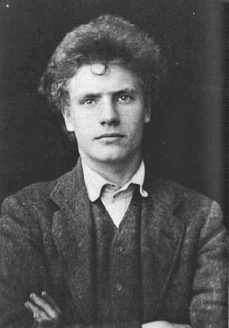

# 混沌魔法：当信念和符号本身成为实验对象

> 定稿，2026 年 11 月 16 日经 PO 批准封存。

1978 年，英国。一本小册子，在一个小团体里流传，书名叫《Liber Null》，作者署名 Peter J. Carroll。

书里有一页，讲一种叫“sigil”的东西。它先说了一个很日常的困境：

“光是‘想要’，很少有效，因为意志会和头脑展开对话……欲望变成自我的一部分，头脑开始担心失败……常常，想要的结果，要等到它被忘掉的时候才出现。”[^1]

接着，它给出了一个办法：做一个“欲望的字形”，“风格化到不会一眼就让人想起那个欲望”；然后让自己把它忘掉。作者说：“sigil 之所以有效，是因为它刺激意志在潜意识里工作，绕开头脑。”[^1]

我们来问：**这页纸上，什么是符号？谁说它有效？有效是什么意思？**

这一课要问的是：**当一个符号系统，把“信念”“解释”和“有意造出来的符号”，都当作可以拿来试验的工具，会发生什么？“试验”得出的“结果”，能证明什么？**

先说明：这一课**是描述和分析，不是操作指南**。不会写怎样做 sigil、怎样“充能”，也不教任何人去影响别人。关于 sigil，我只转述参与者的理论，和这些理论能不能被检验。



## 一、一个很年轻的传统

先看时间。

混沌魔法，据学者 Colin Duggan 的概述，是 20 世纪的一个秘传运动，在 1970 年代末由 Peter Carroll 的《Liber Null》和 Ray Sherwin 的《结果之书》（1978）奠定理论与实践的基础；1980 年代中期，又有第二批作者批判性地评价这一运动，使它进入对 20 世纪秘传的学术讨论。他还指出，这方面的学术研究很少，现有的研究常缺乏进一步研究所需要的方法和术语。[^2]

Carroll 自己的 1987 年合订本（Weiser 出版社）的致谢里写道：Ray Sherwin 在 1978 年帮他把《Liber Null》的第一版提供给“Illuminates of Thanateros”（IOT，一个团体）的学生，并在 1981 年与他一起做了修订。[^1]


据一篇 2025 年发表在《Aries》杂志上的文章（我只读到摘要的转述），1978 年的初版里，“混沌”这个词几乎没有出现；到 1981 年，它已成了关键概念。[^3] 也就是说，**这套理论不是一个现成的体系被“发现”，而是在几年之内，一边写一边成形的。**

这一点要记住：下面所谈的，是 Carroll 1987 年版的说法。

## 二、“sigil”这个词，两种东西

“sigil”（印记、封印）这个词，在魔法史里早就有。

据维基百科对它的概述：中世纪的魔法里，sigil 是某个天使或魔鬼的符号；《所罗门小钥匙》一类的魔法书，列出了七十二个魔鬼的印记；有的印记，是把灵的名字换成数字、在魔法方阵里连线而得（06-02 讲过方阵）；金色黎明也用这个词，指护符。[^4]

这样的 sigil，有三个特点：

- **由传统规定**：哪个符号属于哪一位灵，写在书里；
- **大家共用**：每个读同一本书的人，认的是同一个图形；
- **作用是辨认或召唤**：它是某一位“灵”的标识。

混沌魔法里的 sigil，是另一种东西。据 Carroll：

- 它是**使用者自己做**的：把一个愿望，变成一个“欲望的字形”；
- 它要**风格化**，不让人一眼想起那个愿望；
- 它做好之后，要**让自己忘掉**；
- 它的作用，是**编码一个愿望**，不是召唤一位灵。[^1]


那么，混沌魔法的 sigil，同 Austin Osman Spare（1886—1956）是什么关系？这里要分清**谁在说**。

**Carroll 自己说了什么。**我直接读到的，有两处：一处在导言里，他说 IOT 是“Zos Kia Cultus 和 A∴A∴ 的魔法继承者”——“Zos Kia Cultus”是后来用来称呼 Spare 一脉思想的名字；另一处是个人叙述，他说自己“开始摆弄 Austin Spare 的‘死亡姿势’和他的 sigil”。[^1] 也就是说，**Carroll 把 Spare 当作自己的来源之一，并且自称是继承者**。这是一个团体对自己谱系的说法，不是独立的历史结论。

**Spare 是谁。**据百科条目，他是伦敦的艺术家：17 岁就有作品入选皇家艺术院的夏季展览；1913 年自费出版《快乐之书》（*The Book of Pleasure*），一般被看作他思想的核心文本；后来陷入贫困，战后几乎被忘记；1956 年去世；1970 年代中期他重新被人注意。条目还说，Kenneth Grant（1949 年起是他的朋友）后来让他的遗产保持了影响。[^5] 据另一个条目，Spare 不同意中世纪的看法，即灵是外在的存在，认为灵可以说是潜意识里的“情结”，可以通过 sigil 创造出来。[^4]

**两者之间，能说什么。**Spare 在 1956 年去世，22 年之后才有《Liber Null》（1978）；我读到的材料里，没有他们彼此认识的记载，也没有 Spare 用过“混沌魔法”这个词的记载。所以，**不能说 Spare“创立”了混沌魔法**；能说的是：Carroll 把他列为来源，后来的叙述（百科条目也这样写）常把他称作混沌魔法的先驱。[^5] 至于 Spare 的 sigil 想法，经过哪些人、怎样一步步到了 Carroll 和 Sherwin 手里，以及哪些部分是 Carroll 自己的发明，需要看专门的学术研究：Bernd-Christian Otto 2019 年有一章专门讲 IOT（收在《Religious Individualisation》里，第 759–796 页）；**我没能读到它**（出版社的服务器对自动访问只返回空白的验证页），所以本课不转述它的结论［待核］。[^6]

我也没有读到 Spare 的原文：Kent 大学论文附录里的 1913 年扫描，是图片，不能检索。所以，**Spare 自己是怎样说的，这一课不替他说。**

**所以不要把“sigil”看成一条从中世纪传到今天的、没有变过的线。**同一个词，在不同的时代、不同的人手里，是不同的符号，做不同的事。

## 三、“信念”也是一件工具

Carroll 的书里，还有一个更怪的想法：**信念本身，也是可以拿来换的。**

在一章叫“随机信念”（Random Belief）的内容里，他列出了六种信念——从“异教”到“虚无主义（晚期无神论）”——排成一个圈，让读者“试一个星期、一个月或一年”；它还设了一个“骰子选项”，让读者用掷骰子来选。例如，“选项 4：虚无主义”写的是：“物质的因果就是一切……你死的时候，你就死了。”[^1]

用语言的角度看：这是把“世界观”当成一套**可以换的解释框架**，每一套框架，对同一件事给出不同的意义。在 Carroll 的理论里，**“选哪种信念”不是求真，而是“看用哪一种更合适做事”。**书的导言也说：混沌魔法是“一种极为实用的、个人的、实验性的艺术”；其中的技术，不需要任何象征体系，“只需要现实本身”；它的重点，是要让试验的技术起作用，“不管它们的宗教或象征联系”。[^1]

这里要问的是：**当一个人把所有符号系统都当作工具，他用什么来判断，一个工具“有用”？**

## 四、怎样评价“有没有用”

答案是：**自己的经验和记录。**

Carroll 建议，魔法师要留意“所有的巧合”，不要把它们当作偶然一笔勾销；并且在“魔法日记”里记录下来。他接着写：这样做，巧合会变得“多得多”，“多到再说‘巧合’都很荒谬”。[^1]

他还讲了一个自己的经历：他说，自己曾经做了一个想要“得到猫的业”的 sigil，几天之后，在一个昏暗的小巷里，看到一只蹲在门柱上的大猫，在两对眼睛相遇的那一刻，“有什么说不出的东西闪了过去”，他突然像猫一样嚎叫着狂奔，“完全被附身了”。[^1]

我们怎么读这段话？


**第一，这是一条参与者的报告。**它告诉我们：他**经历了**一次很强烈的事，并且用他的理论去**解释**它。作为经验，它是真实的：一个人可以真的有这样的体验。

**第二，报告不是因果的证明。**一个晚上，昏暗的小巷，一只突然出现的猫，一个几天来一直在想的主题，一个已经准备好要体验“动物性”的人——这些，都可能影响他当时的感受。原因有很多种可能：预期、暗示、选择性的注意、事后的追认。**现有的文字，不足以让我们说，是 sigil 引起了它。**

**第三，“多记巧合”的办法，会放大“有效”的印象。**如果只记下和愿望吻合的事，没吻合的就不记，“有效”的比例，看起来就会很高。这不是在说某个人在撒谎，而是说：**一种评价方式，决定了它能看到什么。**

要判断一个符号是不是**造成**了某个结果，研究者需要：事先写下预测、记录所有的结果、并与没有做 sigil 的情形对比。我读到的 Carroll 的段落里，没有看到这样的做法；他要的，也不是这个。他要的是“实用的、个人的”经验。**这两种目的，不矛盾，但不能互相代替。**

所以，这一课的结论，不是“混沌魔法是假的”，而是：**它是一种以意义的制造和个人经验的变化为目标的实践；它所报告的因果，没有被独立证明。**

## 五、一个团体，和一个符号

最后，一个团体的符号。

IOT 的“混沌 sigil”，是它“唯一使用的符号”，作为“辨认的装置”，也作为“成员之间交流的黑暗之镜”（Carroll 书中的图注）。[^1] 这一点值得留意：一个主张“符号只是工具”的团体，也有自己的**团体标志**：它不是用来“施法”，而是用来**认出自己人**。

这同我们前几课看到的是一回事：**一个符号，既可以是个人的工具，也可以是共同体的身份标志；两种功能，可以同时存在。**

## 六、动手：把一次经验拆开

下面的句子，来自 Carroll 书里的几段话，和对这些话的几种读法。请判断：每一句，属于**符号的外形**、**参与者的解释**、**报告的结果**、**其他可能的解释**，还是**研究者能下的结论**？

```widget
{
  "type": "tagger",
  "caption": "句子是本课根据 Carroll 1987 年版的几段话改写的，没有任何操作性的内容。分类是本课的判断。目的是练习分开“符号长什么样”“参与者怎么理解”“他报告了什么”“还有哪些别的解释”和“研究者能说什么”。有的句子身兼几种，只标最突出的一种",
  "labels": [
    { "name": "符号的外形", "hint": "它长什么样、怎样设计" },
    { "name": "参与者的解释", "hint": "参与者的理论" },
    { "name": "报告的结果", "hint": "参与者说发生了什么" },
    { "name": "其他可能的解释", "hint": "别的原因" },
    { "name": "研究者能下的结论", "hint": "在现有证据下能说什么" }
  ],
  "docs": [
    {
      "tab": "一个 sigil 与一只猫",
      "src": "据 Carroll《Liber Null》1987 年版的几段话（改写）",
      "segs": [
        { "t": "sigil 是一个“欲望的字形”，风格化到不会一眼就让人想起那个欲望。", "ans": 0, "why": "这是对符号设计的描述：它的外形，被有意做得“看不出意思”。" },
        { "t": "sigil 之所以有效，是因为它刺激意志在潜意识里工作，绕开头脑。", "ans": 1, "why": "这是参与者的理论，是他用来解释“为什么有效”的说法，不是已经检验过的机制。" },
        { "t": "作者说，他做过一个想“得到猫的业”的 sigil；几天后，在小巷里看到一只猫，突然像猫一样嚎叫着狂奔。", "ans": 2, "why": "这是他自己报告的经验和结果；作为报告，它是真实的材料，但它只是他自己的叙述。" },
        { "t": "那一刻的体验，可能与昏暗的环境、突然的刺激、预期和暗示有关。", "ans": 3, "why": "这是别的可能的解释：它们不需要“sigil 造成了结果”这个假设。" },
        { "t": "现有的文字只能说明，他报告了一次强烈的体验和他的解释；不足以说明是 sigil 引起了它。", "ans": 4, "why": "这是在证据的限度内能说的话：区分“报告了什么”和“证明了什么”。" }
      ]
    },
    {
      "tab": "魔法日记",
      "src": "据 Carroll 对“记录巧合”的说法和本课的分析",
      "segs": [
        { "t": "作者建议魔法师记下所有的“巧合”，并说这样做，巧合会变得越来越多。", "ans": 1, "why": "这是参与者的方法和他的理论：他把“记得更多”解释为“发生得更多”。" },
        { "t": "如果只记下与愿望吻合的事，没有吻合的就不记，“有效”的比例就会看起来很高。", "ans": 3, "why": "这是选择性记录的解释：评价的方式，会影响“有效”的印象。" },
        { "t": "要判断一个符号是否造成了结果，需要事先写下预测、记录所有结果，并与没有做符号的情形对比。", "ans": 4, "why": "这是研究者检验因果需要的条件；个人的日记，一般做不到。" },
        { "t": "个人的报告，说明他怎样理解自己的经验；它本身不能证明超自然的因果。", "ans": 4, "why": "这是在证据限度内的结论：经验是真实的，因果没有被证明。" }
      ]
    }
  ]
}
```

练习的要点：**制造意义，是一件事；证明因果，是另一件事。**一个符号，可以很有力量地改变一个人怎样看待自己的经验，同时不被证明在“外面”引起了什么。

## 七、第七阶段的结尾，与下一阶段

从玫瑰十字的宣言，到共济会的问答，到灵媒的敲击，到神智学的翻译，到金色黎明的对应表，到塔罗的画，到 Wicca 的“古老宗教”，再到混沌魔法的“信念工具”，这一阶段，我们看的，是**有组织的现代秘传运动**：

- 有的靠“古老”：来历有争议的文件，一个“幸存”的宗教；
- 有的靠“制度”：等级、问答、对应表；
- 有的靠“实验”：把符号和信念本身，当作可以拿来用的东西。

**权威的来源，一步一步，从“传下来的”，移到“自己试出来的”。**

接下来，我们要离开这些团体，走到更日常的地方：一副塔罗牌，一个星座的梗，一个网上的算命小程序。那里，没有等级，没有入会，没有“古老的传承”，符号是在无数个人之间流动的。

[^1]: Peter J. Carroll，*Liber Null & Psychonaut*，Samuel Weiser 出版社，1987 年（《Liber Null》1978 年初版，1981 年修订；《Psychonaut》1982 年）。我读的是 Internet Archive 上的这本书的扫描本 PDF 的文字层，读了导言、致谢、“Sigils”“Random Belief”“记录巧合”的段落、第七图的图注、几段个人经历［已核：原始印本的转录，读了所引段落，没有通读；这是 1987 年合订本，不是 1978 年或 1981 年版］。关于 sigil 的构成与“有效”的理论；“随机信念”的“骰子选项”；“记下所有巧合”；猫的经历；IOT 的“混沌 sigil”，均据此。引文的汉译为本课所作。本课没有转述任何操作步骤。
[^2]: Colin Duggan，“Perennialism and Iconoclasm: Chaos Magick and the Legitimacy of Innovation”，载 Egil Asprem 与 Kennet Granholm 编，*Contemporary Esotericism*，Acumen，2012 年，第 91–112 页［已核：二手，学术章节，只读到出版社网页上的摘要］。混沌魔法起于 1970 年代末，Carroll 的《Liber Null》与 Sherwin 的《结果之书》（1978）；学术研究很少，Dave Evans 的历史著作最为详尽。本课没有读该章正文。
[^3]: 《Aries》杂志 2025 年的文章，题为“‘Book Zero’ through the Years: The First Two Editions of Peter Carroll’s Liber Null”［已核：二手，只读到一条检索得到的摘要转述（1978 年版里“混沌”几乎没有出现，1981 年已成关键概念）；没有读到文章本身；待核］。
[^4]: 英文维基百科“Sigil (magic)”条目［已核：二手，百科条目，仅作线索；条目对 Spare 的叙述部分没有给出 1913 年的日期，且有多处“需要页码”的标记；待核］。中世纪的 sigil（《所罗门小钥匙》的七十二个魔鬼的印记）；由方阵转成的印记；金色黎明用法；Spare 与 chaos magic 的用法；“hypersigil”等后来的发展，本课没有展开。
[^5]: 英文维基百科“Austin Osman Spare”与“The Book of Pleasure”条目，以及“Chaos magic”条目的历史部分［已核：二手，百科条目，仅作线索；其中“Spare 的 sigil 对混沌魔法是关键”一条标有“需要引文”；“Chaos magic”条目把 Spare 称作混沌魔法的先驱，引的是 Carroll 1987、Urban 2006 等，该条目没有说 Spare 或 Grant 与 IOT 有直接关系；待核］。生卒年；17 岁入选皇家艺术院的展览；《快乐之书》1913 年自费出版；1970 年代中期的重新被人注意；Grant 的角色；1978 年两本书。Southwark 的馆藏目录有 1913 年《快乐之书（自爱）》的一个物件记录，没有作者与 sigil 的说明。本课没有读 Spare 的原文：Kent 大学博士论文附录里有扫描页，是图片，不能检索。
[^6]: Bernd-Christian Otto，“The Illuminates of Thanateros and the institutionalisation of religious individualisation”，载 Martin Fuchs 等编，*Religious Individualisation: Historical Dimensions and Comparative Perspectives*，De Gruyter，2019 年，第 759–796 页，DOI 10.1515/9783110580853-038（开放获取）［**没有读到**：De Gruyter 的服务器对自动访问返回空白的验证页，本课没有绕过；元数据来自 Crossref；“IOT 于 1976–77 年宣布”一说，是维基百科“Chaos magic”条目引用该章的说法，本课没有核对］。这一章是研究 Carroll 与 IOT 的学术材料，PO 指定要读；在读到之前，本课不转述它对 Spare、Grant、Carroll、Sherwin 关系的结论。

## 参考与出处

- Peter J. Carroll, *Liber Null & Psychonaut*, Weiser, 1987。[Internet Archive](https://archive.org/download/Birdsfrogsandmirrors/Peter%20J%20Carroll%20-%20Liber%20Null%20Psychonaut.pdf)
- Colin Duggan, “Perennialism and Iconoclasm”, 2012。[出版社页面](https://cambridge.org/core/books/contemporary-esotericism/perennialism-and-iconoclasm-chaos-magick-and-the-legitimacy-of-innovation/63ADA8C3487FDBC18284D062CD78F6C9)
- “Sigil (magic)”，维基百科。[条目](https://en.wikipedia.org/wiki/Sigil_(magic))
- “Austin Osman Spare”，维基百科。[条目](https://en.wikipedia.org/wiki/Austin_Osman_Spare)
- 引文说明：英文引文是 1987 年的印本，汉译为本课所作；本课不转述任何仪式或 sigil 的操作步骤。
