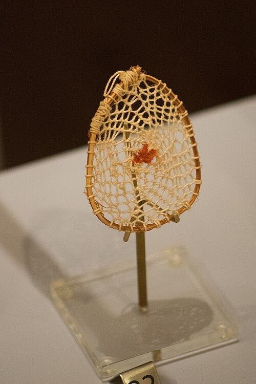

# 从神圣护身物到全球商品

> 定稿，2026 年 11 月 16 日经 PO 批准封存。

20 世纪初，美国民族学家 Frances Densmore 在今天的明尼苏达、威斯康星一带，向奥吉布瓦人（她的书里写作 Chippewa）一件一件地问他们的日常用品。她的调查从 1907 年前后开始，书在 1929 年作为史密森学会民族学局的第 86 号公报出版。

书里讲到婴儿用的摇篮板。她写道：摇篮板的圈上，通常挂两件“蜘蛛网”，有人告诉她，它们“抓住一切坏的东西，就像蜘蛛网抓住并困住碰到它的一切”。[^1]

这件东西，是一个小木圈，里面织了一张像蛛网的网。旧时用荨麻茎搓成的线织，用血根草和野李树的内皮染成深红；后来改用深红色的毛线。[^1]

今天，在机场、便利店、网络商店，你会看到一种叫“捕梦网”（dream catcher）的东西：圈，网，羽毛，珠子，可以是耳环、车窗挂饰，也可以是钥匙扣。

**同一个圈，一个挂在婴儿的摇篮板上，一个挂在便利店的货架上。它们是同一件东西吗？谁有资格回答？**


这一课要做一件事：**沿着一件有记录的东西走几站，每到一站，问清楚“变了什么”。**不预先判定商业化是毁掉了它，还是保存了它。

06-06 讲过泰国佛牌，看过圣物、收藏和价格怎样叠在一起。这一课换一件东西，重点放在**它离开原来的社群之后**：被记录、被模仿、被卖、被立法、被争论。



## 一、第一站：摇篮板上的小圈

先把 Densmore 写下的东西读准，因为后面所有的变化，都要拿它做起点。

她写了三件事。

- **用途**：挂在婴儿摇篮板的圈上，是保护婴儿的小物件；她的另一处写法是，它们“抓住空气里可能有的任何伤害”。[^1]
- **材料**：荨麻茎线、血根草和野李树皮的染色；后来是红毛线。
- **旁证**：她提到，一件类似的波尼人（Pawnee）的护身物，里面的网代表“蜘蛛女”，一位掌管野牛的神。[^1]

这里用 01-03 的眼光看一下：这件东西靠的是**相似**。网会困住飞来的虫子，所以挂着一张网，就像在说：让坏东西也停在这里。这是一种很直觉的“像”，但它不能自己说话；它是不是护身物，要靠**使用它的人**。

注意几件她**没有**写的事。

- 她用的词是“蜘蛛网”，书里没有“捕梦网”这个词。
- 她写的是挡住伤害，没有说它挡的是梦。
- 她提到的“蜘蛛女”，是在波尼人那里。我对着书的文本找了，**没有找到**奥吉布瓦人的蜘蛛女阿西比卡什（Asibikaashi）的故事。[^1]

最后一点值得停一下。维基百科的条目说，Densmore 记录过一个关于蜘蛛女的奥吉布瓦传说，并给出她的书和页码。[^3] 我读了她的书里这一页和另一页，没有找到。**这不等于那个故事不存在**：它可能出自别的人、别的场合，也可能我读到的 OCR 文本有缺漏。它只说明：一个广为流传的说法，和它被标注的出处，不一定对得上。**读到“据某某记载”时，要去看看某某。**

## 二、第二站：一个说法是怎样“有了出处”的

那么，蜘蛛女的故事，现在是从哪里来的？

NativeTech 是一个介绍美洲原住民技术与艺术的网站。它的捕梦网页面，转述了一个讲述：蜘蛛女阿西比卡什照看孩子们；奥吉布瓦人分散到各地之后，母亲、姐妹和祖母接过织网的责任，因为蜘蛛女没法再去每一个摇篮边。这个讲述，网页注明，是 Lyn Dearborn 和 Mary Ritchie 在得到加拿大几位长者的帮助后，于 1995 年在一个邮件列表上分享的。[^2]

这是一种**口述传统的网络记录**。它**不是**20 世纪初的民族志，也不是商品包装上的小卡片；它属于第三种东西：当代的社群成员，把他们认为应该让人知道的东西，写下来，放到网上。

三种“出处”并排：

- **1929 年的民族志**：一个外来的研究者，用翻译，记下她被告知的，并配上图版。
- **1995 年的网络帖子**：当代的讲述者，借助长者，写给更多的人看。
- **商品附带的说明卡**：商家写给买家的。我没有读到哪一张具体的卡，不引用。

三者**说话的对象和目的不同**，不能因为故事好听、被广泛转述，就当成最早的记录。**判断“起源”，要问最早的记录是什么、在哪、谁写的。**

## 三、第三站：圈的名字变了，主人也多了

据维基百科条目的转述（它引用了几份非学术的材料，我没有逐一读）：捕梦网的派生形式，在 1960 至 1970 年代的泛印第安运动中，成为各原住民文化之间团结的符号；“dream catcher”这个词，1970 年代出现在大众媒体（条目引用 1977 年的《妇女家庭杂志》）；1980 年代，它已被当成一种知名的“印第安工艺品”。[^3]（这一段我只读到条目，没有读到原始材料，标为待核。）

如果这一段大致不错，那么这一站发生的，是一次**换名字和换主人**：

- 名字：从“蜘蛛网”（Densmore 的叫法），到“捕梦网”，名字里多了一个新的功能——梦。
- 使用的人：从奥吉布瓦家庭给婴儿用，到各个原住民社群、非原住民的买家。
- 意义：从给婴儿挡灾的小物件，到一个能表示“原住民身份”的符号。

最后一条很有意思：**同一个形状，意义从“护身”滑到了“表示谁”。**这是符号的一种常见移动：从“它有什么用”，变成“它代表哪个群体”。

## 四、第四站：便利店里的圈

2001 年 12 月，美联社发了一篇报道，标题是《捕梦网的销售者招来批评》。报道里几个人的话，值得并排放。[^4]

- **Millie Benjamin**（Mille Lacs 奥吉布瓦部落）说，现在捕梦网成了耳环、车窗挂饰、钥匙扣，卖在便利店里，“对我们的人是不尊重”。
- **Gerald White**（Leech Lake 奥吉布瓦部落）说，折扣店的材料包省掉了制作中的仪式步骤，它已经失去了很多意义，连在他自己的部落里也是；他说这是“一个更大的现象的症状”。
- **Martha Jourdain**（Fond du Lac 部落的文化助理）认为，捕梦网应该送人，不该卖；大批量地卖，是对一件神圣物品的嘲弄。
- **Ruth Garbow**（奥吉布瓦人）在部落博物馆的礼品店里卖捕梦网，希望买的人知道它的含义；她对别的东西，如药轮首饰，则有限制。
- **Colleen Heminger-Cordell**（Sisseton Wahpeton 苏族）做了 15 年左右；她说，“9·11”之后生意更好，大订单多来自非印第安人，她没听说有人反对过她的东西。
- **Dark Feather Red Eagle**（Pine Ridge 拉科塔人，79 岁）说，他在约 30 年前向一位克里族（Cree）女人学会了这门手艺，六年卖了 1,000 多个，价格约 3 到 35 美元；他说不会卖药袋、烟斗这样的神圣物品。

**这里没有一个“原住民的立场”。**反对的人，有；卖的人，也有，而且有的人划了线：这个可以卖，那个不可以。连“来源社群”也不单一：奥吉布瓦、苏族、拉科塔，各有各的关系；Red Eagle 说自己的手艺学自克里族的人。

还有一点，值得记下：在这篇报道里，讲的人在**说同一个圈的什么**？

- 一部分人说的是“**它是什么**”：神圣的，应该送，不应该卖；
- 另一部分人说的是“**这个东西适合怎样流通**”：什么可以卖，卖给谁，说明要不要附上。

这两件事，不是一件事。**一个人可以同时认为一件东西神圣，又认为在某种条件下卖它是可以的。**

## 五、三种“真”：社群的、法律的、市场的

如果一个买家问：“这个是真的吗？”他可能在问三件不同的事。

1. **在社群里，它做得对不对？**谁做的，用什么材料，遵守了什么规矩，为谁做。这是社群自己的判断，每个社群、每位长者可以不同；外人没有现成的标准。
2. **在法律上，标示得对不对？**美国 1990 年的《印第安艺术与手工艺法》，是一部“如实标示”的法律：以“印第安人制作”，或某个部落的名义销售，如果不是该部落的成员、或经部落认证的工匠制作，就是违法。它也覆盖“印第安风格”的传统与当代工艺品。[^5] 它规定的是**怎么标，不是东西本身有没有灵**。
3. **在市场上，它是不是原件？**产地、年份、稀缺性、流传记录，这是收藏者和商人的语言。


三种“真”可以互相冲突。一个由非成员做的“印第安风格”的圈，如果如实标示，在法律上没问题；在社群看来，它可能合适，也可能不合适；在市场上，它可能是便宜的家居装饰。反过来，一个由社群成员按规矩做的圈，如果被拿去乱贴标签，在法律上有问题，在社群内的价值却没有变。

**所以“商业化会毁掉神圣性”和“商业化无害”，都说得太快。**更谨慎的说法是：商业化改变了东西的受众、说法和经济地位；至于这些变化**对谁**意味着什么，各人的回答不同。

## 六、被拍进图版的圈

回到 Densmore 的书。她把这张网，放进了一个编了号的图版（第 24 版，图 a），旁边是别的东西，图注写着：“‘蜘蛛网’护身物，挂在婴儿摇篮上。”[^1]

对一个读者，这很平常。但这一步，其实也是**一次意义的移动**。

- 在摇篮板上，它是用的：有人给孩子挂，有人看着。
- 在图版里，它是**例子**：一个编号，一行说明，在“这个民族的儿童用品”这一类下面。
- 同样的移动，发生在博物馆的陈列、商品图册、网店的图片里。**一张照片、一行说明、一个价格标签，都在替这件东西“说话”，而它们说的，不一定是使用它的人会说的。**


这不是说记录不好；没有 Densmore 的记录，我们连起点都没有。它说的是：**每一种框，都为东西规定了一种阅读方式。**

## 七、动手：这一处，变的是什么

下面的句子，来自本课读到的材料。请判断：每一句，说的是**物体本身**、**出处的说法**、**受众**、**解释惯例**、**经济地位**、**宗教意义**中的哪一种变化，还是**不能由此推出**？

```widget
{
  "type": "infer",
  "caption": "句子来自本课读到的材料，没有任何杜撰的访谈或评价；分类是本课的判断，一句话可以同时属于几种，也可以哪一种都不是。目的是看清：同一件东西的“变了”，至少有六种不同的变法，而且互相不能代替",
  "kinds": [
    { "id": "obj", "name": "物体本身", "hint": "材料、形状、做法" },
    { "id": "claim", "name": "出处的说法", "hint": "谁说它来自哪里" },
    { "id": "aud", "name": "受众", "hint": "谁在看、谁在买" },
    { "id": "conv", "name": "解释惯例", "hint": "怎样读这件东西" },
    { "id": "econ", "name": "经济地位", "hint": "能不能买卖，怎样定价" },
    { "id": "rel", "name": "宗教意义", "hint": "对使用它的社群意味着什么" },
    { "id": "no", "name": "不能由此推出", "hint": "现有材料不足以说" }
  ],
  "items": [
    {
      "text": "网的材料，从荨麻茎搓的线，变成了深红色的毛线。",
      "src": "Densmore 1929",
      "ok": ["obj"],
      "why": "这是物体本身的变化：材料变了；它没有说用途或意义是否也变了。",
      "test": "问：材料变了，使用者认为它还是同一种护身物吗？这段话没有回答。"
    },
    {
      "text": "类似的波尼人护身物，里面的网代表一位掌管野牛的蜘蛛女。",
      "src": "Densmore 1929",
      "ok": ["conv", "rel"],
      "why": "同一类形状，在另一个社群里有另一套解释，是解释惯例和宗教意义的差异。",
      "test": "不能因此说，奥吉布瓦人也这样解释；Densmore 没有这样写。"
    },
    {
      "text": "一个蜘蛛女的起源故事，经长者帮助，由两人于 1995 年在邮件列表上分享。",
      "src": "NativeTech 页面对 Dearborn 与 Ritchie 的说明",
      "ok": ["claim"],
      "why": "这是一个关于出处的说法，它的记录形式是当代的网络帖子，与 1929 年的民族志不是同一种材料。",
      "test": "问：最早的书面记录是什么？这个说法，在 1929 年的书里能找到吗？"
    },
    {
      "text": "一个商品名叫“捕梦网”，挂在车窗上、做成耳环、挂在钥匙扣上。",
      "src": "2001 年美联社报道里 Millie Benjamin 的描述",
      "ok": ["obj", "aud", "econ"],
      "why": "形状和用法变了，面对的是便利店的顾客，成了可以批量买卖的商品。",
      "test": "这一句没有说它的宗教意义是否消失；那要看对谁而言。"
    },
    {
      "text": "一位苏族工匠说，她的大订单大多来自非印第安人，她没听说有人反对她的东西。",
      "src": "2001 年美联社报道里 Colleen Heminger-Cordell 的话",
      "ok": ["aud", "econ"],
      "why": "受众是外部的买家，经济地位是以订单计的生意。",
      "test": "这是她一个人的说法，不能推广为“原住民都不反对”；同一篇报道里另有反对的声音。"
    },
    {
      "text": "捕梦网应该送人，不应该卖；大量地卖，是嘲弄一件神圣的东西。",
      "src": "2001 年美联社报道里 Martha Jourdain 的看法",
      "ok": ["rel", "econ"],
      "why": "这位说话的人，把宗教意义和能不能买卖连在一起：在她看来，卖就改变了它。",
      "test": "同一篇报道里，别的奥吉布瓦人和其他部落的人，画的线不同。"
    },
    {
      "text": "以某个部落的名义销售的工艺品，必须由该部落的成员或经认证的工匠制作。",
      "src": "美国内政部印第安艺术与手工艺委员会对 1990 年法律的说明",
      "ok": ["claim", "econ"],
      "why": "这是出处说法的法律约束：规定能怎样标示，因而影响它在市场上的地位。",
      "test": "它没有规定一件东西有没有宗教意义。"
    },
    {
      "text": "所以，只要大量出售，它就不再有宗教意义；或者，所有人都可以不受约束地制作和出售。",
      "src": "（常见的结论）",
      "ok": ["no"],
      "why": "本课读到的材料，没有一处支持这两个结论中的任何一个：有人认为卖就改变了它，有人在划出一条线之后继续卖。",
      "test": "要问：这句话是替谁说的？它有没有听到持不同看法的人？"
    }
  ]
}
```

这个练习的要点：**“变了”不是一个词，是六七个不同的问题。**一个说法“不对”，往往只是答错了其中一个。

## 八、回到开头

回到那个问题：一个挂在摇篮板上，一个挂在货架上，是同一件东西吗？

**从物理形状看，有的相似，有的已经完全不同**（材料变了，大小变了，有了羽毛和珠子）。**从名字看，不同**：一个叫“蜘蛛网”，一个叫“捕梦网”。**从出处的说法看，层层叠加**：民族志，网络上的口述，商品的卡片。**从买家看，完全不同。**从宗教意义看，则要问是**谁的**意义：对一个奥吉布瓦母亲，对一位坚持“只送不卖”的文化助理，对一个靠它谋生的苏族工匠，对便利店里的顾客，各有各的答案。

所以更稳妥的结论是：它不是**同一件**东西，也不是**毫无关系**的东西。它是一条**流通的链**：每一站都有人，用自己的习惯，重新读一遍，并且有人对此不满，有人不介意，有人从中谋生。

最后留几条提醒：

- **不要**把“网上看到的故事”，当成“一手记录”；
- **不要**用一个原住民说话者的话，代表“所有原住民”；
- **不要**把法律上的“如实标示”，当成对“灵不灵”的判断；
- **要问的是**：这一站，是谁在说？说给谁听？有什么记录？有没有人被排除在外？

下一课，我们换一个舞台：当一个旧符号被放进电影、游戏和唱片里的时候，它又会怎样被重新读一遍。

[^1]: Frances Densmore，*Chippewa Customs*，Bureau of American Ethnology Bulletin 86，Smithsonian Institution，1929［已核：一手的民族志，但我读的是 archive.org 上的 OCR 文本，只读了含“spider web”的两处正文（书中第 52 页前后和第 113 页前后）、图版目录和前言里对调查起始年份的说明，没有通读全书；OCR 里的尺寸数字不清，本课不引用尺寸］。摇篮板圈上通常挂两件“蜘蛛网”；“抓住一切坏的东西，就像蜘蛛网抓住并困住碰到它的一切”；“抓住空气里可能有的任何伤害”；荨麻茎线、血根草和野李树内皮染的深红、后来的红毛线；类似的波尼人护身物里的网代表掌管野牛的蜘蛛女；图版 24 的图 a 的图注；调查从 1907 年前后开始，均据此。我在文本里搜索“Asibikaashi”“Spider Woman”“dream catcher”，只在波尼人一处找到“Spider Woman”，没有找到前两个，也没有“dream catcher”。本课的汉译为本课所作。
[^2]: Tara Prindle，“Dream Catchers”，NativeTech: Native American Technology and Art（nativetech.org）［已核：二手，网站，读了页面；页面里的起源故事注明来自 1995 年 Lyn Dearborn、Mary Ritchie 的邮件列表帖子，我没有找到帖子原文；页面并列了不同来源，也说拉科塔、达科塔常被误认为起源，本课没有展开］。
[^3]: 英文维基百科“Dreamcatcher”条目［已核：二手，百科，仅作线索；它把蜘蛛女阿西比卡什的传说归于 Densmore 的书和页码，我对照 Densmore 的文本没有找到，待核；泛印第安运动、1977 年《妇女家庭杂志》、1980 年代成为知名印第安工艺品的说法，引自非学术的材料，我没有读到原件，待核］。
[^4]: 美联社，“Dream-catcher marketers catch flak”，2001 年 12 月 24 日；我读的是 Deseret News 的转载（deseret.com）［已核：二手，新闻报道，读了全文；报道没有点名任何公司，价格与销量均为受访者自己的说法，没有独立核实］。Millie Benjamin、Gerald White、Colleen Heminger-Cordell、Ruth Garbow、Dark Feather Red Eagle、Martha Jourdain 的身份与说法，均据此；引文为转述或汉译。
[^5]: 美国内政部印第安艺术与手工艺委员会（Indian Arts and Crafts Board），“The Indian Arts and Crafts Act of 1990”页面（doi.gov/iacb/act）［已核：官方页面，读了；法条原文和执法案例，本课没有读］。1990 年（公法 101-644）；禁止以虚假的方式暗示商品是印第安人或某个部落制作的；“印第安人”指联邦或州正式承认部落的成员，或经部落认证的工匠；覆盖 1934 年之后的“印第安及印第安风格”的传统和当代工艺品；页面所列的罚则，均据此。页面没有提到捕梦网，本课没有说该法如何适用于某一件具体的捕梦网。

## 参考与出处

- Frances Densmore, *Chippewa Customs*, Bureau of American Ethnology Bulletin 86, 1929。[archive.org](https://archive.org/details/chippewacustoms00desn)
- Tara Prindle, “Dream Catchers”, NativeTech。[页面](https://nativetech.org/dreamcat/dreamcat.html)
- “Dreamcatcher”，维基百科。[条目](https://en.wikipedia.org/wiki/Dreamcatcher)
- 美联社, “Dream-catcher marketers catch flak”, 2001，Deseret News 转载。[页面](https://www.deseret.com/2001/12/24/19623567/dream-catcher-marketers-catch-flak/)
- Indian Arts and Crafts Board, “The Indian Arts and Crafts Act of 1990”。[页面](https://doi.gov/iacb/act)
- 引文说明：英文引文均为转述或汉译；本课没有杜撰任何访谈或社交媒体帖子，没有复制任何商品或展品的图像；图为本课自绘。
