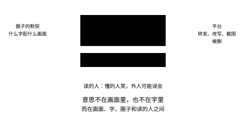
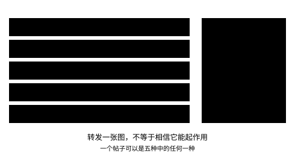

# 互联网神秘学：Meme、Sigil 与数字仪式

> 定稿，2026 年 11 月 16 日经 PO 批准封存。

先讲一条链子。它不是一个从古代传下来的传统，而是几件原本互不相干的东西，被一部分网友在事后连在了一起。先把它们分开。

**1. “KEK”：一个游戏社群里的说法。**据美国民权组织南方贫困法律中心（SPLC，一个记录仇恨与极端活动的倡导组织）2017 年的一篇文章（它转述网站 Know Your Meme；我没有读到后者），在网络游戏《魔兽世界》里，对立阵营的玩家看不懂彼此的话，系统把对方的话换成一种乱码似的文字；在这种乱码里，常见的网络用语“LOL”（笑）显示成了“KEK”。这个词后来被玩家带到论坛和网站，成了“哈哈”的另一种写法。[^1]

**2. Kek：一个古埃及的神名。**SPLC 的文章说，埃及有一位叫 Kek 的神，同混沌和黑暗联系在一起，被画成蛙头或猫头。这些埃及细节，文章没有注明出处，我也没有核对埃及学的材料。[^1]

**3. Pepe：一个现代的卡通角色。**ADL（反诽谤联盟，同样是一个记录仇恨与极端活动的美国民权组织）的页面说，这只青蛙是美国漫画家 Matt Furie 2005 年在漫画《Boy’s Club》里画的角色；漫画里，它的口头禅是“feels good, man”；页面说，它在变成梗图之前，没有种族主义或反犹的含义。[^2]

**4. 后来的网络构造：把它们连起来。**SPLC 的文章说，有人“抓住了一个巧合”，把 Kek 的名字同那位埃及神联系起来，又有人在网上猜测 Pepe 就是 Kek 的化身；文章把后一点称为猜测，也没有指出是谁先这样说的。[^1] **这是 2010 年代网络社群里的一次事后构造，同古埃及之间，没有连续的传承。**

**5. 极端社群的政治用法。**据 SPLC，一些极右翼的社群拿这套构造做了政治用途：有一套半真半假的“Kek 教”，有祈祷词，有虚构的国家“Kekistan”和国旗。ADL 则指出，Pepe 在 4chan 等平台流行之后，出现了偏执的版本，但它的大多数用法，过去和现在，都不是偏执的。[^1][^2]

**6. 参与者关于“模因魔法”与政治事件的说法。**据 SPLC，Daily Stormer 网站的主持人 Andrew Anglin，把美国 2016 年大选的结果，归功于 Kek，还把一场奥克兰的火灾同它联系起来；文章也引了他把一个少年的手势称为“meme magic”的话。这些，是**该人和该网站的说法**，SPLC 只是转述，没有核实，我也没有读到原帖。[^1]

**这六件事，是六种不同的东西：一个游戏里的说法，一个古代的神名，一个卡通角色，一次网络的拼接，一部分极端社群的用法，一些人关于魔法与政治的主张。**把它们混成一个“神秘的古代符号”，或者混成“凡是 Pepe 都是极端的”，都是错的。

**这条链子上，每一环都是巧合：一句翻译的乱码，一个古埃及神的名字，一只青蛙的脸。是谁，在什么时候，把这些巧合变成了“符号”？他们是认真的，还是在开玩笑？**


这一课不讲这个社区“好”还是“坏”，也不讨论政治立场的是非。它问的是一个更窄的问题：**当符号和它的“仪式”，在网络上被复制、混搭、集体解读的时候，什么变了？我们怎么区分“认真地做”“开玩笑”“扮演”和“实验”？研究者靠什么，才不把一个转发，说成一种信仰？**

07-08 讲过混沌魔法和 sigil 的来龙去脉，这里不重复。我们只看：**当这些概念被带到了网络平台上，会怎样。**

## 一、一张图，怎么成了“模板”

先说 meme（网络梗图，模因）的一个基本结构。

很多梗图，是一个**固定的画面**，加上**一个可以换的位置**，通常是一行字。画面是一个熟悉的框，字是每次新填的内容。

用 01-04 的话来说，画面带着一层已经形成的含义；每填一句新话，就在这层含义上再加一层。同一个画面，配上不同的字，就是不同的话。**文字把图的意思“钉”在了一个方向上**；而同一句字，放在不同的画面里，又会变成另一个意思。



这使 meme 成了一种很容易复制的符号结构：

- **画面**：谁都看得懂，也谁都可以拿来用；
- **空位**：让每个人把自己的内容放进去；
- **圈子的规矩**：什么样的字配什么样的画面，才“对味”，是圈子里的人慢慢形成的默契；外人看了，可能一点也不好笑，甚至会误会。

SPLC 的作者就指出过这样一点：这套用语的意思，对外人是有意含糊的。[^1] 这是一种常见的“边界”做法（01-06）：**只有懂的人才读得出来，这本身就是一种身份的标记。**

## 二、一个 sigil，怎么走出了圈子

在 07-08，sigil 是一种个人的做法：把一个愿望，变成一个风格化的图形，做完就忘掉，据说这样能让愿望起作用。

在网上，事情变了几个地方。

- **规模**：一个人的私人做法，变成一群人一起做，和一起谈。
- **公开**：原本要“忘掉”的东西，变成要“发出去”的东西。
- **可复制**：图可以一键转发，上传，改写。
- **解读的人**：看到的人，远多于做的人，而且大多不知道做它的人是怎么想的。

一个有学术研究的例子：2016 年美国大选之后，一些自称实践魔法的美国人，开始用魔法来“抵抗”新政府；他们的做法，一部分在网上进行。研究者 Sabina Magliocco 在《新宗教》（*Nova Religio*）2020 年的一篇论文里，用线上和线下的田野调查研究了这场运动。据论文的摘要，她把它读作对“失去主动权”的焦虑的一种回应；也讲到，运动内部在伦理、审美、信念上的分歧，使它分裂了，效力下降。（据一份对该文的二手介绍，其中受关注最多的，是一份公开发布的、“束缚”某位政治人物的咒语文本；我没有读到那个文本，不引用它的任何细节。）[^3]

这里有两点值得记下。

第一，**“互联网神秘学”不是一个整体**。同一个标题下，有一些人是认真的实践者，有一些是开玩笑的网友，有一些是按这个路子来表达立场的人。Magliocco 的这项研究针对的是**左倾的魔法抵抗**；Asprem（见下）的论文，则把右翼线上社区里的“模因魔法”，同对立一方的魔法放在一起谈。两边的立场相反，却都在用“魔法”的话语。

第二，**这些人“做”什么，同这件事“起不起作用”，是两个问题。**研究者的问法是：他们在做什么？他们怎样谈论它？这件事对他们意味着什么？而不是：这个魔法灵不灵。

## 三、一个转发，等于什么

假如你在网上看到一个人转发了一张“有点玄”的图。他是什么意思？



五种态度，很难分开：

1. **认真的实践**：他真的把它当一件事来做。
2. **戏仿**：他在取笑这套东西。
3. **角色扮演**：在圈子的游戏里，他扮演一个“信徒”。
4. **反讽**：嘴上说得认真，其实不信，而且不想让别人看出来。
5. **试验**：想试试看，保持不确定。

**同一个帖子，可以是五种中的任何一种。**从帖子本身，往往分不出。

SPLC 的那篇文章，对 Kek 的“宗教”，既说它半带反讽、部分是为了惹怒对手（即 trolling），又说作者没有解决“参与者是否真信”的问题；同时，作者断言，这里的反讽是一层外衣，目的是传播种族主义和厌女的观点，并说一些极右翼人物似乎真的相信“模因能塑造舆论”。[^1] 其中，“反讽是外衣”是**一个倡导组织的作者的判断**，不是参与者的陈述，也不是独立的历史证据，更不是对每一个转发者的判断。**我们读的时候，要把“有人这样做”“这个人为什么这样做”和“一个组织怎样解读这件事”分开。**这里至少有几种不同的东西：反讽、trolling、真诚的信念、群体认同、政治宣传，材料只能支持其中的一部分，对具体的人更是如此。

再看 Daily Stormer：据 SPLC，它的主持人把 Kek 当作一个真实的力量来谈，并把大选的结果归功于它。[^1] 这是**该网站公开发表的立场，经 SPLC 转述**。它能说明这个网站愿意这样说；它**不是**对“模因影响了选举”的证明，那需要独立的证据，而本课读到的材料里没有。报道一个政治社群的信念，不等于认同这些信念。

学者 Egil Asprem 在同一期《新宗教》里的一篇论文里（我只读到摘要的转述，没有读到全文），据说提出了另一种读法：他认为，支持和反对这位政治人物的双方，各自的信念，都可以读作对社会力量的“着魔式的”（enchanted）解释；这样的解释，常常出现在反建制的动员和政治合法性动摇的时候；他用到了涂尔干的“集体欢腾”这一概念。[^4] 注意，**这是一个解释“为什么人们这样想”的理论**，它没有说“模因魔法有效”。

## 四、谁来定规矩

在一个线上的社区里，“什么算对”，谁说了算？

没有一个固定的师承，也没有一个人能审核。取而代之的，大概有几样东西：

- **反复**：同一个梗，被不同的人说了很多次，就有了“正统”的味道；
- **命名**：给它一个名字，一个国家，一面旗，就把一个玩笑，变成了一个可以谈论的东西；
- **内部笑话**：懂的人才笑；
- **在场的人的认可**：转发，点赞，跟着改。

**反复，会把一个符号变得熟悉，也会让它看上去“有来头”。**但熟悉和权威，是两回事：在这样的社群里，权威很容易转移，也很容易被别人拿走。

最能说明这一点的，是 Pepe 本身。ADL 的页面（它和 SPLC 一样，是记录仇恨与极端活动的倡导组织，它的解读是一种有立场的解读，不等于独立的历史证据），说得很克制：Pepe 的大多数用法，过去和现在，**都不是偏执的**；因为它在 4chan、8chan、Reddit 这样的平台上流行，所以出现了偏执的版本；要判断一个具体的用法，要看它的**语境**。2016 年秋天，ADL 与 Pepe 的创作者 Furie 一起，发起了一个叫“#SavePepe”的活动，想把这个符号“夺回来”。[^2]

这里可以看到，一个符号的**创作者**、**使用它的各个圈子**、**一个监督仇恨的组织**，各有各的说法，而且都不能一锤定音。**创作者没有最后的解释权；组织的判断，也只是一种判断；而每一个用它的人，又有自己的意思。**

## 五、研究者的难处

对这类现象，研究者面对几个具体的困难：

- **匿名**：一个帖子背后是谁，通常不知道；
- **会消失**：帖子会被删，社区会被关，今天读到的，只是留下来的；
- **意图不明**：同一句话，可以是真话，也可以是玩笑；
- **样本偏**：一个平台上的一些帖子，不能代表所有使用者；
- **解释容易越界**：一个研究者看到一张图里的“神秘符号”，很容易就去找它同古代的联系。

所以，对这样的材料，更稳妥的说法是：

- “在这个平台上，有一批帖子，这样使用这个符号”；
- “有人公开表示，他们把它当作一种实践”；
- “研究者认为，这可以这样解释”；
- 而不是：“这是一种仪式”“用户相信它有超自然的作用”“所有人都是这样想的”。

**一个符号看上去像一件“神秘学”的东西，不等于它是；一个人转发，不等于他相信。**

## 六、动手：同一张图，不同的圈子

下面是一个**本课虚构的教学例子，不是任何真实的梗图或社区做法**。

假设有一张虚构的图：一只卡通猫头鹰，站在一扇关着的门前。我们给它配三种不同的字，放进四个不同的场合。请看：同一个模板，意思怎样变？

```widget
{
  "type": "voices",
  "caption": "这是一个虚构的教学例子：图、字、圈子都是本课编的，不是历史截图，也不代表任何真实的社区。目的是看清：同一个画面，配上不同的字、放进不同的圈子，意思会怎样变；以及一个帖子，常常分不出是认真、玩笑还是试验",
  "outLabel": "这一轮",
  "voices": [
    { "id": "grp", "name": "做梗的朋友群" },
    { "id": "str", "name": "陌生的转发者" },
    { "id": "pra", "name": "把它当练习的小圈子" },
    { "id": "res", "name": "研究者" }
  ],
  "questions": [
    {
      "q": "字是：“凌晨三点的我：再看一集。”（虚构）",
      "say": {
        "grp": { "claim": "一个关于熬夜的玩笑：猫头鹰是夜里醒着的鸟，门是‘该睡了’。", "basis": "虚构设定：群里的猫头鹰，一直是‘熬夜的人’。", "limit": "意思靠群里的惯例；换一个群，可能就没有这层意思。" },
        "str": { "claim": "一个熬夜的笑话，没有更多的意思。", "basis": "虚构设定：他没看到过这个模板的来历。", "limit": "他读到的，是字面上的意思，不是群里的内部笑话。" },
        "pra": { "claim": "这是一个玩笑，不是练习。", "basis": "虚构设定：这个小圈子，把另一类帖子当练习。", "limit": "他们没有把它当练习，是因为字的口气。" },
        "res": { "claim": "这是一个以玩笑为主的帖子。", "basis": "它的字面、圈子和口气，都指向玩笑。", "limit": "只能看到这一个帖子；不能推断发帖人在别处怎么想。" }
      },
      "outcome": "同一张图，在不同的人眼里，是内部笑话、字面笑话，或者“与我无关”。字，把意思钉在一个方向上。"
    },
    {
      "q": "字是：“把这张图转发三次，今天会顺利。”（虚构）",
      "say": {
        "grp": { "claim": "一个模仿连环信的玩笑。", "basis": "虚构设定：群里常拿连环信开玩笑。", "limit": "转发的人，可能只是在玩这个梗。" },
        "str": { "claim": "有点迷信的话；转不转，看心情。", "basis": "虚构设定：他随手转了。", "limit": "转了，不等于他相信。" },
        "pra": { "claim": "一个很轻的小‘仪式’：转发，是一个动作。", "basis": "虚构设定：这个小圈子，常把动作当作一种仪式。", "limit": "他们这样看，是他们的惯例，不能推到别的圈子。" },
        "res": { "claim": "这是一个有仪式形式的帖子：有指令，有动作，有预期的好处。", "basis": "从形式上看，像一个简单的‘仪式’。", "limit": "形式像，不等于参与者相信；要看他们自己怎么说。" }
      },
      "outcome": "同样一句话，可以被读作玩笑、迷信、小仪式。形式上像仪式，不等于参与者把它当仪式。"
    },
    {
      "q": "字是：“想一个愿望，画成一个小记号，发出去，然后忘掉它。”（虚构）",
      "say": {
        "grp": { "claim": "一个对‘sigil 魔法’的戏仿。", "basis": "虚构设定：群里有人看过这类说法，并拿来开玩笑。", "limit": "戏仿也可能让人真的试一试。" },
        "str": { "claim": "看不懂，大概是某种‘玄学’。", "basis": "虚构设定：他不知道 sigil 的说法。", "limit": "他把它归到‘玄学’，是他的归类，不是出处。" },
        "pra": { "claim": "这是一次练习：按步骤做。", "basis": "虚构设定：他们认真地做这类试验，并记录结果。", "limit": "他们的记录，只能说明他们的经验；不能证明记号起了作用。" },
        "res": { "claim": "这是对一类实践的指令，可以研究它怎样被复制和改写。", "basis": "文字与 07-08 讲过的 sigil 做法相似。", "limit": "相似，不等于它们来自同一个源头，也不等于用的人相信它有效。" }
      },
      "outcome": "同一句话，对一个圈子是戏仿，对另一个是练习，对路人是“玄学”，对研究者是一个可以研究的对象。意思，是由圈子和用法定的。"
    }
  ]
}
```

练习的要点：**不要只看画面。**同一个画面，意思是在**字、圈子、平台、读的人**之间形成的。

## 七、收束

回到开头的那条链子：一句翻译的乱码，一个古埃及神的名字，一只卡通青蛙。**每一环，在被人认出来之前，都只是巧合。**一群人认出了它，反复说它，给它起名字，它才开始像一个符号。

这是符号的产生方式：不是某个人在一个时间点设计了它，而是**许多人，在不同的时间，各取了一点**。

这一课留下几个提醒：

- **不要**把每一个“看上去玄”的图，当成仪式的物件；
- **不要**把转发，当成相信；
- **不要**把网上所有同“神秘”沾边的社群，当成一个整体；
- **要问的是**：谁在用？用在什么圈子里？怎么说？有什么样的证据，表明他们认真，或者在开玩笑？

下一课，我们去看另一类“没有魔法”的符号：品牌和时装。同样是让一群人认出一个形状，它们做的事，同前面几课有哪些相似，又有哪些不同。

[^1]: 南方贫困法律中心（SPLC），“Explaining the Alt-Right ‘Deity’ Behind Their ‘Meme Magic’”，*Intelligence Report* 第 163 期（2017 年秋），页面日期 2017 年 8 月 8 日；该文的 Hatewatch 版本在 2017 年 5 月发布［已核：二手，一个倡导组织的文章，读了全文；页面没有署名作者；文章只引 Know Your Meme 和 Daily Stormer 的帖子，埃及神的细节没有注明出处；它的评价（如“反讽是一层外衣”）是作者的断言，不是独立的历史证据］。《魔兽世界》聊天里“LOL”显示成“KEK”（转引 Know Your Meme）；有网友“抓住一个巧合”；埃及神 Kek 被画成蛙头或猫头；Pepe 是 Kek 化身是“网上的猜测”；“Kek 教”、祈祷词与“Kekistan”；Anglin 把选举结果和一场奥克兰火灾同 Kek 联系起来；“It is meme magic”；作者对反讽与信念的判断，均据此，其中后者为作者的断言。本课没有读到 Know Your Meme，也没有读到任何一个原始帖子。
[^2]: ADL（反诽谤联盟），“Pepe the Frog”仇恨符号条目（adl.org）［已核：二手，民权组织的页面，读了；页面没有标出发布或更新日期，本课不说它何时被列入数据库］。2005 年首次出现在漫画《Boy’s Club》，口头禅“feels good, man”；在 4chan、8chan、Reddit 流行；“大多数用法过去和现在都不是偏执的”；判断一个用法要看语境；2016 年秋天与 Matt Furie 发起“#SavePepe”，均据此。
[^3]: Sabina Magliocco，“Witchcraft as Political Resistance: Magical Responses to the 2016 Presidential Election in the United States”，*Nova Religio* 23(4)，2020 年 5 月，第 43–68 页［已核：二手，只读到 Project MUSE 的摘要与索引说明，没有读到全文］。线上和线下的民族志；对 2016 年大选的“在场危机”（de Martino）；运动内部在伦理、审美、信念上的分歧使它分裂；“束缚”咒语文本一事，只见于一份二手的介绍，我没有读到文本，也没有读到论文全文，不引用任何细节［待核］。
[^4]: Egil Asprem，“The Magical Theory of Politics: Memes, Magic, and the Enchantment of Social Forces in the American Magic War”，*Nova Religio* 23(4)，2020，第 15–42 页［已核：二手，只读到摘要的转述（一篇书评和访谈介绍），没有读到全文］。双方的信念可读作对社会力量的“着魔式”解释；常见于反建制动员与合法性动摇时；涂尔干的“集体欢腾”，均据此。

## 参考与出处

- SPLC, “Explaining the Alt-Right ‘Deity’ Behind Their ‘Meme Magic’”, Intelligence Report 163, 2017。[页面](https://www.splcenter.org/resources/reports/explaining-alt-right-deity-their-meme-magic/)
- ADL, “Pepe the Frog”。[页面](https://www.adl.org/resources/hate-symbol/pepe-frog)
- Sabina Magliocco, “Witchcraft as Political Resistance”, *Nova Religio* 23(4), 2020。[Project MUSE](https://muse.jhu.edu/article/755977/summary)
- Egil Asprem, “The Magical Theory of Politics”, *Nova Religio* 23(4), 2020。[Project MUSE](https://muse.jhu.edu/article/755976)
- 引文说明：英文引文均为转述或汉译；本课没有复制任何表情包、截图或社交媒体帖子；第六节的猫头鹰图与文字，是本课编的虚构教学例子，不是历史材料；图为本课自绘。
